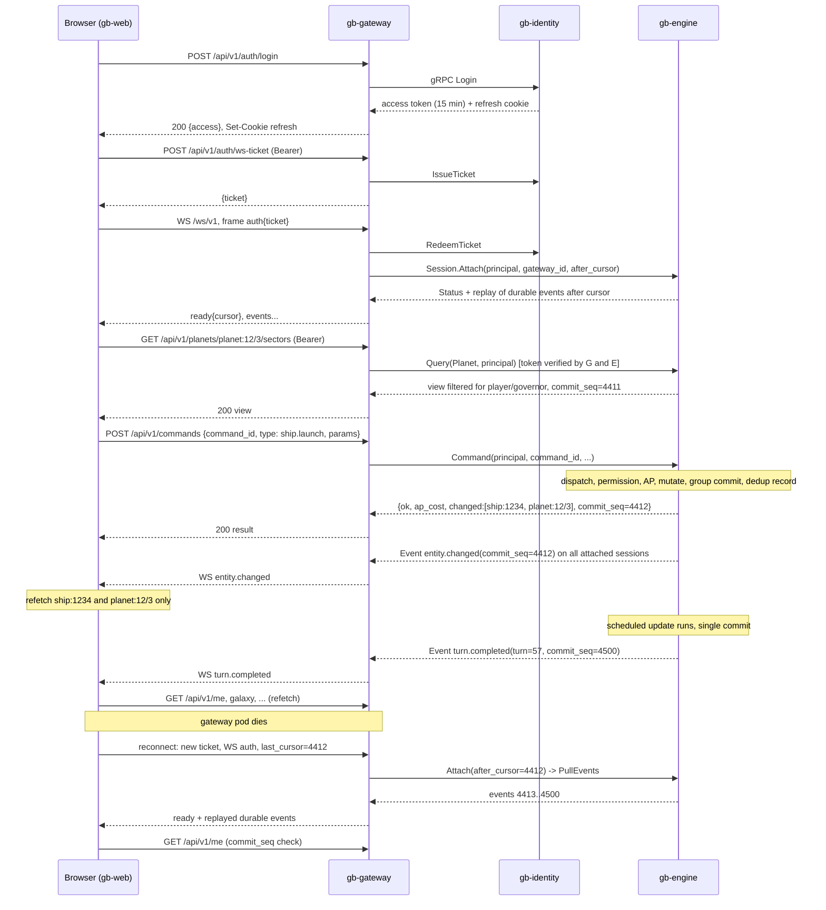
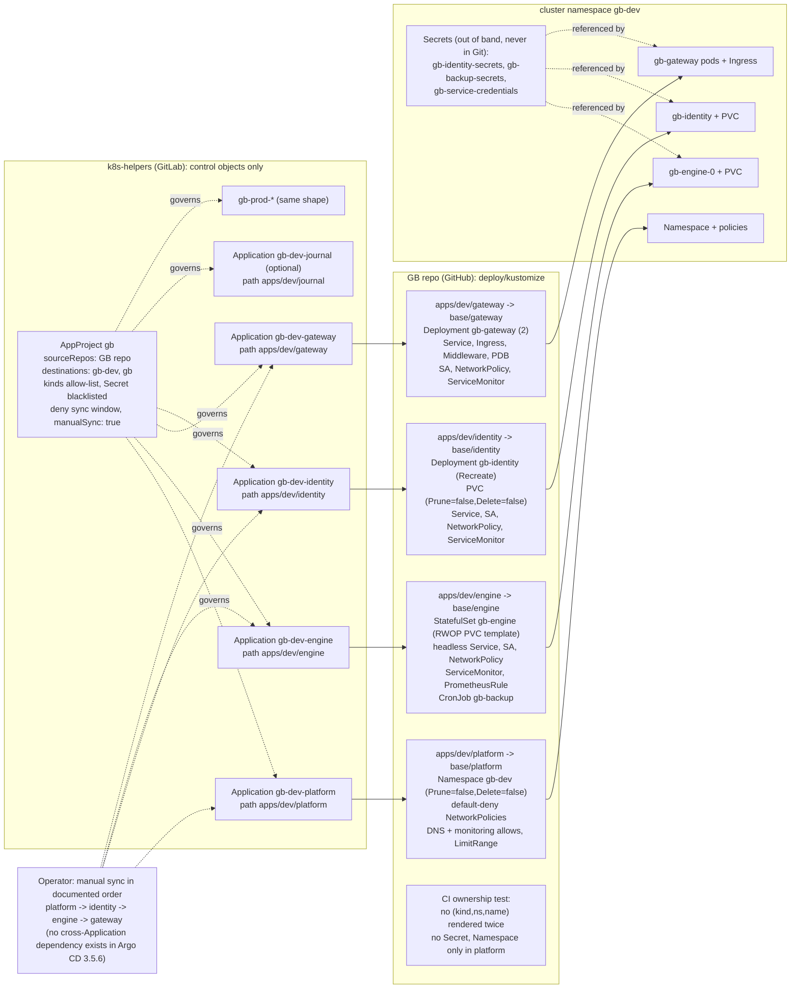

# GB: Microservices Migration Plan

**Status:** revision 2.2 (revision 2.1 plus the focused Phase 2 amendments listed at the end of section 0, from the read-only Phase 2A infrastructure assessment and the Phase 2B artifacts of 2026-10-30). Phases 0 and 1 are implemented and merged; Phase 2 artifacts exist in `deploy/` as specifications only; nothing is deployed. No implementation phase is authorised by this document. No implementation phase is authorised by this document.
**Date:** revision 2.2 on 2026-10-30 (revision 2.1 on 2026-10-28; revision 2 earlier the same day; revision 1 on 2026-10-27).
**Companion document:** `go-code-review.md` (finding IDs `CR-nn` referenced below). The review was not modified in this revision; Appendix B records the two points worth re-checking in it.
**Platform facts** were verified read-only on 2026-10-27 and 2026-10-28 against the live cluster (`kubectl get`, no changes) and against the `k8s-helpers` repository at `~/k8s-helpers`. Where this plan relies on something not verified, it says so.

---

## 0. Revision summary (what changed in revision 2 and why)

Revision 1 established the direction: one authoritative engine per universe, a stateless gateway, an identity service, an optional journal, a modular monolith before any extraction, Kustomize plus Argo CD on manual sync, bbolt on Longhorn, no broker, mesh, or cache. That direction is unchanged. Revision 2 corrects the parts of revision 1 that would not have survived implementation and adds a new first-class requirement.

| Area | Revision 1 said | Revision 2 says | Why |
|---|---|---|---|
| Browser client | Phase 9 afterthought: "static web client served by the gateway" | **First-class TypeScript graphical client**, its own architecture section (7), its own workstream (Phases 4c, 7a to 7d), part of the production-readiness gate | Owner requirement: GB is to become a browser game with a real GUI; terminal interaction becomes a compatibility tool |
| Client protocol | JSON frames over WebSocket carrying C-formatted text | **Structured, typed API**: HTTPS for authentication, queries, snapshots and commands; WebSocket for server-originated events and the legacy terminal; one OpenAPI document generates the TypeScript types; engine-side visibility filtering | A GUI cannot parse terminal transcripts; fog of war and governor permissions must be enforced by the engine, not the browser |
| Turn failure | "a panic in a turn aborts the turn without flushing" | **Transactional turn boundary**: the turn's effects are never visible until a single bbolt transaction commits a commit record, world changes, outbox events, RNG state and schedule together; a failed turn discards in-memory state by reloading the committed world; the engine then halts turn processing until an operator acts (section 8) | Skipping the flush leaves mutated memory in use; that is corruption, not recovery |
| Command durability | unspecified; "flush after each command batch" | **Acknowledged means committed**: a command's result is sent only after its group-commit transaction is durable; retries deduplicate on a persisted command id | Players must not lose acknowledged actions on a crash |
| Turn stamps | "startup verifies all records carry `last_turn`" | **Commit record and monotonic `commit_seq`**; records carry the sequence of their last write, which must be `<=` the commit record, never required to be equal | Unchanged records legitimately keep older stamps; the old rule was wrong |
| Randomness | "seed from crypto in prod" | **Persisted RNG state** in the commit record; per-turn streams derived deterministically from it | A fresh seed after restart makes a retried turn produce a different outcome |
| Gateway replay | "reconnect with `last_seq` lets the gateway replay from its queue" | **Honest recovery semantics**: reconnection, token restoration, snapshot resynchronisation, durable event replay from the engine outbox cursor, best-effort transient output, idempotent command retry (section 6.6) | A stateless gateway cannot promise lossless replay from memory |
| `who` and presence | gateway-local registry | **Engine owns presence** through `Attach`/`Detach` on the session stream; `who` is an engine query | A pod-local registry is incomplete with two gateway replicas; no Redis needed |
| Enrollment saga | "compensation releases the reserved player number" | **Engine allocates the player number** inside the idempotent placement transaction; identity reconciles uncertain outcomes by querying, never by assuming failure; nothing is released on a timeout | A timed-out RPC may have succeeded |
| Internal trust | engine trusts the gateway via NetworkPolicy plus shared secret | **End-user tokens are verified by the engine** (asymmetric signature from identity) and mapped to the engine's own race record; separate service credential per caller; admin operations need an admin-role token; NetworkPolicy is defence in depth only (section 14.1) | NetworkPolicy is not authentication |
| Health probes | liveness on an actor heartbeat | **Liveness = process alive plus turn progress**, readiness = serving state; a long valid turn is never killed; an unrecoverable state fails readiness, not liveness (section 11.5) | Kubernetes must not kill a long turn or restart-loop a halted engine |
| Argo CD ownership | per-service Applications plus a shared base, `makeuniv` as a `PreSync` hook mounting the engine PVC, cross-Application sync waves | **One Kustomize entry point per Application** with a CI test that no resource is rendered by two Applications; a `platform` Application for namespace-level objects; **no cross-Application ordering is assumed** (the installed Argo CD 3.5.6 CRD has no dependency field; ordering is an operator runbook step); universe creation is an **explicit `gbctl` operation against the engine's admin API**, never a hook (section 12) | Two Applications rendering one resource conflict with `FailOnSharedResource`; the hook could run before the PVC exists and could re-run destructively |
| Storage single-writer | "Longhorn RWO enforces this" | **ReadWriteOncePod** (documented as supported by Longhorn since v1.11.0; installed v1.12.1; to be validated with a throwaway PVC in `gb-dev`) plus StatefulSet ordinal semantics plus an **advisory** engine-side owner lease that detects, but cannot fence, a stale writer (section 11.3) | RWO is per node, not per pod |
| Backup | "`Admin.Snapshot(dest)`" | **Backup CronJob pulls a consistent snapshot stream** over gRPC, verifies it, uploads to S3 with checksum and retention; restore is an engine admin operation into an uninitialised store; monthly restore test (section 11.7) | The old proposal did not say how the file left the container |
| CI on `kind` | apply the dev overlay to `kind` | **A `ci` overlay** that replaces Longhorn, Traefik, cert-manager and monitoring dependencies, plus CRD-only installs for render validation; the home-lab cluster is used only in `gb-dev` (section 13) | A vanilla `kind` cluster has none of those |
| Failing tests | `t.Skip` with the CR number | **Known-defect inventory** with expected-failure reporting and a generated parity-gap report; an unexpected pass fails CI (section 17.2) | Skipped tests hide defects |
| Phase 4 | one binary startable as `all` or split processes | **Boundaries and contracts only**; process separation moves to Phases 5 and 6 | Multi-process operation before extraction is premature |
| Roadmap order | hardening and cutover (8) before parity breadth (9) | **Essential gameplay and the playable GUI (Phase 7) precede production readiness (Phase 8)**; a gameplay capability matrix (section 15) classifies every C command as essential, optional, superseded or retired | A production release must be a playable game |
| First task | Phase 0 plus three Phase 1 items | **Phase 0 only** (section 21) | Keep the repository and test foundation separate from actor-loop rewrites |
| Finding references | planetary guns and CEW cited as CR-17/CR-18 in the first task | Corrected to **CR-26 and CR-27** | Error in revision 1 of this plan; the review itself was consistent |
| Decisions | 18 | **30**: the 18 re-evaluated, 12 added for the client, the transactional turn and single-writer enforcement (section 22) | New requirement and corrections |

**Revision 2.1 corrections** (after an independent review of revision 2; architecture, client strategy, service boundaries, the 30 decisions, the capability matrix and the roadmap are unchanged):

1. Phase 5 no longer "adopts" a differently named StatefulSet: the engine StatefulSet is named `gb-engine` from Phase 2 with its immutable fields frozen and CI-checked, and Phase 5 is an explicit ownership-and-image transfer with freeze, digest verification and rollback (12.3 item 5, Phase 5 work items).
2. Phases 1 and 2 claim only orderly-restart continuity; `gb-dev` is disposable until Phase 3a; no crash consistency is asserted before the commit record exists (16.1, Phase 1 and 2 criteria, 17.3).
3. The owner lease is an advisory conflict detector, not a fence; forced takeover needs positive confirmation that the former writer stopped; the conservative Longhorn node-loss policy is retained (11.3, 11.4, Decision 30).
4. Phases 1 and 2 use a minimal static-token admin listener (`status`, `update`, `segment`, `quiesce`, `resume`, `universe init`); snapshot, restore and backup exist only from Phase 3a; Phase 2 data preservation is regeneration from the recorded seed (Phase 1 and 2 work items, 12.5 item 7, Decision 18).
5. Determinism is defined over a canonical logical-state digest (world, RNG state, schedule, dedup table, outbox), never over bbolt file bytes (8.8, T1, T3, T9, T10, Phase 3b).
6. Commands run through a staging set with record-level copy-on-write and buffered effects; an error or panic after mutation leaks nothing; group-commit failure is defined (8.4, T11, T12, Diagram 5).
7. Phase 4c tests use an injected socket drop and a monolith restart; gateway-only failure tests belong to Phase 5 (Phase 4c, 7.10, 17.3).
8. The monolith route is first-class: Phase 6m carries the identity work in-process; Diagram 7, the roadmap table, Phase 7c and 8 prerequisites, 17.1, 17.3 and Decision 1 name both routes.
9. Refresh-token rotation tolerates concurrent tabs through client coordination (Web Locks, BroadcastChannel) and a server-side grace window with idempotent rotation (6.5, 7.7).
10. Phase 0 CI has strict build, format, vet and test gates and a baselined lint gate; no runtime code is repaired in Phase 0; dependent work items are combined into testable pull requests (Phase 0, section 21, 13.1, 17.3).

Assumptions made in this revision, documented rather than asked: the owner's "Traefik ingress" and "Argo CD already installed" corrections from revision 1 stand; the GB repository remains on GitHub and `k8s-helpers` on GitLab; the home-lab cluster is the only deployment target; the browser client lives in the GB repository (owner's stated preference); no C data files exist to migrate.

**Revision 2.2 amendments (2026-10-30; Phase 2 only, from the read-only Phase 2A assessment of the live cluster and `k8s-helpers`, and the Phase 2B artifacts; architecture, client strategy, service boundaries and the roadmap are unchanged):**

1. **Argo CD** v3.5.6 is installed but **observe-only** (read-only Roles in two namespaces, no StatefulSet in its resource inclusions, no GitHub repository registered). Write access scoped to `gb-dev` is a prerequisite of Phase 2, specified in `docs/operations/bootstrap.md`, performed only through a `k8s-helpers` change (12.2, 16.4, ADR-0005).
2. **The Namespace `gb-dev` is operator-owned**; no Application renders or patches it, and Argo CD gets no Namespace write (12.3 item 2, 12.5 item 1, ADR-0005).
3. **Traefik** is confirmed as the only IngressClass (no nginx); **production** issuance (`letsencrypt-production-cloudflare`) is used for `gb-dev.home.spukhaus.com` too (11.6, Decision 4).
4. **Admin listener and metrics:** the Phase 1 code serves `/metrics` only on the admin listener (8081), so Phases 2 to 4 bind it to `0.0.0.0:8081` inside the pod, scrape it with a PodMonitor, fence it with a NetworkPolicy that admits only Prometheus, keep it off every Service and Ingress, and reach it with `kubectl port-forward` (11.6, ADR-0005, ADR-0007).
5. **RWOP** is designed but **unvalidated** on this cluster; the throwaway test precedes the first server sync, and the RWO fallback is declared (11.3, Decision 30, ADR-0007).
6. **No `gbctl universe init --force`** exists or will be added; development data is recovered by quiescing, scaling down, protecting or retiring the volume with explicit authorisation, and initialising a new empty volume from the recorded seed (12.5 item 4, 16.4 rollback, ADR-0008).
7. The GB repository's default branch is **`master`** (13.1, Application `targetRevision`); the repository is **public**, so Argo CD can source it over anonymous HTTPS (12.2).
8. **No PodDisruptionBudget** for the single-replica engine (it would block the drain acceptance test); multi-universe naming is **deferred** and the Phase 2 identity is frozen as `gb-engine`/`gb-engine`/`world`/`gb-dev`/1 replica (Decision 14).

---

## 1. Executive summary

GB is a turn-scheduled 4X game whose entire world advances as one consistent simulation every update. That fact decides the architecture: **the simulation cannot be split into "ships", "planets" and "combat" services** without turning every turn into a distributed transaction across data that the C code (correctly) treated as one shared image. What *can* be split, and should be where it earns its cost, are the concerns the C program bolted onto the simulation because it had no other place to put them: network sessions, identity and enrollment, durable player messaging, universe creation, and operations.

**Recommended target:** a browser-based graphical game in TypeScript on top of three independently deployable Go services plus one optional consumer, all in one repository, sharing contracts through one OpenAPI document (browser edge) and protobuf (internal):

| Component | Kind | Owns | Scale |
|---|---|---|---|
| **gb-web** (TypeScript client) | static assets served by the gateway | presentation, client-side cache of server views, input | n/a (browser) |
| **gb-engine** | stateful, exactly one writer per universe | the world database (bbolt on Longhorn), turn schedule, rules, visibility, presence, event outbox | 1 pod per universe |
| **gb-gateway** | stateless | HTTPS API and WebSocket termination, token verification, rate limits, protocol translation, static client | 2+ pods |
| **gb-identity** | stateful, small | accounts, credentials, enrollment saga, token issuance, admin roles | 1 pod |
| **gb-journal** (optional, later) | consumer | durable per-player inboxes and news feeds built from the engine's outbox | 1 pod |

**Communication:** HTTPS JSON for authentication, queries, state snapshots and commands; WebSocket JSON for server-originated events and the legacy terminal stream; gRPC between services; an **outbox pull** pattern for events. No service mesh, API gateway product, message broker or distributed cache: none is justified by GB's load (tens of players) and each would add a failure mode the home lab has to operate.

**Recommended path:** not a rewrite and not an immediate extraction. The current Go code fails to build from a clean clone, crashes on its own admin endpoint, loses combat results between turns, and wipes its universe on every Kubernetes restart (`go-code-review.md` sections 5 and 6). It must first become a **tested modular monolith with one owner of state and a transactional turn boundary**, deployed early to a `gb-dev` namespace through Argo CD on manual sync, following the gating already written into `k8s-helpers/docs/argocd/`. Structured game APIs are added inside the monolith, a browser proof of concept is connected to them, and only then are the gateway and identity extracted along boundaries the monolith already enforces. **Extraction is conditional**: each extraction phase has an explicit go/no-go gate, and the plan is sound if it stops at the modular monolith (section 3.3, Decision 1).

**Phases:** 0 foundation, 1 safe local server, 2 private Kubernetes dev deployment, 3 correct simulation and transactional recovery (four slices), 4 modular monolith, structured APIs and browser proof of concept (three slices), 5 extract gateway, 6 extract identity, 7 essential gameplay breadth and the playable TypeScript GUI (four slices, including a UX design milestone with the owner), 8 production readiness and cutover, 9 optional journal, advanced GUI, nonessential parity. Section 16 has the per-phase detail.

**Two platform assumptions in the original brief were wrong and matter:** the cluster's ingress is **Traefik** (IngressClass `traefik`, default), not NGINX; and **Argo CD is already installed** (`argocd` namespace, v3.5.6, two proposed Applications in manual-sync mode in `k8s-helpers`). The plan uses both facts.

---

## 2. Current-state architecture

### 2.1 Summary

Two codebases share the repository. The C tree (`source/`, 30,730 lines) is the behavioural reference: one process, one `select()` loop, inline turns, raw struct files, no locking, 109 reachable commands. The Go tree (`go/`, 21,350 lines) is a one-binary port: an HTTP/WebSocket front end and a single actor goroutine that holds the whole world in memory and writes it to a bbolt file. Details are in `go-code-review.md` section 2.

### 2.2 Diagram 1: current Go architecture

```mermaid
flowchart LR
  subgraph client["Clients"]
    C1["gb-client (terminal)\nWS text frames"]
    C2["Browser\n/enroll HTML form"]
  end
  subgraph pod["gb-server process (Deployment, 1 replica)"]
    direction TB
    HTTP["net.Server\n/auth/login /ws /status\n/admin/update /api/enroll /enroll"]
    REG["SessionRegistry\n(per-session mutex writes)"]
    ACT["game.State actor goroutine\ncmdCh -> dispatchCommand\ntimers -> doUpdate/doSegment"]
    MEM["In-memory world\nstars, planets, races, ships,\nsdata, power, blocks, dirs"]
    DB[("bbolt gb.db\none bucket per entity\nJSON values")]
    HTTP -->|HandleCommand (blocking)| ACT
    ACT --> MEM
    ACT -->|flushAll: 1 tx per record| DB
    ACT -->|per-command Put*| DB
    ACT -.->|reload ships each turn| DB
    HTTP -->|Authenticate reads races\n(no lock)| MEM
    HTTP -->|handleEnroll: 2nd db.Open\n(times out)| DB
    ACT --> REG
    REG --> C1
  end
  subgraph init["Init container (every pod start)"]
    MU["makeuniv -> overwrites stars/planets"]
  end
  MU --> DB
  C1 --> HTTP
  C2 --> HTTP
  subgraph tools["Offline tools"]
    RG["racegen -> PutRace\n(no home planet)"]
  end
  RG --> DB
```

### 2.3 Properties that block decomposition and a GUI today

- **No single owner of state.** Ships: database wins at turn start (`turn.go:72`). Planets: memory wins at flush, except six handlers that read and write a second copy (`commands_load.go`, `commands_order.go`). Stars and races: memory wins. (CR-11, CR-17.)
- **No transaction boundary.** `flushAll` is one bbolt transaction per record (CR-18); a crash mid-flush leaves a mixed-turn database; a panic mid-turn leaves mutated memory in use (CR-22).
- **Domain depends on transport.** `game` imports `net` for the output interface used by all handlers (CR-30). Nothing in `game` can be compiled or tested without the WebSocket layer.
- **One 14,000-line package.** Rules, turn driver, command parsing, persistence calls and output formatting are interleaved in the same functions (CR-31).
- **Non-deterministic turns.** Map iteration order and an unseeded global RNG (CR-15). Parity cannot be tested until this is fixed.
- **No protocol.** Output is C-era formatted text in WebSocket frames; the prompt is never sent; `SendJSON` is unused (CR-42). There is no machine-readable representation of a star, planet, sector or ship on the wire, and no notion of what a given player is allowed to see. A GUI has nothing to consume.
- **No health, metrics, structured logs, limits, or shutdown sequence.**

### 2.4 Deployment assets as they exist

`Dockerfile` (root, `alpine:latest`, no health check), `k8s-deployment.yaml` (default namespace, `image: gb:latest`, `imagePullPolicy: Never`, liveness on a 404 path, init container that regenerates the universe, env var the server never reads), `Makefile` with `kubectl apply` targets, `KUBERNETES.md` describing minikube. None of it is usable on the RKE2 cluster. Argo CD is not referenced anywhere in the GB repository.

---
## 3. Target-state architecture

### 3.1 Domains

Working from what GB does rather than from the Go package names, the business domains are:

| Domain | What it is | Consistency requirement | Natural owner |
|---|---|---|---|
| **World simulation** | stars, planets, sectors, ships, races' in-game state, power blocks, market lots, turn schedule, all rules, **what each player may see** | one atomic image per committed transaction; commands are serialised against it | one engine per universe |
| **Player sessions** | connections, token verification, which governor is attached, output delivery, rate limiting | per connection | gateway |
| **Identity and enrollment** | accounts, passwords, governors' credentials, the race-design and validation workflow, token issuance, admin roles | per account; enrollment needs one world-side placement | identity |
| **Messaging and journal** | telegrams (per governor inbox), four news streams, announcements to offline players | append-only, at-least-once from the world, read-your-writes per player | engine outbox now; journal later if adopted |
| **Universe lifecycle** | creating a universe, restoring one, backups, triggering turns manually, enrolling the first God race | administrative, infrequent | engine admin API plus `gbctl` and Jobs |
| **Presentation** | galaxy, system, planet and fleet views; forms for every command; notifications; accessibility | none (derived from server views) | TypeScript client |

Market, combat, production, movement and victory are **sub-rules of the world simulation**, not domains. They share the same transaction and the same consistency boundary. Splitting them would be the "every Go package is a microservice" mistake the brief warns against. Visibility (fog of war, exploration, ownership, governor scope, God) is likewise a rule of the world and is evaluated only in the engine.

### 3.2 Diagram 2: target backend microservices architecture

```mermaid
flowchart TB
  subgraph edge["Traefik ingress (cert-manager TLS)"]
    ING["gb.DOMAIN\n/ (static) /api/v1/* /ws/v1"]
  end
  subgraph ns["namespace gb"]
    subgraph gw["gb-gateway (Deployment, 2 replicas, stateless)"]
      GW1["HTTPS API v1 + WS events\nverifies identity-signed tokens\nrate limits, frame limits\nJSON to gRPC translation\nembedded static client"]
    end
    subgraph id["gb-identity (Deployment, 1 replica)"]
      ID1["accounts, bcrypt\nrace design + validation\nenrollment saga\nEd25519 token issuer\nadmin roles"]
      IDDB[("accounts.db\nLonghorn 1Gi")]
      ID1 --> IDDB
    end
    subgraph eng["gb-engine (StatefulSet, 1 replica per universe)"]
      EN1["actor: commands + turns\nrules (pure)\nvisibility views\npresence registry\nschedule (persisted)\nevent outbox\nadmin API"]
      WDB[("world.db\nLonghorn RWOP 5Gi\none tx per commit")]
      EN1 --> WDB
    end
    subgraph jr["gb-journal (optional)"]
      JR1["outbox consumer\ninboxes, news streams"]
      JDB[("journal.db")]
      JR1 --> JDB
    end
    BK["gb-backup CronJob\npulls snapshot stream"]
    GBC["gbctl (operator CLI)\nadmin-role token"]
  end
  subgraph ext["Outside the namespace"]
    S3[("RustFS S3\nbackups")]
    PROM["Prometheus (ServiceMonitor)"]
    LOKI["Alloy -> Loki"]
  end
  ING -->|HTTPS, WSS| GW1
  GW1 -->|gRPC Session stream\n+ unary Query/Command| EN1
  GW1 -->|gRPC Login, Refresh, Enroll| ID1
  ID1 -->|gRPC PlaceRace / GetPlacement\n(idempotent)| EN1
  JR1 -->|gRPC PullEvents(after cursor)| EN1
  GW1 -.->|gRPC ReadInbox (if journal adopted)| JR1
  BK -->|gRPC Admin.Snapshot stream| EN1
  BK --> S3
  GBC -->|gRPC Admin| EN1
  GW1 & ID1 & EN1 & JR1 --> PROM
  GW1 & ID1 & EN1 & JR1 --> LOKI
```

### 3.3 Diagram 3: target architecture including the TypeScript browser client

```mermaid
flowchart LR
  subgraph browser["Browser (TypeScript client, gb-web)"]
    UI["UI components\n(galaxy, system, planet,\nfleet, forms, inbox)"]
    DM["Domain models\n(generated from OpenAPI)"]
    API["API client\nHTTPS queries + commands\nWS event subscriber"]
    ST["Client state\nserver-view cache keyed by\nentity id + commit_seq\nsession + connection state"]
    UI --> ST
    ST --> API
    API --> DM
  end
  subgraph auth["Authentication boundary"]
    TOK["access token (15 min, Ed25519)\nin memory only\nrefresh token: HttpOnly cookie\nWS: one-time ticket, no token in URL"]
  end
  subgraph gwb["gb-gateway"]
    HTTPS["HTTPS /api/v1\nauth, me, galaxy, star, planet,\nships, market, telegrams, who,\ncommands (idempotency key)"]
    WS["WS /ws/v1\nevents: turn, telegram, presence,\nserver status, change hints\nlegacy terminal stream"]
    STATIC["static assets\n(embedded, hashed filenames, CSP)"]
  end
  subgraph engb["gb-engine"]
    VIEW["visibility-filtered views\nper player and governor"]
    CMD["typed command dispatch\npermissions, AP cost"]
    OUT["outbox (durable, cursor)"]
  end
  IDN["gb-identity\nlogin, refresh, enroll"]
  API -->|Bearer access token| HTTPS
  API -->|ticket then events| WS
  browser -->|GET /| STATIC
  HTTPS -->|gRPC Query (player, governor from verified token)| VIEW
  HTTPS -->|gRPC Command| CMD
  WS -->|gRPC Session stream Attach/Detach,\nPullEvents after cursor| OUT
  HTTPS -->|gRPC Login/Refresh/Enroll| IDN
  TOK -.-> API
```

The browser never computes game state, never receives data the engine's visibility rules exclude for that player and governor, and never talks to the engine or identity directly.

### 3.4 Why this target and not the alternatives

| Alternative | Verdict | Reason |
|---|---|---|
| **A. Containerise the current monolith** and stop | Rejected as an end state, **required as Phase 2** | Gets a Kubernetes deployment early, but keeps every CR finding and every single-process assumption. It is the first milestone, not the architecture. |
| **B. Modular monolith** (one binary, enforced package boundaries, in-process interfaces identical to the later gRPC contracts, structured HTTPS/WS API, embedded client) | **Required transitional state (Phase 4)**, **acceptable end state** | Removes the coupling that prevents extraction, is testable in-process, can run as one StatefulSet, and supports the GUI fully. If the extraction gates (Decision 1) are not met, B is where the project stops, and nothing in Phases 7 to 9 depends on extraction. |
| **C. Engine + gateway + identity (+ journal)** | **Recommended target, conditional** | Each boundary corresponds to a different failure domain, scaling shape, data owner and release cadence: the gateway restarts without pausing the game and absorbs slow clients (CR-23); identity changes do not touch the simulation; the engine is one pod per universe. Extraction proceeds only when the Phase 5 and 6 gates in section 16 are met. |
| **D. Fine-grained services** (ships, planets, combat, market, victory, scheduler) | **Rejected** | A turn reads and writes all of them in one pass with C-order dependencies (`doturn.c`; CR-10 shows what one reorder costs). It would require a distributed transaction or an event-sourced rebuild of the whole world per turn, for a workload a single core finishes in seconds. |
| **E. Replace bbolt with PostgreSQL for the world** | Rejected for the engine unless benchmarks fail, open for identity | The world is a single-writer, whole-image-per-commit dataset; an embedded store with one transaction per commit is the right tool. The Phase 3a exit criterion includes a flush benchmark on the dev PVC; only a failed benchmark reopens this. |
| **F. Browser as a thin terminal (xterm.js over the text protocol)** | **Rejected as the product**, kept as the compatibility tool | It is the cheapest "web client" and it is what revision 1 implicitly planned. It does not meet the requirement: it still demands that players memorise commands and it cannot render a map. |
| **G. Separate frontend repository and deployment** | Rejected for now | One repository keeps API schema and generated types in one commit; serving the client from the gateway avoids a second workload, a second Ingress rule set and a second Argo CD Application. Revisit if the client acquires its own release cadence (Decision 24). |

### 3.5 What stays a shared library

| Library | Content | Consumers |
|---|---|---|
| `api/openapi/gb-v1.yaml` | the browser-facing HTTPS API and WS event frame schemas (single source of truth for client types) | gateway (server stubs or validation), `web/` (generated TypeScript), e2e tests |
| `api/proto/gb/engine/v1`, `identity/v1`, `journal/v1` | gRPC contracts (generated Go in `gen/`) | all services, `gbctl` |
| `internal/rules` | pure game formulas (combat, production, cost, movement arithmetic) with no I/O | engine, golden tests, universe generator |
| `internal/model` | world record types and their schema version | engine, universe generator, journal (read-only subset) |
| `internal/view` | visibility-filtered projections of the world for a given player and governor (what the API returns) | engine (served over gRPC), tests |
| `internal/platform` | slog setup, Prometheus registry, health server, gRPC interceptors (request id, metrics, recovery), token verification, env config | all services |

Libraries are versioned with the repository; services are versioned by image digest. A proto change follows the `buf` breaking-change rule (additive only within `v1`). An OpenAPI change follows the same rule, enforced by `oasdiff` in CI.

---

## 4. Proposed microservice inventory

### 4.1 gb-engine

1. **Purpose:** the authoritative simulation of one universe, including what each player is allowed to see.
2. **Responsibilities and boundary:** owns every world record; executes typed player commands serially; runs updates and segments on its persisted schedule or on an admin trigger; evaluates all rules and permissions; computes visibility-filtered views; tracks presence (which governors are attached through which gateway); emits events (telegram, news, announcements, turn lifecycle, change hints) to a durable outbox; exposes an admin API. It does **not** know about sockets, HTTP, cookies, HTML, or accounts.
3. **Existing code it owns:** `internal/game` (after the Phase 3 and 4 rework), `internal/model`, `internal/db` (as the world store), `cmd/makeuniv` logic (as a library behind `Admin.InitUniverse`).
4. **Functionality moving into it:** enrollment's world side (`enrol.c` placement: home planet, sector, government ship, **player-number allocation**) as `PlaceRace`; manual triggers as typed admin RPCs (CR-04); snapshot streaming and restore; universe initialisation; presence and `who`; the text-verb parser that maps the legacy terminal syntax onto typed commands.
5. **APIs:** gRPC `gb.engine.v1`:
   - `Command(CommandRequest) -> CommandResult` (unary): `{principal, command_id, type, params}` → `{ok, error{code, field, message}, ap_cost, messages[], changed[], commit_seq}`. Deduplicated on `(player, governor, command_id)` from a persisted table.
   - `Query(QueryRequest) -> View` (unary): `Me`, `Galaxy`, `Star`, `Planet`, `Ships`, `Ship`, `Market`, `Telegrams`, `News`, `Who`, `Schedule`, each filtered for the principal; every response carries `commit_seq`.
   - `Session` (bidi stream, one per attached governor): `Attach{principal, gateway_id, session_id, after_cursor}` / `Detach`; server side `Event{cursor, kind, payload}`, `Status{turn_in_progress, halted, ...}`, legacy `Output{text}` and `Prompt{scope, ap}` for terminal sessions.
   - `PlaceRace(enrollment_id, account_id, race_spec) -> Placement{player_num, ...}` (idempotent on `enrollment_id`); `GetPlacement(enrollment_id)`; `ListPlacements(since)`.
   - `PullEvents(after_cursor, max) -> events, next_cursor` (durable outbox for the journal and for client resynchronisation through the gateway).
   - `Admin` (admin-role token required): `InitUniverse(spec)`, `RestoreSnapshot(stream)`, `Snapshot() -> stream`, `TriggerUpdate`, `TriggerSegment`, `Quiesce`, `Resume`, `RetryTurn`, `SkipTurn`, `Status`, `Schedule`.
   - HTTP on the health port: `/livez`, `/readyz`, `/metrics`.
6. **Dependencies:** none at runtime except identity's **public key** for token verification (distributed as a ConfigMap or fetched once and cached; the engine does not call identity on the request path). Identity and gateway depend on the engine, not the reverse.
7. **Persistence and ownership:** `world.db` (bbolt) on its own Longhorn `ReadWriteOncePod` PVC. One transaction per commit; every commit writes the **commit record** (section 8.3). Schema version in the commit record. Outbox, command-dedup table, presence is **not** persisted (it is reconstructed from live streams).
8. **Communication:** synchronous gRPC for commands and queries (the player is waiting); the session stream for events; the outbox for durable replay. Backpressure: per-session bounded buffer in the gateway; the engine never blocks on a client; the engine drops a session that does not drain its stream.
9. **Failure isolation and recovery:** section 8. A failed command is rolled back by discarding its staging set (its record copies and buffered effects), with reload from the committed world as the fallback; a failed turn is rolled back by reload and the engine enters `TURN_FAILED` (schedule paused, mutating commands refused) until an operator issues `RetryTurn` or `SkipTurn`. SIGTERM: quiesce, finish or abort the in-flight turn at the transaction boundary, close the store. Startup validates the commit record and schema and refuses to serve on a mismatch (readiness fails, liveness passes).
10. **Scaling:** vertical only; exactly one replica per universe. A second universe is a second StatefulSet (Kustomize component with a different name and PVC), not a second replica.
11. **Kubernetes:** StatefulSet, `replicas: 1`, `volumeClaimTemplates` with `accessModes: [ReadWriteOncePod]`, `persistentVolumeClaimRetentionPolicy: {whenDeleted: Retain, whenScaled: Retain}`, startup probe on `/readyz` (up to 10 minutes), liveness on `/livez` (section 11.5), readiness on `/readyz`, `terminationGracePeriodSeconds: 300`, preStop calls `Admin.Quiesce`. Requests 200m/256Mi, limits 2 CPU/1Gi (revise after measuring). ServiceAccount with no token mounted. NetworkPolicy: ingress only from gateway, identity, journal, the backup CronJob and `gbctl` runner; metrics from `cattle-monitoring-system`.
12. **Migration complexity and risk:** **high**. This is where the correctness, transactional and visibility work (Phases 3 and 4) lives. Risk: behaviour change while fixing behaviour; mitigated by golden formula tests, deterministic replay fixtures and the C reference.

### 4.2 gb-gateway

1. **Purpose:** the edge for the browser client and the legacy terminal client.
2. **Responsibilities:** terminate HTTPS and WebSocket; serve the static client; verify access tokens (signature, expiry, audience) and derive the principal; enforce per-connection limits, command quota (port of C's 250-burst/4-per-second), connections per source, frame and body size limits, Origin allow-list; translate HTTPS JSON and WS frames to gRPC; attach sessions to the engine stream and fan events out; on reconnect, resume the event stream from the client's cursor by asking the engine; parse legacy terminal lines into typed commands (or forward them to the engine's parser; Decision 22).
3. **Existing code it owns:** `internal/net` (rewritten), `cmd/gb-client` as a test client.
4. **Functionality moving into it:** nothing game-related. The prompt becomes an engine `Prompt` message on terminal sessions; `who` becomes an engine query.
5. **APIs:** external: `GET /` and static assets, `GET /api/v1/*` and `POST /api/v1/*` (section 6.3), `GET /ws/v1` (events; ticket-authenticated), `GET /ws/v1/terminal` (legacy), `/healthz`, `/readyz`, `/metrics`. Internal: client of `gb.engine.v1` and `gb.identity.v1`.
6. **Dependencies:** engine (hard: no engine, no game; readiness fails), identity (hard for login, refresh and enrollment; **not** needed to verify access tokens, which are signature-checked locally with identity's public key).
7. **Persistence:** none. A gateway pod holds only in-flight buffers; everything recoverable lives in the engine (outbox, dedup table, presence) or the client (cursor, cached views).
8. **Communication:** unary gRPC for commands and queries; one session stream per attached governor; HTTP/2 flow control to the engine; bounded per-client buffer toward the browser.
9. **Failure isolation:** a gateway pod can die without affecting the game; clients reconnect to another pod and resynchronise (section 6.6). Engine unavailability is reported as a `server.status` event and HTTP 503 with `Retry-After`.
10. **Scaling:** horizontal, 2 replicas behind the Service; no session affinity required.
11. **Kubernetes:** Deployment, 2 replicas, RollingUpdate, PodDisruptionBudget `minAvailable: 1`, requests 50m/64Mi, limits 500m/256Mi, Ingress (`ingressClassName: traefik`) with the cert-manager issuer annotation, Traefik `Middleware` for HTTPS redirect and security headers, optional `ipAllowList`. NetworkPolicy: ingress from the Traefik pods only; egress to engine, identity, journal, DNS.
12. **Complexity and risk:** **medium**. The API design (section 6) is the main decision; the code is small.

### 4.3 gb-identity

1. **Purpose:** who can log in, as which race and governor, with which roles, and the enrollment workflow.
2. **Responsibilities:** accounts, password hashing, per-governor credentials, race design validation (port of `racegen.c` point costs), the enrollment saga, access and refresh token issuance (Ed25519 or ES256 signatures; public key published), token revocation (refresh-token families), admin role assignment, login rate limiting.
3. **Existing code:** `internal/enroll`, `cmd/racegen` (validation and costing), `net/auth.go` (replaced).
4. **Functionality moving into it:** race and governor passwords out of the world's `Race` record (the engine keeps `player_num -> account_id` only); the credential side of `governors`/`appoint`/`revoke`.
5. **APIs:** external via gateway: `POST /api/v1/auth/login`, `/auth/refresh`, `/auth/logout`, `/auth/ws-ticket`, `POST /api/v1/enrollments`, `GET /api/v1/enrollments/{id}`, governor credential endpoints. Internal gRPC `gb.identity.v1`: `Login`, `Refresh`, `Revoke`, `IssueTicket`, `RedeemTicket`, `Enroll`, `GetEnrollment`, `PublicKeys`.
6. **Dependencies:** engine (for `PlaceRace` and `GetPlacement`). The engine does not depend on identity at runtime.
7. **Persistence:** `accounts.db` on its own Longhorn PVC (ReadWriteOncePod if validated, else RWO with `Recreate`). Recommendation: SQLite via `modernc.org/sqlite` (Decision 7).
8. **Communication:** synchronous gRPC; the saga in section 6.7.
9. **Failure isolation:** identity down means no new logins, refreshes, tickets or enrollment; **existing sessions continue** because access tokens are verified locally by the gateway and engine until they expire (15 minutes), after which the client is asked to log in again. Engine down means enrollment stays `PENDING` and is reconciled later.
10. **Scaling:** 1 replica. Not on the hot path.
11. **Kubernetes:** Deployment, `strategy: Recreate`, PVC 1Gi, probes, Secret `gb-identity-secrets` (signing private key, created out of band). NetworkPolicy: ingress from gateway only; egress to engine, DNS.
12. **Complexity and risk:** **medium**. The credential migration from `Race.Password` must be scripted and reversible; the saga must be tested at every failure point.

### 4.4 gb-journal (optional)

1. **Purpose:** durable, independently readable player messaging and offline notifications.
2. **Responsibilities:** consume the engine outbox; maintain per-governor telegram inboxes and the four news streams with per-governor read cursors; serve them to the gateway; optionally forward selected events to Discord through the lab's n8n webhook.
3. **Existing code:** telegram and news buckets from `internal/db`, `commands_teleg.go` read paths.
4. **Functionality moving into it:** everything `tele.c` did.
5. **APIs:** gRPC `gb.journal.v1`: `ReadInbox`, `ReadNews(stream, after)`, `Ack`.
6. **Dependencies:** engine (pull). Gateway depends on journal only for inbox reads once adopted.
7. **Persistence:** `journal.db` on its own PVC; the outbox cursor is stored in the same transaction as the data.
8. **Communication:** asynchronous pull with a durable cursor; idempotent by event id.
9. **Failure isolation:** journal down means inbox reads fall back to the engine's own inbox view (kept for one phase) and events accumulate in the engine outbox within retention.
10. **Scaling:** 1 replica.
11. **Kubernetes:** Deployment, Recreate, PVC 1Gi.
12. **Complexity and risk:** **low**, and **optional** (Phase 9). Until it exists, the engine serves telegrams and news from `world.db`. The outbox is built in Phase 3a regardless, because the GUI's event feed and client resynchronisation need it.

### 4.5 Not services

- **Turn scheduler:** inside the engine (single writer). A Kubernetes CronJob calling `Admin.TriggerUpdate` is an optional operator override (Decision 8).
- **Universe creation:** an engine admin operation (`InitUniverse`) invoked explicitly by `gbctl`, never a hook or init container (section 12.5).
- **Backup:** a CronJob that pulls `Admin.Snapshot` as a stream, verifies and uploads it (section 11.7).
- **gbctl:** operator CLI over the admin gRPC with an admin-role token. Replaces `@@` commands and the ad-hoc `/admin/*` endpoints.
- **Web client:** built in CI from `web/`, embedded in the gateway image, served by the gateway (Decision 24).
- **Legacy terminal client (`gb-client`) and xterm-style web terminal:** compatibility and debugging tools, kept while useful, never the primary experience.

---

## 5. Responsibilities and boundaries: the hard cases

- **AP (action point) deduction.** AP lives in the world. Every `CommandResult` carries `ap_cost` and the new AP balance appears in the `Me` view; terminal sessions additionally receive the C-style prompt. The gateway and the browser never compute game state.
- **`who` and presence across gateway replicas.** The engine is the only place that sees every attached session (it must, to deliver events). `Attach`/`Detach` on the session stream maintain an in-memory presence table keyed by `(player, governor, session_id, gateway_id)`; a stream break removes its entries; a gateway heartbeat on the stream expires stale ones. `who` is `Query.Who` over that table. Duplicate-login policy (one session per governor, or explicit takeover) is enforced here, not per gateway. No shared cache is needed.
- **Governors.** Credentials are identity's; the governor's in-game scope, money and toggles are the engine's. `appoint` creates both, engine first (world record), identity second (credential), idempotently, with the same uncertain-outcome handling as enrollment.
- **God and admin.** Two different things. **God** is a race flag in the world (`Race.God`); the engine evaluates it from its own record for every command and view, never from a token claim. **Admin** is an identity role carried in the token that permits `Admin` RPCs and nothing in-game. A God race played through the GUI needs no admin role; an operator running `gbctl` needs no race.
- **Visibility.** The engine computes views per `(player, governor)`. Stars appear only if explored by that race (`Star.Explored` bit), planets only if the race has `Info[player].explored`, sectors only for explored planets, foreign ships according to the C `tactical`/`ship` visibility rules, God sees everything. Governor scope restrictions (money, AP per governor) are applied in views and commands exactly as the C `Governor` checks do. Views are the only data serialised to clients; there is no "full object with hidden fields" on the wire.
- **Telegrams before the journal exists.** The engine writes them to `world.db` in the commit transaction and serves `Query.Telegrams`. When the journal is adopted, the engine stops serving them and the gateway routes to the journal; the cursor starts at the migration point.
- **Market and money.** Entirely engine. Identity never sees money.
- **Legacy text commands.** A text verb line is parsed into the same typed command the GUI sends, so both paths share one dispatch table, one permission check and one AP rule (Decision 22 decides whether the parser lives in the gateway or the engine; the recommendation is the engine, so `gb-client` keeps working against an in-process monolith).

---
## 6. Communication, contracts and data ownership

### 6.1 Four classes of message

The design distinguishes them because they have different durability, ordering and retry semantics:

| Class | Example | Direction | Transport | Durability | Retry and dedup |
|---|---|---|---|---|---|
| **1. Commands** (mutate state) | launch ship 42; set tax 10%; build a fighter | client → engine | HTTPS `POST /api/v1/commands` → gRPC `Command` | acknowledged only after commit (section 8.4) | client-generated `command_id` (UUID); engine persists `(player, governor, command_id) -> result`; a retry returns the stored result |
| **2. Queries** (read state) | my status; this planet's sectors; ships in orbit | client → engine | HTTPS `GET /api/v1/...` → gRPC `Query` | n/a (reads committed state; response carries `commit_seq`) | idempotent; cacheable by the client until a newer `commit_seq` is seen |
| **3. Events** (something changed) | turn completed; telegram arrived; player connected; server halted; entities changed | engine → client | gRPC session stream → WS `/ws/v1` | **durable** for turn lifecycle, telegrams, news and change hints (outbox with cursor, bounded retention); **best-effort** for presence and transient notices | client stores `last_cursor`; on reconnect requests events after it; gaps beyond retention force a snapshot refresh |
| **4. Durable messages** (read later) | telegram inbox, four news streams, announcements to offline players | engine (or journal) → client on request | HTTPS `GET /api/v1/telegrams`, `/news/{stream}` | durable in `world.db` (later `journal.db`) | read cursors per governor (C `newspos` semantics) |

Legacy terminal output (C-formatted text) is a fifth, transitional class: best-effort, sent only on `/ws/v1/terminal`, never consumed by the GUI.

### 6.2 Protocol choice for the browser

Reevaluated against the gameplay: GB is turn-scheduled; a player issues perhaps a few commands a minute, reads a lot, and must learn promptly when a turn ran, a telegram arrived, or the server paused. The latency budget is human (hundreds of milliseconds), not real-time.

| Option | Verdict |
|---|---|
| **WebSocket for everything** (commands, queries, events on one socket) | Rejected. It needs a hand-rolled request/response correlation layer, loses HTTP semantics (status codes, caching, `Retry-After`, idempotency keys in headers, easy `curl` and Playwright testing), and couples command delivery to the health of a long-lived socket. Its one advantage, ordering between a command result and the events it causes, is obtained instead by stamping both with `commit_seq`. |
| **HTTPS for everything with polling** | Rejected. Turn and telegram notifications would arrive late or cost constant polling. |
| **HTTPS for commands and queries; WebSocket for events** (recommended) | One request/response protocol with standard semantics, one push channel that carries only small event frames. Both are needed anyway (the terminal already uses WS). JSON on both. |
| Server-Sent Events instead of WS for the event channel | Viable alternative (built-in reconnection and `Last-Event-ID`); recorded in Decision 21. Not chosen by default because WS is already required for the terminal and one push mechanism is simpler to operate through Traefik. |
| gRPC-web or protobuf to the browser | Rejected. Adds a proxy layer or a code generator to the client for no gain at this payload size; JSON with generated TypeScript types is inspectable in the browser's dev tools. |

Internal hops keep gRPC: typed, streaming, deadlines and metadata built in. The gateway translates. This is one external protocol family (HTTPS plus WS, both JSON) and one internal (gRPC), which is the minimum that meets the requirements.

### 6.3 Browser API v1 (high-level contract, not the final endpoint list)

All paths under `/api/v1`. All responses are JSON with `commit_seq` and `turn` fields in an envelope. Identifiers are opaque strings built from GB's already-stable keys: `star:12`, `planet:12/3`, `sector:12/3/40/8`, `ship:1234`, `race:7`, `governor:7/2`, `lot:55`.

| Area | Endpoints (indicative) | Notes |
|---|---|---|
| Auth | `POST auth/login`, `auth/refresh`, `auth/logout`, `auth/ws-ticket` | section 6.5 |
| Enrollment | `POST enrollments`, `GET enrollments/{id}`, `GET enrollments/options` | the saga state is visible to the client (`PENDING`, `PLACED`, `ACTIVE`, `FAILED`) |
| Me | `GET me` | race, governor, AP, money, scope, toggles, God flag, turn and schedule, server status |
| Galaxy | `GET galaxy` | visible stars with coordinates, exploration and ownership summary |
| System | `GET stars/{id}` | star detail, visible planets, ships in orbit the player may see |
| Planet | `GET planets/{id}`, `GET planets/{id}/sectors` | planet detail; sector grid as a compact array; stockpiles per owner only for the viewer's race (C rules) |
| Ships | `GET ships?scope=...`, `GET ships/{id}` | owned and visible foreign ships; orders, cargo, status |
| Market | `GET market/lots`, `GET market/mine` | when `MARKET` is enabled |
| Messaging | `GET telegrams`, `GET news/{stream}`, `POST telegrams/read-cursor` | class 4 |
| Social | `GET who`, `GET races`, `GET blocks`, `GET relations` | presence from the engine |
| Commands | `POST commands` with `{command_id, type, params}` | one envelope; `type` enumerates the typed commands (section 15); response `{ok, error, ap_cost, messages, changed, commit_seq}` |
| Admin | `POST admin/...` | only with an admin-role token; mirrors `gbctl` |
| Meta | `GET version`, `GET openapi.json` | client compatibility check |

Validation errors are structured: `{code: "INSUFFICIENT_AP", field: "ship", message: "..."}`; the codes are an enumerated part of the OpenAPI document so the GUI can render them without parsing text.

### 6.4 WebSocket event channel v1

`GET /ws/v1` is opened after `POST auth/ws-ticket` returns a one-time ticket (valid 30 seconds, single use). The first client frame is `{"t":"auth","ticket":"..."}`; the server answers `{"t":"ready","cursor":"..."}` or closes. No token in the URL. Frames after that are server-originated:

| Event | Durable? | Payload |
|---|---|---|
| `turn.started`, `turn.completed`, `segment.completed` | yes | turn and segment numbers, `commit_seq`, duration |
| `telegram.new`, `news.new` | yes | id, stream, sender, preview |
| `entity.changed` | yes (bounded retention) | list of `{id, kind}` hints so the client can refetch only what changed; emitted per commit |
| `presence.changed` | no | who connected or disconnected (`who` refresh hint) |
| `server.status` | no (also available from `GET me`) | `turn_in_progress`, `halted`, `maintenance`, `version` |
| `session.expiring` | no | access token nearing expiry; client refreshes |

The client sends only `{"t":"ping"}` and `{"t":"ack","cursor":"..."}`. Commands never travel over this channel.

### 6.5 Authentication, authorisation, sessions, browser security

- **Tokens:** identity issues an **access token** (15 minutes, Ed25519-signed JWT or PASETO v4; Decision 27) containing `account_id`, `player`, `governor`, `roles`, `aud`, `exp`, `jti`, and a **refresh token** (opaque, 7 days idle, 30 days absolute, rotated on every use, with **reuse detection that tolerates legitimate races**: identity keeps the previous token of a family valid for a 30-second grace window after rotation and answers a presentation of it with the *same* already-issued successor, so two tabs refreshing concurrently receive one rotation; presenting a token that is neither current nor the previous one within its grace window revokes the whole family). The access token lives only in browser memory; the refresh token is an `HttpOnly; Secure; SameSite=Strict` cookie scoped to `/api/v1/auth`. This gives XSS no access to the refresh token and CSRF no access to anything (bearer header plus `SameSite=Strict` plus Origin check).
- **Verification:** the gateway and the engine verify access tokens locally with identity's public key (fetched at start, refreshed hourly, rotated by overlap). Neither calls identity per request. The engine **re-derives** God, Guest and governor status from its own race record on every command and view; the token only asserts "this account is allowed to act as player P governor G".
- **Admin operations:** need a token with `roles: [admin]`, issued by identity to operator accounts only, short-lived, audited in the engine log with `jti`. `gbctl` obtains one interactively. God-in-game never implies admin.
- **Service-to-service:** each caller presents a per-service credential in gRPC metadata (a static bearer from its Secret, rotated by redeploy; SPIFFE or mTLS are upgrades if a mesh ever arrives). The engine accepts `Command`/`Query`/`Session` only from the gateway credential **and** a valid end-user token; `PlaceRace` only from identity's credential; `Admin` only with an admin-role token (plus the `gbctl` or CronJob credential). NetworkPolicy restricts who can reach the port at all; it is not the authentication mechanism.
- **Session expiry and reconnect:** access expiry → silent refresh → continue; refresh expiry or revocation → client shows the login screen without losing the current view; WS ticket redeemed once → after a WS drop the client requests a new ticket.
- **Browser hardening:** strict CSP (`default-src 'self'`, no inline scripts, hashed asset names), `frame-ancestors 'none'`, `Referrer-Policy: no-referrer`, HSTS at Traefik, same origin for static and API (no CORS), `Origin` allow-list on the WS upgrade, body and frame size limits, login rate limit at identity, command quota at the gateway, error messages never echo raw input into HTML.

### 6.6 Reconnection and resynchronisation: honest semantics

Revision 1 promised `last_seq` replay from a gateway queue. A stateless gateway cannot keep that promise. The replacement, each layer separately:

| Concern | Mechanism | Guarantee |
|---|---|---|
| **Reconnection** | client reopens `/ws/v1` with a fresh ticket; any gateway pod | always possible while a gateway is up |
| **Authentication restoration** | access token still valid → reuse; else refresh; else login | no re-entry of credentials inside the refresh window |
| **Game-state resynchronisation** | client compares its cached `commit_seq` with `GET me`; if different, refetches the views it displays (or all) | the client never shows a view older than the server's committed state after resync |
| **Durable event replay** | `ready` frame reports the engine's current cursor; client sends its `last_cursor`; gateway asks the engine `PullEvents(after)`; engine outbox retention is bounded (default 7 days or 10,000 events, whichever first) | all durable events in retention are delivered at least once, in order; beyond retention the server sends `resync.required` and the client refetches views and inbox |
| **Best-effort transient messages** | presence changes, terminal output, "turn in progress" notices | may be lost on any disconnect; the UI shows "reconnected, state refreshed" rather than pretending nothing was missed |
| **Command retry and dedup** | client retries a `POST commands` whose response it never saw, with the same `command_id`; the engine's dedup table (persisted with the commit, bounded per governor, 24 h) returns the original result | a command is applied at most once; the client always learns the outcome or an explicit `UNKNOWN_OUTCOME` after the dedup window |

### 6.7 Enrollment saga with uncertain outcomes

States in identity: `PENDING -> PLACED -> ACTIVE`, terminal `FAILED` (validation or explicit engine rejection only), and an operator-visible `UNCERTAIN` sub-state while reconciling.

1. Identity validates the race design, creates `enrollment{id (UUID), account_id, spec, state=PENDING}` durably, **then** calls `PlaceRace(enrollment_id, account_id, spec)` with a deadline.
2. The engine, in one commit transaction: if `enrollment_id` already placed, return the stored placement (idempotent); else allocate the next free player number (the engine owns race slots), create the race, home planet, sector and government ship exactly as `enrol.c` does, record `placements[enrollment_id] = {player_num, account_id, commit_seq}`, write the outbox event `race.enrolled`, commit, reply.
3. On a clear reply: identity stores `player_num`, marks `PLACED`, creates the governor-0 credential binding, marks `ACTIVE`.
4. On timeout or transport error, identity marks `UNCERTAIN` and **does not assume failure**. A reconciler (runs at identity startup and every minute while any `PENDING`/`UNCERTAIN` exists) calls `GetPlacement(enrollment_id)`: `FOUND` → continue from step 3; `NOT_FOUND` → safe to call `PlaceRace` again (idempotent key); unreachable → keep waiting and alert after 15 minutes.
5. Orphan protection: the reconciler also calls `ListPlacements(since last_checked)` and adopts any placement whose `enrollment_id` it does not know (possible only after an identity store restore); the engine refuses a second placement for the same `account_id` unless the spec says the account may own several races (default no).
6. Nothing is ever "released": the player number is allocated by the engine inside the same transaction as the race, so there is no reservation to leak. A `FAILED` enrollment that was never placed consumes nothing.
7. Login requires `ACTIVE`; the client shows the saga state meanwhile.

The same pattern (durable intent, idempotent engine operation keyed by a client-generated id, query-then-retry reconciliation) is used for `appoint` and for any future identity-to-engine write.

### 6.8 Idempotency, timeouts and backpressure

- Every mutating RPC carries a caller-generated id; the engine persists recent ids with results in the commit transaction (bounded LRU).
- Gateway to engine deadlines: 10 s for a command or query outside a turn; during a turn the engine answers immediately with `TURN_IN_PROGRESS` for mutating commands (the client shows a banner and retries after `turn.completed`); queries are served from the committed world during a turn (section 8.2).
- The engine never writes to a client; it writes to the gateway stream with HTTP/2 flow control, and drops a session whose stream is not drained within 30 s (the client reconnects and resyncs).
- Rate limits at the gateway: 4 commands/s sustained, burst 250 (C values), 10 connections per source IP, 64 KiB max frame, 64 KiB max body. Identity: 5 failed logins per account per minute, then exponential delay.

### 6.9 Contracts and versioning

- **OpenAPI 3.1** at `api/openapi/gb-v1.yaml` is the source of truth for the HTTPS API and the WS frame schemas (as components). `oapi-codegen` generates Go server types for the gateway; `openapi-typescript` generates the client types into `web/src/api/generated/`; CI fails if generated files are stale. Breaking changes are detected with `oasdiff`; within `v1` only additive changes; `v2` is a new path prefix served alongside.
- **Protobuf** under `api/proto`, managed with `buf` (`lint`, `breaking --against main`). Package names carry `v1`.
- **Compatibility rule for deployment:** gateway N works with engine N and N-1 and with client N and N-1 (clients may be cached in browsers); the client reads `GET version` at start and shows an "update available" banner on a newer gateway, forcing reload on a major mismatch. A contract test in CI runs the previous engine image against the new gateway and the previous client bundle against the new gateway.

### 6.10 Diagram 4: browser to gateway to engine request and event flows



### 6.11 Service discovery and data ownership

Kubernetes DNS only: `gb-engine-0.gb-engine.gb.svc.cluster.local:9090` (headless Service), `gb-identity.gb.svc:9090`, `gb-journal.gb.svc:9090`. Addresses are environment variables set by the Kustomize overlay. No registry, no mesh.

| Store | Owner | Readers | Writers | Backup |
|---|---|---|---|---|
| `world.db` (world, outbox, placements, dedup table, commit record) | engine | engine only (others through RPCs) | engine only | `Admin.Snapshot` stream pulled by the CronJob plus Longhorn recurring snapshot |
| `accounts.db` (accounts, credentials, enrollments, refresh-token families) | identity | identity | identity | same pattern |
| `journal.db` (optional) | journal | journal | journal | same pattern |
| static client bundle | gateway image | browsers | CI | rebuilt from Git |

No shared volume, no shared bucket, no cross-service file access, **no process other than the engine ever opens `world.db`** (including universe creation and restore, which are engine operations).

### 6.12 Observability across boundaries

A `request_id` is generated at the gateway per HTTP request and propagated as gRPC metadata and a `slog` attribute; the engine logs it with `player`, `governor`, `turn`, `commit_seq`, `cmd_type`. Metrics per service in section 14.2. Tracing is deferred: with one hop per command, logs with a shared request id answer every question tracing would.

---
## 7. TypeScript Browser Client — Architecture and Migration Strategy

### 7.1 Scope of this section

This section fixes what the architecture and roadmap must accommodate so that a serious graphical client can be built. It deliberately does **not** decide visual design, layouts, colours, navigation patterns, component libraries or the frontend framework; those are Decisions 19 to 28 and the Phase 7a UX design milestone with the owner. It does fix the things that would be expensive to change later: where the code lives, how types are shared, what the client may and may not do, how it authenticates, how it stays consistent with the server, how it is built, tested and deployed, and how it is introduced incrementally.

### 7.2 Client vision, checked against the GB rules

The capabilities the owner listed map onto real GB mechanics; the capability matrix in section 15 ties each to C commands, backend status and a GUI interaction. Three things the C game has that shape the GUI are worth stating now:

- **Scope.** C players "move" a cursor (`cs`) between universe, star, planet and ship levels, and most commands are relative to it. The GUI replaces this with navigation: the thing you are looking at *is* the scope, and commands are offered in context (right-click a ship, open a planet). The API still carries an explicit scope on commands that need it; the client supplies it from the current view.
- **Fog of war and asymmetric knowledge.** Unexplored stars, unexplored planets, foreign stockpiles, cloaked ships and other races' sector details are hidden by rule. The engine's views enforce that; the client simply cannot render what it does not receive. The GUI needs an explicit visual language for "unknown" versus "empty".
- **Governors.** A race has up to six governors with their own money and partially restricted powers; a player logs in as one. The GUI shows the governor context persistently and disables what that governor may not do, using permission flags the engine includes in views (never by re-implementing the rules).

### 7.3 Non-negotiable boundaries

1. The client consumes only the structured API (section 6.3, 6.4). It never parses terminal transcripts, and the terminal view (if kept) is an isolated component that renders text and nothing else.
2. The client contains no game rules. Costs, ranges, odds and permissions it displays come from the server (views include derived display fields such as "can launch", "AP cost", "in range" where the GUI needs them; the engine computes them).
3. The client never receives hidden information; filtering happens in the engine. A "God mode" GUI is the same client with views the engine returns for a God race.
4. Optimistic updates are limited to pending indicators; game state in the UI changes only when the server's result or an event says so.

### 7.4 Repository organisation (monorepo)

```
GB/
  web/                          # TypeScript client (one package)
    package.json, pnpm-lock.yaml (or npm), tsconfig.json (strict), vite.config.ts (default build tool, Decision 19 may change)
    src/
      api/
        generated/              # types generated from api/openapi/gb-v1.yaml (committed, CI-checked)
        client.ts               # typed fetch wrapper: auth header, retries, idempotency keys, error mapping
        events.ts               # WS connection, ticket flow, cursor, reconnect, backoff
      domain/                   # view models and pure helpers (formatting, id parsing); no rules
      state/                    # session, connection, view cache keyed by id + commit_seq, invalidation
      ui/                       # components grouped by screen: galaxy/, system/, planet/, fleet/, messages/, enroll/, admin/
      app/                      # routing, layout shell, error boundaries, loading and disconnected states
      i18n/                     # strings (English first; structure allows more)
    test/
      unit/                     # vitest
      e2e/                      # playwright specs against a local backend
    public/
  api/openapi/gb-v1.yaml        # single source of truth shared with the gateway
  go/internal/gateway/static/   # build output embedded into the gateway binary (generated in CI, not committed)
```

Why one repository: the OpenAPI document, the Go server, the generated client types and the e2e tests change together; one pull request shows the whole contract change. The client is a workspace with its own lockfile and CI job; it does not slow Go builds.

### 7.5 Layers and their contracts

| Layer | Responsibility | Depends on |
|---|---|---|
| UI components | render views, collect input, show loading, error, disconnected and "unknown" states; keyboard and pointer interaction | state, domain |
| Domain models | typed view models from generated types; display helpers; id helpers | generated types |
| API client | HTTPS calls with bearer token, silent refresh, retries with the same `command_id`, structured error mapping; WS event subscriber with ticket, cursor, backoff | generated types, auth state |
| Client state | session (tokens in memory, principal, permissions), connection (`online`, `reconnecting`, `resyncing`, `turn_in_progress`, `halted`), view cache keyed by entity id with `commit_seq`, invalidation on `entity.changed` and `turn.completed`, command queue with pending status | API client |

State-management library is Decision 23; the requirements it must meet are: cache entries addressable by entity id, invalidation by id list and by global `commit_seq`, derived selectors for screens, no duplication of server rules, and testability without a DOM.

### 7.6 Synchronisation model

- On login or reload: `GET me` (gives `commit_seq`), open the event channel, fetch the views for the current screen.
- On `entity.changed`: refetch the listed ids if they are on screen or cached; otherwise drop them from the cache.
- On `turn.completed`: mark the whole cache stale; refetch what is on screen; show a non-blocking "turn N completed" notice.
- On command result: apply the result's `changed` list the same way; display `messages` and `ap_cost`.
- On reconnect: `ready{cursor}` versus `last_cursor`; replayed events are processed in order; if `resync.required` arrives, treat as a reload of all state.
- While `turn_in_progress` or `halted`: the UI disables mutating controls and explains why, instead of letting the player hit errors.

### 7.7 Authentication and session management in the client

Access token in memory only; refresh through the HttpOnly cookie; a single in-flight refresh promise shared by concurrent requests within a tab; `session.expiring` triggers a proactive refresh; on `401` after a refresh the UI returns to login preserving the route. Logout calls `auth/logout` (revokes the refresh family) and clears memory in every tab.

**Multiple tabs.** All tabs of one browser profile share the rotating refresh cookie, so an unguarded rotation race would look like token reuse. Two layers prevent a legitimate race from revoking the family:

1. **Client coordination.** Tabs take a `navigator.locks` lock named `gb-refresh` (falling back to a `BroadcastChannel` election where Web Locks is unavailable) so that at most one tab calls `auth/refresh` at a time; the winner broadcasts the new access token on `BroadcastChannel('gb-session')`, and the other tabs adopt it instead of refreshing. Refresh is attempted only on `401` or `session.expiring`, never on a per-tab timer.
2. **Server grace window.** Identity's rotation is idempotent for 30 seconds on the previous token (6.5): if two refreshes still overlap (two profiles' worth of tabs, a lock failure), the second one receives the same successor rather than a revocation. Only a token older than the previous one, or a previous token outside its grace window, is treated as theft and revokes the family.

A Playwright test opens three tabs, expires the access token, and asserts exactly one rotation, all tabs working, and no family revocation; a second test presents a two-generations-old token and asserts revocation.

### 7.8 Error handling

Structured server errors (`code`, `field`, `message`) map to form field errors or toasts; network errors map to connection state; unknown errors go to an error boundary with a "copy diagnostics" action that includes `request_id`. The client never shows raw stack traces or raw server text as HTML.

### 7.9 Accessibility, responsiveness, browsers

Requirements to carry into the UX milestone (not designs): every action reachable by keyboard; focus management on dialogs; ARIA roles on custom widgets (the map in particular needs a list or table equivalent for screen readers); colour never the only signal (ownership, danger, unknown); respects `prefers-reduced-motion`; minimum layout 1024 px wide for the full map experience with a usable read-only and messaging experience at tablet width; target browsers: current and previous major versions of Chrome, Firefox, Safari and Edge (Decision 28 may narrow this).

### 7.10 Build, type checking, testing

- TypeScript `strict`, `noUncheckedIndexedAccess`, ESLint with type-aware rules, Prettier. Generated types are regenerated in CI and must be unchanged.
- Unit tests (Vitest or equivalent) for state, API client, domain helpers; component tests for forms and the connection-state machine.
- Contract tests: the API client is exercised against a mock server generated from the OpenAPI document (Prism or equivalent) and against the real gateway in e2e.
- End-to-end (Playwright): a local backend started by the test harness with a fixture universe (one monolith process through Phase 4; separate engine, gateway and identity processes on the extraction route from Phase 5); specs cover the vertical slice (section 7.12), enrollment, reconnect after an injected socket drop and after a backend restart (Phase 4c), reconnect after a gateway-only restart (Phase 5 and later, extraction route only), turn completion, telegram arrival, and visibility (a second race's secrets never appear in the DOM or in network responses). The same specs run against `gb-dev` nightly or on demand.
- Accessibility checks (axe) in Playwright on each top-level screen.
- Bundle budget enforced in CI; source maps uploaded to nowhere (kept in the artifact for debugging).

### 7.11 Build and deployment integration

- CI job `web`: install, lint, typecheck, unit, build, Playwright against the Go services built in the same workflow, axe, bundle budget.
- The gateway Dockerfile has a `node` build stage that produces `web/dist`, copied into the gateway image and served from an embedded filesystem with hashed asset names (immutable caching) and an `index.html` served with `no-cache` and the CSP header. One image, one digest, one Argo CD Application (`gb-<env>-gateway`). No separate "web" workload or Ingress rule set.
- Version: the bundle embeds the git sha and the API version it was generated from; `GET version` lets it detect a newer gateway.
- Rollback is a gateway image digest revert.
- Decision 24 records the alternative (separate static deployment behind Traefik) and when it would be justified.

### 7.12 Incremental client development

| Step | What | When | Evidence it is done |
|---|---|---|---|
| 1. Structured contracts | OpenAPI v1 with views, commands, events; engine views and typed dispatch; gateway serves them in-process | Phase 4b | contract tests green; visibility tests green; `gb-client` still works through the same dispatch |
| 2. Initial UX and minimum playable workflow | owner-involved design session: screens, navigation, the minimum playable feature set | Phase 7a (may start during 5 and 6) | UX brief accepted by owner; Decisions 19, 20, 23, 25 and 28 resolved |
| 3. Proof of concept | smallest TypeScript app: login, event channel, one view, one command | Phase 4c | the vertical slice below passes in Playwright against the monolith |
| 4. Connect to the real backend in Kubernetes | PoC served by the gateway in `gb-dev` | Phase 5 exit | slice passes against `gb-dev` through Traefik |
| 5. Essential gameplay interactions | the essential rows of the capability matrix | Phase 7b and 7c | capability matrix "GUI" column complete for essentials |
| 6. Usable graphical client | navigation, inbox, enrollment, fleet and colony management, turn awareness, reconnect | Phase 7c | e2e suite covers the minimum playable loop |
| 7. Validate complete gameplay | multi-turn playtest by real people on `gb-dev`, defects triaged | Phase 7d | owner accepts the GUI beta |

**Recommended vertical slice for the proof of concept** (chosen from capabilities that exist after Phase 3c and are visible without waiting for a turn): log in as an enrolled race; see the home system and the home planet's sector map with the one owned sector; select the docked government ship from the planet's ship list; issue `ship.launch`; observe the ship appear in orbit, the planet's docked list shrink, and the AP balance drop in the header, driven by the command result and the `entity.changed` event. It exercises authentication, a visibility-filtered view, entity selection, an authorised mutating command, AP accounting, and event-driven refresh, with no turn required. Phase 4c adds "restart the backend during the session" and expects re-authentication, cursor replay and resync; Phase 5 (extraction route) adds "kill one gateway pod during the session" and expects the same without the engine noticing.

### 7.13 Client acceptance criteria (used by Phases 4c, 7c, 7d and 8)

- The client makes no request outside `/api/v1` and `/ws/v1` and never opens the terminal socket for GUI functions.
- No response consumed by the client contains data outside the engine's view for that principal (asserted by visibility e2e tests with two races).
- Every essential capability in section 15 is performable with a pointer and with the keyboard alone.
- Reconnect after gateway loss restores the session without re-entering credentials within the refresh window, and the displayed state matches `GET me`'s `commit_seq` afterwards.
- A turn completing while the player is active is visible within 2 seconds (event) and the views refresh without a manual reload.
- Lighthouse accessibility score at or above 90 on each top-level screen; axe reports no serious violations.
- The bundle loads and renders the galaxy for a 100-star universe in under 3 seconds on a mid-range laptop over the home-lab network.
- The owner has reviewed and accepted the minimum playable GUI (Phase 7d) before Phase 8 cutover.

### 7.14 Security requirements specific to the frontend

Strict CSP with no inline scripts; no third-party scripts at runtime; dependencies pinned by lockfile and audited in CI (`npm audit` or `pnpm audit` with a fail threshold, plus Renovate or Dependabot); no secrets in the bundle; tokens never in `localStorage` or URLs; all user-provided strings rendered as text, not HTML; the terminal component (if present) escapes everything; subresource integrity is unnecessary because assets are same-origin and hashed.

---
## 8. Persistence, atomic turns and crash recovery

### 8.1 The problem with revision 1

Revision 1 said a panic in a turn "aborts the turn without flushing". That leaves the in-memory world partly advanced (ships moved, some planets produced, some not) and in use by the next command; the next flush would then persist the mixture. Skipping a flush is not a rollback. The design below provides a real failure-recovery boundary.

### 8.2 World sizing and the choice of mechanism

Upper bounds from `tweakables.h` and the model: 256 stars, up to 10 planets each, sector maps up to 45 by 19, 64 races, ship numbers in the tens of thousands. A fully populated worst case is on the order of 2,500 planet records of up to ~20 KiB (sectors plus per-race `Info`) plus ships at roughly 1 KiB each: **well under 100 MiB in memory and in bbolt**. A 100-star dev universe is a tenth of that. Deep-copying or reloading the whole world is therefore a sub-second to few-second operation, which makes the simple mechanisms viable and the complex ones (copy-on-write trees, persistent data structures, write-ahead undo logs) unnecessary.

| Approach | Verdict |
|---|---|
| Staged working copy: deep-copy the committed world before the turn, mutate the copy, swap on commit | Viable; costs a correct deep copy of every type (easy to get subtly wrong with slices and pointers) and double memory during turns |
| Copy-on-write or persistent structures | Rejected: large rewrite of the model for no need at this size |
| Undo log per mutation | Rejected: intrusive in every handler, easy to miss a write |
| **Reload the last committed world from the store after a failure** (recommended) | Simple, provably correct given single-transaction commits (the store *is* the committed state), no copy code, exercised constantly by startup. Cost: a few seconds of reload after a failure, which is rare and already an operator event |

Chosen: **commit is a single bbolt transaction; the committed world is exactly what the store holds; any failure between commits is recovered by discarding memory and reloading the store.** Turns run directly on the in-memory world under the actor (and are rolled back by reload); commands run through a per-command staging set with record-level copy-on-write and buffered effects (8.4), so a failed command is rolled back by dropping the staging set and reload is only a fallback. The actor never hands out references across the transaction boundary (queries during a turn are answered from a read-only snapshot described in 8.6).

### 8.3 The commit record

Every commit transaction writes, atomically with the records it changes:

```
meta/commit = {
  schema_version,
  commit_seq        (monotonic, +1 per commit),
  turn, segment     (counts after this commit),
  kind              ("command-batch" | "update" | "segment" | "admin" | "init" | "restore"),
  rng_state         (serialised ChaCha8 or PCG state after this commit),
  schedule          {next_update_at, next_segment_at, segments_this_update, paused, halted_reason},
  outbox_head       (last event id written),
  dedup_head        (last dedup entry),
  wall_time, engine_version, universe_id
}
```

Every world record carries `last_commit_seq` (the sequence of the transaction that last wrote it). **The validation rule is `record.last_commit_seq <= commit.commit_seq` for every record**, and `outbox` ids are contiguous up to `outbox_head`. Unchanged records legitimately keep old stamps. A record stamped *higher* than the commit record, a gap in the outbox, or a missing commit record means the file was written by something other than a well-formed commit (a bug, a wrong restore, a foreign writer) and the engine **refuses to serve** (readiness fails with `CORRUPT_STORE`; liveness passes; operator action). bbolt's own atomicity makes a torn commit impossible, so this check guards against logic errors and operational mistakes, not against crashes.

### 8.4 Command-level atomicity and durability

- Commands run one at a time in the actor. A command never mutates the shared in-memory world directly: it works through a **command staging set**. The world's mutation API hands the handler a private copy of each record the first time the command touches it (record-level copy-on-write; commands touch a handful of small records, so this is cheap), and every externally visible effect the handler produces (its result messages, telegrams and news for other players, outbox events, presence or notification hints, terminal output) is appended to the same staging set instead of being sent. On **success** the actor applies the staged copies to the world, marks them dirty, and moves the staged effects to the pending-commit buffer. On **error or panic**, the staging set is dropped: the world, the dirty set, the outbox and every session are exactly as they were before the command, with no reload required. A handler may therefore validate late or fail after partial work without leaking anything.
- **Group commit:** dirty records from one or more consecutive commands are written in one transaction when the queue is idle or every 50 ms, whichever first. **A command's `CommandResult` is sent only after the transaction that contains its effects has committed.** Acknowledged therefore means durable. On a local disk this costs single-digit milliseconds; on Longhorn a few tens; both inside the human latency budget.
- The dedup entry `(player, governor, command_id) -> result` and the command's outbox events are written in the same transaction, so a retry after a crash finds either the committed result or nothing (and the command is simply re-executed).
- **Buffered effects.** Nothing a command produced is visible outside the actor until the transaction containing it has committed: `CommandResult`s, telegrams, events and terminal output for the whole batch are held in the pending-commit buffer and released together after the fsync. A player, another player, or the journal can never observe an effect that later fails to commit.
- **Command failure (error returned, at any point):** the staging set is dropped; the caller receives the structured error; nothing else changes (T11).
- **Command panic:** the staging set is dropped the same way, the caller receives `INTERNAL_ERROR`, `gb_command_panics_total` increments, and serving continues; the other commands of the batch are unaffected because they were staged and applied independently. As a belt-and-braces check the actor compares the world's dirty set with the pending batch after a panic and, on any discrepancy (a sign that a handler bypassed the staging API), discards the in-memory world and reloads from the store, which contains every acknowledged command and none of the unacknowledged ones; those unacknowledged commands are re-executed on client retry because their `command_id`s are absent from the dedup table. Three panics in ten minutes put the engine into `HALTED` (section 8.7). A lint rule forbids direct writes to world records outside the staging API.
- **Group-commit failure:** if the batch transaction fails (I/O error, disk full, bbolt error), no `CommandResult` is sent as success; every caller in the batch receives a retryable `COMMIT_FAILED`; the buffered effects are discarded; the actor reloads the world from the store (the last successful commit) so that in-memory state and store agree; a second consecutive commit failure puts the engine into `HALTED` (T12). Clients retry with the same `command_id` once the engine serves again.

### 8.5 Turn-level atomicity

1. The scheduler fires (or `Admin.TriggerUpdate` arrives). The actor drains the command queue to a batch boundary and commits it (so the turn starts from a committed state with a known `commit_seq`).
2. The actor sets `turn_in_progress`, publishes `turn.started` (best-effort status, not yet durable), derives the turn's RNG stream (section 8.8), and runs the turn on the in-memory world. Every mutation marks dirty. No command is dispatched meanwhile; mutating RPCs receive `TURN_IN_PROGRESS` immediately.
3. On success: **one transaction** writes the dirty set, the outbox events generated during the turn (telegrams, news, `turn.completed`, `entity.changed`), the new schedule, the new RNG state and the commit record with `kind=update|segment`. bbolt fsyncs; the transaction either exists entirely or not at all.
4. After commit: the actor clears `turn_in_progress`, publishes the committed events to attached sessions, resumes commands.
5. On panic or returned error anywhere in step 2 or 3 **before the transaction commits**: nothing is written; the actor logs the panic with the turn phase and the entity being processed, **discards the in-memory world and reloads from the store** (back to the state after step 1), verifies the commit record, sets `halted_reason=TURN_FAILED` in a small admin-only commit (so the halt survives a restart), raises `gb_turn_failed`, and enters `TURN_FAILED` mode (8.7).
6. A crash (process kill, node loss) at any point: on restart the store contains the last commit, by bbolt's guarantees. Startup validation (8.3) passes, the schedule is restored from the commit record, and if the crash happened mid-turn the turn simply has not happened yet (`next_update_at` is in the past), so it runs again from the same committed state with the same RNG state.

The guarantees requested, mapped:

| Guarantee | How |
|---|---|
| 1. A failed turn cannot leave partial state visible to later commands | memory is discarded and reloaded from the last commit before any command runs |
| 2. A failed turn cannot be flushed later | nothing is written until the single commit; after failure the dirty set is gone with the discarded world |
| 3. A crash during persistence cannot leave a partial turn | one bbolt transaction, fsynced, atomic |
| 4. Turn metadata, schedule, world and outbox commit together | all in the commit transaction with the commit record |
| 5. Acknowledged commands have a defined durability | result sent only after the containing transaction commits |
| 6. Restart restores a known consistent state | load from store, validate commit record, restore schedule and RNG from it |
| 7. Operator intervention when safety is not demonstrated | `TURN_FAILED` and `CORRUPT_STORE` modes never auto-resume |

### 8.6 Queries during turns and the read snapshot

Queries (GUI views) should keep working during a turn that takes seconds. Two acceptable implementations, chosen in Phase 3a by measurement: (a) serve queries from a **read-only bbolt view transaction** on the last commit (consistent by construction; costs decoding per query; fine at GUI query rates), or (b) keep an immutable **published snapshot** of the view-relevant data refreshed after each commit. Either way, queries never read the mutating in-memory world mid-turn, so a reader can never observe a half-advanced universe.

### 8.7 Engine modes and operator intervention

| Mode | Entered when | Commands | Queries | Turns | Readiness | Exit |
|---|---|---|---|---|---|---|
| `SERVING` | validation passed | yes | yes | on schedule | ready | n/a |
| `TURN_IN_PROGRESS` | a turn is running | refused with `TURN_IN_PROGRESS` | yes (snapshot) | running | ready | commit or failure |
| `TURN_FAILED` | a turn panicked or errored | mutating refused with `ENGINE_HALTED`; read-only allowed | yes | paused | ready (so operators and players can see status) | `Admin.RetryTurn` (after a fixed image is deployed; the same RNG state reproduces the turn) or `Admin.SkipTurn` (records an outbox event and advances the schedule; requires `--confirm`) |
| `HALTED` | repeated command panics, store write errors (disk full, I/O), owner-lease conflict | refused | yes if the store is readable | paused | **not ready** | `Admin.Resume` after the operator fixes the cause; restart re-validates |
| `CORRUPT_STORE` | startup validation failed | refused | no | no | not ready | restore from backup or operator repair; never auto-repaired |
| `UNINITIALIZED` | empty store | refused | no | no | ready for admin only (gateway treats as unavailable) | `Admin.InitUniverse` or `Admin.RestoreSnapshot` |
| `QUIESCED` | `Admin.Quiesce` or SIGTERM | refused | yes | finishing or aborted at the boundary | not ready | process exit or `Admin.Resume` |

A halted or failed engine is **alive** (liveness passes) so Kubernetes does not restart-loop it; it is **not ready** only where serving would be unsafe. Alerts fire on every non-`SERVING` mode lasting more than one minute.

### 8.8 Deterministic randomness

- The RNG is `math/rand/v2`'s ChaCha8 (seedable, state marshalable) owned by the actor; no package-level RNG anywhere in `rules` or `engine` (CR-15); `rules` functions take the generator as a parameter.
- The commit record stores the RNG state after each commit. Commands draw from the stream and the state they leave is committed with them.
- A turn derives its stream as `ChaCha8(seed = H(rng_state_at_turn_start, turn, segment, kind))`: deterministic given the committed state, and independent of how many commands preceded it within the batch.
- Consequences: a crash-and-rerun of a turn produces the identical outcome; a `RetryTurn` after a code fix produces the identical outcome unless the fix changes the order or number of draws (documented in the fix); test fixtures pin the seed and compare the resulting **logical state** across runs (CI determinism test), never the physical file.
- **Logical-state digest.** Equality of outcomes is defined over a canonical serialisation, `worldstore.Digest()` (also `gbctl state-digest`): every world record in key order with canonical field ordering, plus `commit_seq`, `turn`, `segment`, `rng_state`, the schedule fields that are game state (`next_update_at`, `next_segment_at`, `segments_this_update`, `paused`, `halted_reason`), the dedup table (ids and results), and the outbox events in id order with their `kind`, `audience` and payload. Excluded by construction: `wall_time`, `engine_version`, any audit timestamp in event payloads (events carry `commit_seq`, not wall time, for exactly this reason), the advisory owner lease, bbolt page layout and freelist. Two bbolt files with the same digest are the same game; byte comparison of the files is never used because bbolt's physical layout is not deterministic.
- Universe generation is also seeded (`InitUniverse(seed)`), and the seed is in the commit record of the `init` commit so a dev universe can be regenerated identically.

### 8.9 Outbox and events

Events are rows in an `outbox` bucket keyed by a monotonic id, written only inside commits. Each has `{id, commit_seq, kind, audience (player/governor or all), payload}`. Retention: 7 days or 10,000 events (configurable); trimming happens in a later commit and advances `outbox_tail` in the commit record. Consumers (gateway on behalf of clients, journal) pull after a cursor; delivery is at least once; consumers deduplicate by id.

### 8.10 Backups and the commit record

A snapshot is a bbolt `tx.WriteTo` copy taken inside a read transaction: it contains exactly one commit. Restore validates the commit record and schema and reports `commit_seq`, `turn` and `wall_time` before replacing anything (section 11.7).

### 8.11 Crash-injection tests that prove the guarantees (Phase 3a exit)

Implemented with a test-only hook `GB_TEST_FAULT=<point>` honoured by the engine binary built with a `faultinject` build tag (never in release images), plus process kills from the harness:

| Test | Injection | Assertion |
|---|---|---|
| T1 crash mid-turn | `os.Exit` or SIGKILL in `doShip` at ship N | reopen: commit record unchanged, every record `<=` commit, schedule in the past, turn reruns and produces the same logical-state digest (8.8) as an uninterrupted run |
| T2 crash inside the commit transaction | SIGKILL after N bytes written (hook in the bbolt write path or a `WriteTo` wrapper) | reopen: either the old commit or the new one, nothing else; bbolt reports no error |
| T3 panic in a turn handler | panic at planet P | engine enters `TURN_FAILED`; logical-state digest equals the pre-turn commit; `GET me` works; `POST commands` returns `ENGINE_HALTED`; `RetryTurn` on a fixed build commits; digest equals the uninterrupted run |
| T4 panic in a command | panic in handler X after a mutation | command returns `INTERNAL_ERROR`; previously acknowledged commands are present; the panicking command's mutations are absent; later commands succeed |
| T5 acknowledged durability | SIGKILL immediately after `CommandResult` is sent | reopen: the command's effects and dedup entry are present |
| T6 unacknowledged commands | SIGKILL before the group commit | reopen: effects absent; a retry with the same `command_id` executes once |
| T7 disk full | fill the volume before a commit | engine enters `HALTED`, no partial write, resumes after space is freed and `Resume` |
| T8 foreign write | a test writes a record with a stamp above the commit record | startup refuses with `CORRUPT_STORE` |
| T9 determinism | run the same fixture turn twice from the same commit, on two different machines in CI | identical logical-state digest (world, RNG state, schedule, dedup table, outbox); the physical files are expected to differ |
| T10 restore | snapshot during load, restore into an empty store, run one update | same logical-state digest as the source after the same update |
| T11 handler error after mutation | fault point makes handler X return an error after it has changed two records and queued a telegram | the command fails with the error; neither record change nor the telegram reaches the world, the dirty set, the outbox or any session; the next command sees the pre-command state; digest unchanged |
| T12 group-commit failure | the commit transaction of a batch of three commands fails (injected I/O error) | no `CommandResult` of the batch is sent as success; all three callers receive a retryable `COMMIT_FAILED`; no buffered output or event was delivered; the engine reloads from the store and its digest equals the pre-batch commit; after the fault is cleared the retried commands apply exactly once |

These run in `go test` with temporary files (T1 to T6, T8 to T12) and in the `kind` CI job for T7 (a small emptyDir with `sizeLimit`). Every "same state" assertion uses the logical-state digest of 8.8.

### 8.12 Diagram 5: atomic world-state and event persistence

```mermaid
flowchart TB
  subgraph actor["engine actor (single goroutine)"]
    Q["command queue"] --> D{"mode?"}
    D -->|SERVING| C["dispatch typed command\nvalidate, permission, AP\nstage record copies (COW)\nbuffer output + events"]
    C -->|ok: apply staged copies\nmark dirty, queue effects| GC["group commit trigger\n(idle or 50 ms)"]
    S["scheduler fires"] --> DR["drain and commit batch"]
    DR --> T["run turn on in-memory world\n(doturn.c order, derived RNG stream)\nmark dirty, append events"]
    T -->|ok| TX
    GC --> TX["ONE bbolt transaction:\ndirty records (stamped commit_seq)\noutbox events, dedup entries\nschedule, rng_state\nmeta/commit"]
    TX -->|committed| ACK["send CommandResults\npublish events to sessions\nclear turn_in_progress"]
    T -->|panic / error| RL["discard in-memory world\nreload from store\nvalidate commit record"]
    C -.->|panic with dirty-set mismatch\n(fallback only)| RL
    RL -->|turn| TF["mode TURN_FAILED\n(schedule paused, alert)\nawait Admin.RetryTurn / SkipTurn"]
    C -->|error / panic: drop staging set\n(no world change)| ERR["structured error or INTERNAL_ERROR\nto caller; continue serving"]
    TX -->|commit failed| CF["COMMIT_FAILED to batch\ndiscard buffered effects\nreload from store"]
    RL -->|command fallback| ERR
  end
  WDB[("world.db\nlast commit = committed truth")]
  TX --> WDB
  RL --> WDB
  RO["read snapshot for queries\n(bbolt View on last commit)"] --> WDB
  QRY["Query RPCs (also during turns)"] --> RO
  OB["PullEvents(after cursor)"] --> WDB
  BK["Admin.Snapshot (tx.WriteTo)"] --> WDB
  ST["startup: load, validate\nrecord stamps <= commit_seq\noutbox contiguous\nrestore schedule + rng"] --> WDB
```

---

## 9. Current-to-target gap analysis

| Area | Current Go | Required | Target | Difficulty | Behaviour-change risk | Phase |
|---|---|---|---|---|---|---|
| Build and repo | `cmd/` untracked (CR-01), no CI, no tests | track, CI, lint, honest baseline, golden fixtures | same plus buf, OpenAPI, web CI, image build | low | none | 0 |
| Process safety | panics kill server (CR-04, CR-22), no shutdown flush (CR-24) | typed admin messages, recover with reload semantics, drain on SIGTERM | engine modes (8.7) | low-medium | none | 1, 3a |
| Health and config | 404 liveness (CR-02), env ignored (CR-06, CR-34), default secret (CR-35) | `/livez` `/readyz`, env config, refuse insecure defaults | platform lib, probe design (11.5) | low | none | 1 |
| Universe creation | reruns every restart (CR-05) | idempotent, explicit | `Admin.InitUniverse` via `gbctl` | low | none | 1, 2 |
| State ownership | three rules, dual copies (CR-11, CR-17) | memory is truth; dirty set; one tx per commit | same | **high** | medium (fixes bugs players would notice) | 3a |
| Transactional recovery | none (CR-18, CR-22) | commit record, reload on failure, modes, crash tests | same | **high** | none | 3a |
| Determinism | map order, global RNG (CR-15) | sorted iteration, persisted RNG state | same | medium | none in rules, large in tests | 3b |
| Turn order and missing steps | CR-10, CR-12, CR-13, CR-14, CR-16 | match `doturn.c` | same | medium | high (intended) | 3b |
| Rules divergences | CR-26, CR-27, CR-19, CR-28, enslavement, exploration | fix under golden tests | `internal/rules` | medium | high (intended) | 3c |
| Enrollment | no placement (CR-07), wrong labels (CR-08), stale races (CR-09) | engine `PlaceRace` with player-number allocation | identity saga | medium | high (intended) | 3c, 6 |
| Dispatch and permissions | switch order (CR-40), dropped gates (CR-41), 45 missing | declared typed command table | same, shared by text and GUI | medium | medium | 4b, 7b |
| Visibility | none (text formatting hides by omission) | engine views per principal | `internal/view` | medium | none (new surface) | 4b |
| Domain to transport coupling | `game` imports `net` (CR-30) | invert; engine-owned ports | gRPC | low | none | 4a |
| Client protocol | raw text, no prompt (CR-42) | OpenAPI v1, events, tickets | same | medium | visible (intended) | 4b |
| Browser client | none (one inline enrollment form) | PoC, then playable GUI | `web/` | **high** | n/a | 4c, 7 |
| Sessions and presence | in-process registry, no limits, nil-race login (CR-20, CR-23) | engine presence, gateway limits | gb-gateway | medium | none | 4a, 5 |
| Identity | passwords in world records, JWT default secret | account model, asymmetric tokens, saga | gb-identity | medium | credential migration | 6 |
| Messaging | buckets in world.db, live-only notices | outbox events | engine; journal optional | low | none | 3a, 9 |
| Logging and metrics | `log.Printf`, none | slog JSON, Prometheus, ServiceMonitor | same | low | none | 1, 8 |
| Container and manifests | root alpine, minikube manifest | distroless non-root, Kustomize per Application, Argo | same | low | none | 2 |
| Backup and restore | none | snapshot stream, verified upload, restore drill | same | medium | none | 8 |

**Is the existing Go implementation a strong foundation?** No, but it is not worthless (unchanged from revision 1). The arithmetic that was checked against C is largely right and the model is complete; that is perhaps a third of the value. The lifecycle, persistence, networking, enrollment and turn-driver code need to be redesigned in Go rather than carried forward. Code that must be redesigned: `State` and its actor loop, `flushAll` and all per-command `Put*` calls, `internal/net` entirely, enrollment, the dispatch `switch`, `scheduleTimers`, the Dockerfile and manifests.

**Code the earlier model generated incorrectly or inadequately**, beyond the defects: the `go/reference/` audit documents, `KUBERNETES.md`, the `.gitignore` patterns, the "actor model" comments in `state.go` describing a model the code does not implement, the "JSON protocol" claim in `README.md`, and the "Production Ready" conclusion in `TEST_REPORT.md`.

---

## 10. Proposed repository organisation

Single repository (`phreddrick/GB`), single Go module, one TypeScript package, multiple binaries. The C tree stays untouched as the reference.

```
GB/
  source/                      # C reference, unchanged
  go/                          # Go module (rename github.com/gbgame/gb -> github.com/phreddrick/gb, Decision 15)
    go.mod
    cmd/
      gb-server/               # Phases 1-4: the monolith (engine + gateway + identity in-process)
      gb-engine/               # Phase 5+
      gb-gateway/              # Phase 5+
      gb-identity/             # Phase 6+
      gb-journal/              # Phase 9, optional
      gbctl/                   # operator CLI over admin gRPC
      gb-client/               # legacy terminal test client
    gen/                       # generated Go from proto and OpenAPI (committed, CI-checked)
    internal/
      model/                   # world records, schema version (retained)
      rules/                   # pure formulas, no I/O (extracted from game/)
      world/                   # in-memory world, dirty tracking, deterministic iteration
      worldstore/              # bbolt persistence: commit tx, commit record, validation, snapshot, restore
      view/                    # visibility-filtered projections per principal
      engine/                  # actor, modes, typed dispatch table, handlers, turn driver, outbox, presence, admin
      textcmd/                 # legacy text verb parser -> typed commands
      gateway/                 # HTTPS API, WS events, limits, token verification, static embed
      identity/                # accounts, tokens, saga, racegen validation
      journal/                 # outbox consumer (optional)
      platform/                # slog, metrics, health, grpc interceptors, token keys, env config
    test/
      golden/                  # C-derived fixtures (csv) for rules
      fixtures/                # seeded universes for turn and crash tests
      e2e/                     # scripted sessions and crash-injection harness
      ctool/                   # tiny C harness that prints golden csv (built only in CI)
      knowndefects.yaml        # expected-failure inventory (section 17.2)
  api/
    openapi/gb-v1.yaml         # browser API and WS event schemas
    proto/gb/engine/v1, identity/v1, journal/v1, buf.yaml, buf.gen.yaml
  web/                         # TypeScript client (section 7.4)
  deploy/
    docker/                    # one Dockerfile with --target per binary; node stage for web
    kustomize/
      base/
        platform/              # Namespace, default-deny NetworkPolicies, DNS and monitoring allows, LimitRange
        engine/                # StatefulSet, headless Service, ServiceAccount, NetworkPolicy, ServiceMonitor, PrometheusRule, backup CronJob
        gateway/               # Deployment, Service, Ingress, Middleware, PDB, SA, NetworkPolicy, ServiceMonitor
        identity/              # Deployment, Service, PVC, SA, NetworkPolicy, ServiceMonitor
        journal/               # optional
        server/                # Phases 2-4 only: StatefulSet gb-engine running the monolith image; identity fields identical to base/engine (12.3 item 5)
      apps/
        dev/platform, dev/server, dev/engine, dev/gateway, dev/identity, dev/journal
        prod/platform, prod/engine, prod/gateway, prod/identity, prod/journal
        ci/platform, ci/server, ci/engine, ci/gateway, ci/identity   # kind-compatible substitutions
      # each apps/<env>/<app>/kustomization.yaml is the single entry point of exactly one Argo CD Application
  docs/
    architecture/              # this plan, the review, adr/NNNN-*.md
    operations/                # runbooks: deploy, sync order, bootstrap, restore, backup, restart, halted engine, new universe
    testing/                   # known-defect policy, parity-gap report (generated), test tiers
  .github/workflows/
    ci.yml                     # go + web + contracts + images + kind
    contract.yml               # gateway N vs engine N-1, client N-1 vs gateway N
```

Deployment ownership between repositories (section 12 has the rationale):

- **GB repository:** Dockerfiles, Kustomize bases and per-Application entry points, image digest pins, the ownership test.
- **k8s-helpers repository:** `argocd/projects/gb.yaml` (AppProject) and `argocd/applications/gb-<env>-<app>.yaml` (Applications pointing at the GB repository), plus the out-of-band Secret documentation and the sync-order runbook pointer. Nothing else.

---
## 11. Kubernetes infrastructure and workload design

### 11.1 Verified platform facts (read-only, 2026-10-27 and 2026-10-28)

| Item | Observed |
|---|---|
| Kubernetes | `v1.36.4+rke2r1`, 11 nodes, all `amd64` |
| Ingress | IngressClass **`traefik`** (default), DaemonSet `rke2-traefik` in `kube-system`. No NGINX ingress controller. |
| TLS | cert-manager ClusterIssuers `letsencrypt-production-cloudflare`, `letsencrypt-staging-cloudflare`, both Ready |
| Storage | Longhorn **v1.12.1** (CSIDriver `driver.longhorn.io`, `attachRequired: true`, `fsGroupPolicy: ReadWriteOnceWithFSType`); StorageClasses `longhorn` (Delete, default replica count 2), `longhorn-static`, `longhorn-ollama` (Retain), `nfs` (default, Retain), `nfs-ephemeral`. Longhorn settings: `auto-salvage: true`, `auto-delete-pod-when-volume-detached-unexpectedly: true`, **`node-down-pod-deletion-policy: do-nothing`** |
| ReadWriteOncePod | Longhorn documents RWOP as supported ("mounted as read-write by a single pod in the entire cluster"), added in **v1.11.0** (longhorn/longhorn issue 9727); Kubernetes RWOP is GA since 1.29. **Not validated on this cluster** (that needs a PVC; Phase 2 task with approval). |
| Monitoring | Rancher Monitoring; Prometheus `rancher-monitoring-prometheus` with empty `serviceMonitorSelector` and namespace selector, so ServiceMonitors in any namespace are scraped; PodMonitor and PrometheusRule CRDs present |
| Logging | Alloy DaemonSet to Loki (per `k8s-helpers/docs/monitoring-observability.md`) |
| Networking | Cilium 1.19.x, CiliumNetworkPolicy CRD present; no NetworkPolicies in existing app namespaces |
| Argo CD | **v3.5.6** in `argocd`; AppProjects `default` (restricted) and `homelab-apps`; Applications `copilot-gateway` and `homebox` proposed in Git with `ApplyOutOfSyncOnly=true, FailOnSharedResource=true, Validate=true`, no `automated` block, no finalizer; **the Application CRD has no cross-Application dependency field** (`spec` has `source`, `sources`, `destination`, `project`, `syncPolicy`, `ignoreDifferences`, `info`, `revisionHistoryLimit` only) |
| Conventions | plain manifests in `k8s-helpers/apps/<name>.yaml`; `runAsUser: 65532`; `nodeSelector: workload.home-apps: "true"` (nodes `backup`, `wkr1`); Traefik `Middleware` for HTTPS redirect; ingress-shim Certificates; Secrets created out of band; AppProjects allow-list kinds, blacklist `Secret`, deny-all sync window with `manualSync: true` |

### 11.2 Containerisation

- One multi-stage Dockerfile: Go build stage (`golang:1.27-bookworm` pinned by digest, `CGO_ENABLED=0`, `-trimpath -ldflags "-s -w -X main.version=..."`, `GOFLAGS=-mod=readonly`), a Node build stage for `web/` (pinned by digest, `pnpm install --frozen-lockfile`, `pnpm build`), one `--target` per binary on `gcr.io/distroless/static-debian12:nonroot` (UID 65532). The gateway target copies `web/dist`. No shell in runtime images; debugging uses `kubectl debug` with an ephemeral container.
- Reproducibility: `go.sum` and lockfile verified, `SOURCE_DATE_EPOCH` set, bases pinned by digest, Renovate or Dependabot for bumps.
- Tagging: `ghcr.io/phreddrick/gb-<service>:<git-sha>`; **deployments reference the digest**, never a tag.
- Supply chain: `govulncheck`, `golangci-lint`, `pnpm audit`, Trivy on each image (fail on critical with a fix available), SBOM attached; `cosign` keyless signing optional (recorded with Decision 6).
- Architecture: `linux/amd64` only.

### 11.3 Single-writer protection for the engine database

`ReadWriteOnce` is enforced per **node**: two pods on the same node can both mount an RWO volume. The engine therefore layers four protections:

1. **`ReadWriteOncePod` access mode** on the engine's `volumeClaimTemplates`: the kubelet refuses to mount the volume into a second pod anywhere in the cluster. Supported by Longhorn v1.11.0 and later per vendor documentation; the installed version is v1.12.1. Validation (Phase 2, needs approval): create a throwaway RWOP PVC in `gb-dev`, mount it from one pod, confirm a second pod stays `ContainerCreating` with the expected event, delete both. If RWOP fails on this cluster, fall back to RWO plus the remaining three protections and record the gap.
2. **StatefulSet semantics:** a StatefulSet never runs two pods with the same ordinal; a rolling update terminates `gb-engine-0` before recreating it, and a Deployment (which would overlap during `RollingUpdate`) is never used for the engine.
3. **bbolt exclusive `flock`** (effective within a node, including an ephemeral debug container or a mistaken second process).
4. **Advisory engine owner lease** inside the store: on open, the engine writes `meta/owner = {pod_name, boot_id, started_at, heartbeat}` in its own bucket outside the commit sequence and refreshes the heartbeat every 10 s; a starting engine that finds a heartbeat younger than 60 s from a different `pod_name` enters `HALTED` with `OWNER_CONFLICT` instead of serving. **This is a conflict detector, not a fence.** A heartbeat inside the database cannot stop a former writer that still has the volume attached during a storage or network partition, because nothing in the file can prevent that process from writing. The only real fences are the volume attachment itself (Longhorn attaches a volume to one node, RWOP to one pod), the StatefulSet's one-pod-per-ordinal rule and the process-local `flock`. The lease exists so that an operator mistake or a stale attachment is **noticed** before the new engine serves. Forced takeover (`gbctl engine take-ownership --confirm`) is permitted only after **positive confirmation that the former writer has stopped**: the old pod is gone (`kubectl get pod` shows it deleted, not `Terminating`), the old node is powered off or `NotReady` **and** Longhorn shows the volume detached from it (`kubectl -n longhorn-system get volumes.longhorn.io <pv> -o jsonpath='{.status.state}{" "}{.status.currentNodeID}'`), and the runbook's checklist is recorded in the operations log. Without that confirmation the engine stays `HALTED`.

### 11.4 StatefulSet lifecycle, upgrades, node loss, attachment recovery

- **Upgrade:** image digest bump → Argo sync → StatefulSet terminates `gb-engine-0` (preStop `Quiesce`: refuse new mutating commands, finish or abort the in-flight turn at the transaction boundary, close the store) → new pod starts, Longhorn re-attaches the volume, engine validates the commit record, serves. Expected downtime: tens of seconds; the gateway shows `server.status: maintenance`; clients reconnect and resync. `terminationGracePeriodSeconds: 300` covers a long turn; a turn that cannot finish in time is aborted (safe, by 8.5) and reruns after restart.
- **Node loss:** with `node-down-pod-deletion-policy: do-nothing`, the engine pod on a dead node stays `Terminating` and the volume stays attached to the dead node; Kubernetes will **not** reschedule a StatefulSet pod by itself. Recovery is an operator runbook step (`docs/operations/engine-node-loss.md`): confirm the node is really down (powered off or fenced, not merely partitioned), force-delete the pod, confirm in Longhorn that the volume is detached from the old node, let Longhorn (auto-salvage on) re-attach on the new node, watch the engine validate and serve, and clear the advisory lease only with the confirmation checklist of 11.3. The conservative `do-nothing` policy is **retained** (Decision 30): changing it to `delete-statefulset-pod` would trade manual steps for automatic failover at the risk of split-brain, and the owner lease can only detect that condition, not prevent it.
- **Attachment failures:** Longhorn `auto-delete-pod-when-volume-detached-unexpectedly: true` recreates the pod when the volume detaches; the engine's startup validation makes any reattachment safe. `PrometheusRule`: alert when the engine pod is not Ready for 5 minutes.
- **Access during initialisation, restore and backup:** none of them mounts the volume from another pod. Initialisation and restore are engine RPCs executed by the engine process; backup is a snapshot stream served by the engine. The PVC is therefore mounted by exactly one pod at all times, which RWOP also enforces mechanically.
- **Scaling:** `replicas` is never raised above 1 for an engine StatefulSet; a Kyverno or admission rule is out of scope; a CI test asserts `replicas: 1` in every rendered engine StatefulSet, RWOP refuses the second mount at runtime, and the advisory owner lease reports a mistake that slips through.

### 11.5 Health probes

Process liveness and turn progress are separated.

| Probe | Endpoint | Semantics | Settings (initial) |
|---|---|---|---|
| startup | `/readyz` | passes once the store is loaded and validated (or the engine is in `UNINITIALIZED`); covers large universes and restores | period 5 s, failureThreshold 120 (10 minutes) |
| liveness | `/livez` | served by the HTTP goroutine, independent of the actor; returns 200 if the process is alive **and** the actor watchdog is satisfied: the actor either heartbeated within 60 s (idle or serving) **or** is inside a turn or commit whose **progress counter** (entities processed, bytes written) advanced within `turn_stall_timeout` (10 minutes). A long valid turn keeps advancing and is never killed; a genuinely stuck actor is. `TURN_FAILED`, `HALTED`, `CORRUPT_STORE` return 200 (restarting would not help and would hide the state). | period 10 s, failureThreshold 3 |
| readiness | `/readyz` | 200 in `SERVING`, `TURN_IN_PROGRESS`, `TURN_FAILED` (read-only service is still useful and the GUI shows the status), `UNINITIALIZED` (admin only; gateway readiness handles the player view); 503 in `HALTED`, `CORRUPT_STORE`, `QUIESCED`, and during startup | period 5 s |

Gateway: `/readyz` 200 only when its engine stream is up and identity's public key is loaded; `/livez` process-only. Identity: `/readyz` after the store opens and keys load.

Graceful shutdown sequence (engine): SIGTERM → preStop already called `Quiesce` → stop accepting mutating RPCs → if a turn is in progress and estimated to finish within the remaining grace period, finish it and commit; else abort it (nothing written) → commit any pending command batch → write the owner lease release → close the store → exit 0. Gateway: stop accepting new connections, send WS close frames with `1012 service restart`, drain for up to 20 s, exit.

### 11.6 Workloads

| Service | Kind | Replicas | Stateful | Probes | Storage | Termination |
|---|---|---|---|---|---|---|
| gb-engine | StatefulSet | 1 | yes | 11.5 | `volumeClaimTemplates`: `ReadWriteOncePod`, `longhorn`, 5Gi; `persistentVolumeClaimRetentionPolicy: Retain/Retain` | grace 300 s, preStop quiesce |
| gb-gateway | Deployment | 2 | no | `/healthz`, `/readyz` | none | grace 30 s, WS close frames |
| gb-identity | Deployment (Recreate) | 1 | yes | `/healthz`, `/readyz` | PVC `longhorn` 1Gi (RWOP if validated), annotated `Prune=false,Delete=false` | grace 30 s |
| gb-journal | Deployment (Recreate) | 1 | yes | same | PVC 1Gi | grace 30 s |
| gb-backup | CronJob | 1 | no | n/a | emptyDir scratch, writes to S3 | n/a |
| gb-engine with the monolith image (Phases 2 to 4, rendered by `base/server`) | StatefulSet **named `gb-engine`** | 1 | yes | as engine | identical `volumeClaimTemplates`, selector and `serviceName` to the engine row (immutable fields; see 12.3 item 5) | as engine |

Common pod settings (match `k8s-helpers` conventions): `runAsNonRoot: true`, `runAsUser/Group/fsGroup: 65532`, `fsGroupChangePolicy: OnRootMismatch`, `seccompProfile: RuntimeDefault`, `allowPrivilegeEscalation: false`, `readOnlyRootFilesystem: true`, `capabilities.drop: [ALL]`, `automountServiceAccountToken: false`, `nodeSelector: workload.home-apps: "true"` (Decision 5). Namespace labelled `pod-security.kubernetes.io/enforce: restricted`.

Services: `gb-engine` headless (`clusterIP: None`) for the stable pod DNS name plus ports `grpc 9090`, `http 8080` (health, metrics); `gb-gateway` ClusterIP `http 8080`; `gb-identity`, `gb-journal` ClusterIP `grpc 9090`, `http 8080`.

*Amended 2026-10-30 for Phases 2 to 4 (monolith image):* the Phase 1 server has two listeners, **player 8080** (`/ws`, `/auth/login`, `/status`, `/livez`, `/readyz`) and **admin 8081** (token-protected `/admin/v1/*` plus unauthenticated `/livez`, `/readyz`, `/metrics`); `/metrics` exists only on 8081. The manifests therefore bind both to `0.0.0.0` inside the pod, list only `player` on the headless Service `gb-engine` and on the ClusterIP Service `gb-player`, probe on `player`, scrape `/metrics` through a **PodMonitor** on the named port `admin`, and fence 8081 with a NetworkPolicy that admits only the Rancher Monitoring Prometheus pods. The admin port is on no Service and no Ingress; operators reach it with `kubectl port-forward`, which dials localhost inside the pod's network namespace. The `grpc 9090` layout applies from Phase 5.

Ingress: one `Ingress` with `ingressClassName: traefik`, host `gb-dev.home.spukhaus.com` / `gb.DOMAIN` (Decision 4), TLS via ingress-shim annotation with the **production** issuer `letsencrypt-production-cloudflare` in dev as well as prod (amended 2026-10-30: every existing lab host uses it and a staging certificate would make WebSocket clients fail on trust), Traefik `Middleware` for HTTPS redirect (Phase 2) and security headers (`HSTS`, `X-Content-Type-Options`; later), optional `ipAllowList` Middleware while the game is private. Traefik is verified as the cluster's only IngressClass (2026-10-30; no nginx). WebSockets need no extra Traefik configuration; the WS idle timeout is covered by 30 s pings.

RBAC: one ServiceAccount per service with no Roles (none talks to the Kubernetes API).

NetworkPolicies (standard `NetworkPolicy`): default deny ingress and egress in the namespace (platform Application); allow DNS egress; gateway ingress from the `rke2-traefik` pods in `kube-system` (selector confirmed 2026-10-30 from the live DaemonSet pods: namespace `kube-system`, `app.kubernetes.io/name=rke2-traefik`, `app.kubernetes.io/instance=rke2-traefik-kube-system`; the Phase 2 set is `default-deny-all`, `allow-dns-egress`, `gb-engine-allow-player-from-traefik`, `gb-engine-allow-metrics-from-monitoring`, with enforcement verified live before the server is synced); engine ingress from gateway, identity, journal, backup CronJob and the `gbctl` runner pod; identity ingress from gateway; metrics ports ingress from `cattle-monitoring-system`; egress from the backup CronJob to the S3 endpoint; identity egress to engine; gateway egress to engine, identity, journal.

Scheduling: `podAntiAffinity` preferred between gateway replicas; the engine follows the node selector only.

### 11.7 Backup and restore

- **Consistent online snapshot:** `Admin.Snapshot` opens a bbolt read transaction and streams `tx.WriteTo` over gRPC (server-streaming, chunked, with a trailing sha256 and the commit record as metadata). The snapshot is exactly one commit; the engine keeps serving (bbolt readers do not block the writer).
- **Transport:** the `gb-backup` CronJob (image `gbctl`, service credential plus a backup-role token from a Secret) runs `gbctl backup run`: pull the stream to `emptyDir`, **verify** by opening the file read-only with bbolt, checking the sha256 and the commit record validation (8.3), then upload to the RustFS S3 bucket as `gb/<universe>/<date>-<commit_seq>.db` with the sha256 and commit metadata as object metadata; write `gb_backup_last_success_timestamp` and `gb_backup_size_bytes` through the Pushgateway-free route of a textfile in a shared metric (or the CronJob's own `/metrics` scraped by a PodMonitor; the simplest is a final gRPC `Admin.ReportBackup` that the engine exposes as a metric).
- **Retention:** S3 lifecycle: daily for 14 days, weekly for 8 weeks, monthly for 6 months; bucket versioning on. Longhorn recurring snapshots (daily, 7 kept) stay as a second layer for the whole volume.
- **Restore into a fresh volume:** operator runbook `docs/operations/restore.md`: scale nothing; delete the engine PVC only if the volume itself is unusable (otherwise restore in place); the engine starts in `UNINITIALIZED` on an empty volume; `gbctl universe restore --from s3://.../<file>` streams the snapshot into the engine, which validates the commit record, writes it to a temp file, fsyncs, renames over `world.db`, reopens, validates again, and reports `commit_seq`, `turn`, `wall_time`. Restoring over an **initialised** store requires `--force` plus the current `commit_seq` as a confirmation argument and is preceded by an automatic safety snapshot to S3.
- **Scheduler and turn state** come from the restored commit record, so after restore `next_update_at` is whatever it was at snapshot time (likely in the past); the engine does **not** run catch-up turns automatically; it runs one turn at the next tick and reports how many were missed. Decision 8 covers whether missed turns should be run.
- **Backup verification and restore tests:** every backup is verified at creation; monthly (Phase 8 onwards) a scheduled job in `gb-dev` restores the latest prod snapshot into a scratch dev universe, runs one update, and compares the commit record against expectations; the result is a metric and an alert.
- **Identity and journal stores** use the same snapshot-stream pattern over their own admin RPCs (SQLite `VACUUM INTO` for identity).

### 11.8 Storage notes

- `longhorn` class reclaim policy is `Delete`. For prod, the PV bound to the engine PVC is patched to `Retain` by the operator after first creation (runbook), or a `longhorn-retain` StorageClass is added in `k8s-helpers` (Decision 5). The StatefulSet's `persistentVolumeClaimRetentionPolicy: Retain` protects the PVC from StatefulSet deletion; `Prune=false,Delete=false` protects Git-managed PVCs (identity, journal) from Argo operations only; **none of these protect against `kubectl delete pvc`**, which the runbook says never to run without a verified backup.
- NFS is not used for databases; it is acceptable as a secondary backup landing zone.
- Schema migrations: forward-only, in-process at engine startup, guarded by the schema version in the commit record, preceded by an automatic snapshot to S3 (the engine needs the backup credential only if this feature is enabled; alternative: the migration refuses to run unless a backup younger than one hour exists, checked through `Admin.ReportBackup`'s metric). Expand-then-contract across two releases when the previous engine image must still read the store.

### 11.9 Security summary

Least-privilege identities (no API access), namespace isolation (`gb`, `gb-dev`), default-deny network policies, TLS at Traefik with cert-manager, asymmetric end-user tokens verified in every service, per-service credentials, admin-role tokens for admin operations, token signing key and credentials in out-of-band Secrets (names documented, values never in Git; the AppProject blacklists `Secret`), restricted pod security, digest-pinned non-root images, no `latest`. In-cluster gRPC is plaintext inside the namespace under NetworkPolicy; mTLS is not justified without a mesh and is recorded as a non-decision.

---

## 12. Argo CD and GitOps strategy

### 12.1 Constraints inherited from `k8s-helpers`

The infrastructure repository already defines how Argo CD is used in this lab (`docs/argocd/ARCHITECTURE.md`, `MIGRATION-PLAN.md`): one Application per app, manual sync with no `automated` block until its Phase 9, AppProjects with explicit source repositories, destination namespaces and resource-kind allow-lists, `Secret` blacklisted, a deny-all sync window with `manualSync: true`, no `resources-finalizer`, `Prune=false,Delete=false` on Namespaces and PVCs, non-cascading delete procedure, ApplicationSets deferred, Argo CD controller RBAC granted per namespace and per verb set (RBAC-REVIEW §5), and "explicit user approval is required before any command that changes Kubernetes". GB follows these rules. Deviations are listed in Decisions.

### 12.2 Repository relationship

**Recommended:** the GB repository holds everything that changes with the code (Dockerfiles, Kustomize bases, per-Application entry points, image digests). `k8s-helpers` holds only the Argo CD control objects for GB (`argocd/projects/gb.yaml`, `argocd/applications/gb-<env>-<app>.yaml`) and the record of out-of-band Secrets. Applications point at the GB repository (`repoURL: https://github.com/phreddrick/GB.git`, `targetRevision: master`, `path: deploy/kustomize/apps/<env>/<app>`).

Why: probe paths, ports, environment variables and volume layout are properties of a commit of the code; keeping them together means a rollback is one revision. Consequence: the `gb` AppProject lists that repository in `sourceRepos`. *Amended 2026-10-30:* the repository is public, so anonymous HTTPS needs no credential; a read-only deploy key (created out of band like the existing GitLab key, never a personal access token) remains the option if the `k8s-helpers` owner prefers SSH. Argo CD is observe-only today and must additionally be granted write access scoped to `gb-dev` and have StatefulSet, ServiceAccount, NetworkPolicy and PodMonitor added to its resource inclusions (`docs/operations/bootstrap.md` section 4). Alternative (rendered manifests copied into `k8s-helpers/apps/gb/` per release by a CI bot) is Decision 2.

### 12.3 Resource ownership: one Application, one entry point, no overlap

Rules:

1. **Every deployed resource is rendered by exactly one Kustomize entry point, and every entry point is the `path` of exactly one Application.** Entry points are `deploy/kustomize/apps/<env>/<app>/kustomization.yaml`. Each references only `base/<app>` (plus patches). No two entry points reference the same base.
2. **Namespace-level shared resources** (default-deny NetworkPolicies, DNS and monitoring allow policies, the ServiceAccount, the PodMonitor, LimitRange, the Grafana dashboard ConfigMaps if kept in-namespace) are owned by **`gb-<env>-platform`** and by nothing else. *Amended 2026-10-30:* **the Namespace itself is operator-owned** (created with its Pod Security labels in a separately authorised step and recorded in `k8s-helpers`); no Application renders, adopts or patches it and Argo CD receives no Namespace write, in line with `k8s-helpers` RBAC-REVIEW §5 (ADR-0005). Service Applications own only their own workload, Service, ServiceAccount, PVC, PDB, Ingress, Middleware, per-service NetworkPolicy, ServiceMonitor, PrometheusRule and CronJob.
3. **CI ownership test:** render every entry point for an environment, collect `(apiVersion, kind, namespace, name)` tuples, fail on any duplicate across entry points, fail if any entry point emits a `Namespace` other than `platform`, fail if any entry point emits a `Secret`. This catches overlap before `FailOnSharedResource=true` would at sync time.
4. **Argo CD tracking:** label-based tracking (`argocd.argoproj.io/instance`) as the install already uses; `FailOnSharedResource=true` on every GB Application so an accidental overlap fails the sync rather than flapping ownership.
5. **Phases 2 to 4** have two Applications per environment: `gb-dev-platform` and `gb-dev-server` (the monolith). **The engine StatefulSet's identity is fixed in Phase 2 and never changes afterwards:** `base/server` (monolith image) and `base/engine` (engine image) both render a StatefulSet named `gb-engine` with the same `spec.selector` labels, the same `spec.serviceName` (`gb-engine`), the same `spec.podManagementPolicy` and the same `spec.volumeClaimTemplates` entry (`name: world`, same storage class, access mode and size), because those fields are immutable on a StatefulSet and the PVC name `world-gb-engine-0` derives from them. Only the container image and environment differ. A CI test (`statefulset-identity`) diffs those fields between the two renders and fails on any difference. Phase 5 therefore changes **Argo CD ownership and the image, not the StatefulSet or PVC identity**; renaming is never relied on to preserve a volume. The step-by-step transfer, its verification and its rollback are in Phase 5's work items (section 16.4), rehearsed in `kind` and performed only in `gb-dev`.

### 12.4 Diagram 6: Argo CD Applications, resource ownership and deployment flow



### 12.5 Bootstrap: first deployment, universe initialisation, restore

Sync ordering across Applications is **not** provided by Argo CD (verified: no dependency field in the installed CRD; sync waves order resources *within* one Application only). The design therefore (a) makes every service tolerate its dependencies being absent (readiness fails, no crash), and (b) documents the order as a runbook the operator follows in manual-sync mode:

1. Operator creates Secrets out of band in the namespace: `gb-identity-secrets` (signing key), `gb-service-credentials` (per-service bearer credentials), `gb-backup-secrets` (S3). Names and keys in `docs/operations/secrets.md`; values never in Git. (The Namespace must exist first: the operator creates it; since 2026-10-30 no Application manages it, so the `Prune=false,Delete=false` annotation applies to Git-managed PVCs only. In Phase 2 the single Secret is `gb-server-secrets` with keys `jwt-secret` and `admin-token`, consumed through `GB_JWT_SECRET_FILE` and `GB_ADMIN_TOKEN_FILE`; `docs/operations/bootstrap.md`.)
2. Operator applies `argocd/projects/gb.yaml` and the Applications from `k8s-helpers`; grants the Argo CD controller the per-namespace write RBAC per RBAC-REVIEW §5 (operator action, separately approved).
3. Sync `gb-<env>-platform`, then `identity`, then `engine`, then `gateway` (then `journal` if adopted). Each sync is a separate approved operator action. A wrong order is harmless: the gateway stays not-ready until the engine answers.
4. **Universe initialisation is an explicit operator command, not a hook:** the engine starts on its empty PVC in `UNINITIALIZED` mode and serves only the admin API. The operator runs `gbctl universe init -seed N -stars S -min-planets a -max-planets b` (the Phase 1 CLI; from a workstation with port-forward, or as a one-off `kubectl run` with the `gbctl` image and the admin credential). The engine generates the universe inside one bbolt transaction, records seed, parameters, generator version and `initialized_at` in `meta/universe` (the commit record arrives in Phase 3a), and switches to `SERVING`. **Running `init` against an initialised store is refused** (HTTP 409, `gbctl` exit 4). *Amended 2026-10-30:* there is **no `--force`** and none is added before Phase 3a; until then re-initialisation means a new empty volume (quiesce, scale to 0, protect or retire the old PVC with explicit authorisation, scale to 1, `init` from the recorded seed; ADR-0008, `docs/operations/dev-volume-recovery.md`). A guarded overwrite with a safety snapshot is a Phase 3a question, once the snapshot stream exists.
5. **Restore instead of create:** `gbctl universe restore --from s3://...` in `UNINITIALIZED` mode (section 11.7). No universe generation is involved; the two operations are distinct commands with distinct audit log lines.
6. No `PreSync`, `PostSync` or init-container touches the PVC. The only Job-like object in the manifests is the backup CronJob, which never mounts the PVC.
7. **What exists when.** Phases 1 to 3a use the minimal static-token admin listener from Phase 1 (`status`, `update`, `segment`, `quiesce`, `resume`, `universe init`); the snapshot stream, `universe restore`, `RetryTurn`, `SkipTurn` and the commit record arrive in Phase 3a; admin-role tokens replace the static token in Phase 4b; the backup CronJob and the S3 retention policy arrive in Phase 8 (a manual `gbctl backup run` is usable from Phase 3a). Before Phase 3a the only data-preservation mechanism is regeneration from the recorded seed, and the runbooks say so.

### 12.6 Synchronisation policy

- **dev:** manual sync for Phases 2 to 5; from Phase 6, `automated: {prune: false, selfHeal: false}` is proposed for `gb-dev-*` only, but only after OutOfSync and Degraded alerts exist and the `k8s-helpers` owners accept the exception (Decision 13).
- **prod:** manual sync throughout this plan; promotion is a reviewed commit changing the prod entry points' digests.
- Drift detection: Argo's diff; alerts on `argocd_app_info{sync_status!="Synced"}` and `health_status="Degraded"`.
- Rollback: `git revert` of the digest bump, then sync. For the engine, a rollback across a schema migration additionally restores the pre-migration snapshot (runbook).
- Health: Argo's built-in StatefulSet and Deployment health plus readiness. A failed engine startup (schema mismatch, corrupt store) shows as Degraded; nothing is auto-retried.
- Namespace and PVC deletion protection, stated accurately: `Prune=false,Delete=false` annotations stop Argo CD's prune and cascading delete from touching the object; omitting the finalizer stops a plain Application delete from cascading; neither stops `kubectl delete` or `argocd app delete --cascade`. The engine PVC is created by the StatefulSet controller (not by Argo) and protected by `persistentVolumeClaimRetentionPolicy: Retain`.

### 12.7 Diagram: from commit to deployment

```mermaid
sequenceDiagram
  participant Dev as Developer / agent
  participant GH as GitHub (GB repo)
  participant CI as GitHub Actions
  participant REG as ghcr.io
  participant KH as k8s-helpers (GitLab)
  participant ARGO as Argo CD (cluster)
  participant K8S as namespace gb-dev / gb
  Dev->>GH: push branch, open PR
  GH->>CI: ci.yml
  CI->>CI: go test -race, golden parity, known-defect report, lint, govulncheck, buf + oasdiff breaking
  CI->>CI: web: typecheck, unit, build, Playwright against local services, axe
  CI->>CI: kustomize render all apps, ownership test, kubeconform
  CI->>CI: build images (amd64, distroless, digest-pinned bases), trivy, sbom
  CI->>REG: push gb-SVC:SHA (main only)
  CI->>CI: contract tests: gateway(new) vs engine(prev), client(prev) vs gateway(new)
  CI->>CI: kind e2e with ci overlay: deploy, init universe via gbctl, scripted session, pod kills
  Dev->>GH: merge to main
  CI->>GH: open deploy PR updating apps/dev digests
  Dev->>GH: merge deploy PR
  ARGO->>GH: detects OutOfSync (gb-dev-*)
  Dev->>ARGO: manual sync, documented order, each approved
  ARGO->>K8S: apply, health
  Dev->>GH: after soak and GUI acceptance, PR updating apps/prod digests
  Dev->>ARGO: manual sync prod
  Note over KH: holds only AppProject + Applications; unchanged per release
```

CI never touches the home-lab cluster. Argo CD never builds. The only artefacts that cross from CI to GitOps are image digests written into the entry points by a pull request that a human merges.

### 12.8 Environments and disaster recovery

- **dev** (`gb-dev`, staging issuer, small resources, 20 to 50-star universe): continuous target for every merge; also the GUI playtest environment. Its data is disposable until Phase 3a (regenerated from the recorded seed); from Phase 3a it is kept across redeploys where practical, but it is never a backup target.
- **ci:** ephemeral `kind` cluster per workflow run with the `ci` entry points (section 13.3); no cluster resources.
- **prod** (`gb`): manual promotion after the Phase 8 gate.
- **Recreate from nothing:** two Git repositories, three out-of-band Secrets, the latest snapshot in S3. Runbook: create Secrets, sync platform, identity, engine (comes up `UNINITIALIZED`), `gbctl universe restore`, sync gateway, verify a login and `GET me`'s `commit_seq`.

---

## 13. CI/CD and test environments

### 13.1 Pipeline stages

| Stage | Tool | Gate |
|---|---|---|
| Go format and lint | `gofmt`, `go vet` strict; `golangci-lint` (errcheck, staticcheck, gosec) strict for **new** findings against the Phase 0 baseline (`docs/testing/lint-baseline.md`), fully strict once the baseline is empty (target Phase 3a) | fail |
| Go unit, golden, crash-injection | `go test -race ./...` including `test/golden` and the `faultinject`-tagged suites | fail; known defects reported, not hidden (17.2) |
| Vulnerabilities | `govulncheck ./...`, `pnpm audit` | fail on reachable / high |
| Contracts | `buf lint`, `buf breaking`, `oasdiff breaking`, generated code up to date | fail |
| Web | typecheck, lint, unit, build, bundle budget | fail |
| Browser e2e | Playwright against engine, gateway, identity started by the harness with a fixture universe; axe | fail |
| Manifests | `kustomize build` every entry point, ownership test, `kubeconform` with the CRD schemas vendored for ServiceMonitor, PrometheusRule, Middleware, Certificate | fail |
| Build | Docker buildx, digest output | fail |
| Image scan | Trivy | fail on critical-fixable |
| Contract test | previous engine image with new gateway; previous client bundle with new gateway | fail |
| Kubernetes e2e | `kind` with the `ci` entry points (13.3) | fail |
| Publish | push to GHCR on `master` (the repository's default branch) and tags; job-scoped `packages: write` | |
| Deploy PR | update `apps/dev` digests | human merge |

No kubeconfig for the home lab exists in CI. GHCR uses the repository's `GITHUB_TOKEN`.

### 13.2 Test tiers and where they run

| Tier | Needs | Runs |
|---|---|---|
| 1. Unit, golden, package, crash-injection, Playwright against local processes | nothing but Go and Node | every PR, locally |
| 2. Kubernetes behaviour in `kind` with the `ci` entry points | `kind`, CRDs | every PR on `main` and nightly |
| 3. Platform integration in `gb-dev` (Longhorn RWOP, Traefik, cert-manager, Prometheus, Argo CD) | the home lab, operator-approved syncs | per phase gate and nightly Playwright run against `gb-dev` (read-only against the cluster: it only plays the game) |

Tiers 1 and 2 are independent of the home lab by construction.

### 13.3 The `ci` entry points for `kind`

A vanilla `kind` cluster has no Longhorn, Traefik Middleware CRD, cert-manager or Prometheus operator. The `ci` entry points reuse `base/<app>` with patches: StorageClass `standard` (kind's local-path provisioner) and `ReadWriteOnce` (RWOP is not relied on in CI; the single-writer tests that need it are tier 3), no `Ingress`/`Middleware`/`Certificate` (the e2e harness port-forwards the gateway Service), ServiceMonitor and PrometheusRule removed (their rendering is validated by `kubeconform` against vendored CRD schemas instead), NetworkPolicies kept (kind with its default CNI does not enforce them; the policy *semantics* are tested in tier 3; a `kind` cluster with Cilium is an optional nightly job). The ownership test runs on `ci` too, so the structure is identical to dev and prod.

What the `kind` job proves: images start as UID 65532 with a read-only root, probes behave, `gbctl universe init` works against an uninitialised engine, the scripted session passes, killing the gateway pod mid-session leads to reconnect and resync, killing the engine pod mid-turn leads to a validated restart and the turn rerunning with the same logical-state digest (T1 in 8.11 at pod level), restoring a snapshot into a fresh engine works, the disk-full test (T7) with a `sizeLimit` emptyDir. (The gateway and engine pod-kill cases exist only from Phase 5; before that the `kind` job restarts the single monolith pod.)

### 13.4 Phase gates: which tests must pass

Listed per phase in section 16; the rule is: a phase exits only when every test it introduced passes, every previously passing test still passes, and the known-defect inventory has not grown without an entry explaining why.

---

## 14. Security and observability strategy

### 14.1 Security

- **Authentication and authorisation:** section 6.5. End-user tokens verified in gateway and engine with identity's public key; engine authority derived from its own race record; admin-role tokens for admin RPCs; per-service credentials; NetworkPolicy as defence in depth.
- **Engine permission table:** a single declarative table keyed by command type (God-only, not-Guest, governor-level requirements, AP cost, scope requirements) replaces the 41 scattered checks (CR-41) and is the same table the GUI's permission flags are derived from.
- **Input:** body and frame limits, command length (C `MAXCOMMSTRSIZE` 250 for text), argument validation from the OpenAPI schema, UTF-8 validation, bcrypt cost 10, constant-time comparison for service credentials.
- **Secrets:** out-of-band Kubernetes Secrets; names documented in the GB repository; `gitleaks` in CI.
- **Browser:** section 7.14.
- **Containers and RBAC:** section 11.

### 14.2 Observability

- **Logs:** `log/slog` JSON to stdout; fields `service`, `version`, `request_id`, `session_id`, `account`, `player`, `governor`, `turn`, `commit_seq`, `cmd_type`, `duration_ms`, `err`, `mode`. Alloy ships pod stdout to Loki with `namespace`, `pod`, `container` labels.
- **Metrics (Prometheus `/metrics`, ServiceMonitor per service):**
  - engine: `gb_engine_mode` (gauge per mode), `gb_turn_duration_seconds{kind}`, `gb_commit_duration_seconds{kind}`, `gb_commit_seq`, `gb_turn_last_success_timestamp`, `gb_turn_failed` (gauge), `gb_turn_progress` (counter advanced per entity; used by the liveness watchdog and by a "stalled turn" alert), `gb_commands_total{type,result}`, `gb_command_panics_total`, `gb_commit_failures_total`, `gb_command_duration_seconds`, `gb_actor_queue_depth`, `gb_outbox_pending`, `gb_sessions_attached`, `gb_world_ships`, `gb_world_races`, `gb_db_size_bytes`, `gb_schedule_next_update_timestamp`, `gb_backup_last_success_timestamp`, `gb_owner_lease_conflicts_total`.
  - gateway: `gb_http_requests_total{route,code}`, `gb_ws_connections`, `gb_ws_frames_total{dir,kind}`, `gb_ws_dropped_sessions_total`, `gb_rate_limited_total`, `gb_engine_stream_up`, `gb_token_verify_failures_total`.
  - identity: `gb_logins_total{result}`, `gb_refreshes_total{result}`, `gb_enrollments_total{state}`, `gb_enrollments_uncertain` (gauge).
  - all: Go runtime and gRPC server/client metrics.
- **Alerts (PrometheusRule, routed through the existing Alertmanager to n8n/Discord):** engine mode not `SERVING` for more than 1 minute (severity by mode: `TURN_FAILED`, `HALTED`, `CORRUPT_STORE` page; `TURN_IN_PROGRESS` longer than 10 minutes warns); no successful update in `2 * update_interval`; turn progress stalled 5 minutes; command panics; commit duration > 10 s; actor queue depth > 200 for 1 minute; outbox pending growing 30 minutes; gateway engine stream down; token verification failure spike; enrollment uncertain > 15 minutes; backup older than 26 hours; backup verification failed; PVC usage > 80%; engine pod not Ready 5 minutes; Argo Application OutOfSync > 24 h or Degraded.
- **Dashboards:** one Grafana dashboard per service plus a "game health" dashboard (turns, players online, commands, modes), provisioned as ConfigMaps following the lab's convention (owned by the `platform` Application if in-namespace).
- **Correlation:** `request_id` from gateway to engine via gRPC metadata and into every log line; the browser receives it in error responses for support.
- **Tracing:** deferred.

---
## 15. Gameplay capability matrix

Derived from the C dispatcher (`GB_server.c:1483-1648`, 109 reachable commands with default flags; `go-code-review.md` section 4.1 lists the 45 with no Go equivalent). Classification is **provisional**: it is confirmed in Phase 3d (parity acceptance) and Phase 7a (UX milestone), and every change is recorded in ADR-0009.

Classes: **E** essential for the minimum complete gameplay loop (must exist in backend, structured API and GUI before production); **O** optional (may ship after cutover); **S** superseded (the capability is provided by a GUI or API feature instead of a command; the text verb may remain for the terminal); **R** retired (not carried forward; recorded in ADR-0009). "Go today" summarises the review: *present* (handler exists, needs the typed command and API), *missing*, *broken* (with the finding).

| Capability group | C commands | Class | Go today | Structured API (4b, 7b) | GUI interaction (7c) |
|---|---|---|---|---|---|
| Orientation and scope | `cs`, `zoom`, `orbit`, `map`, `stars`, `center`, `highlight`, `distance` | `cs`/`zoom`/`orbit`/`map`/`stars`: **S** (navigation and map views); `center`/`highlight`: **R** (client-side); `distance`: **S** (shown on selection) | `cs map orbit zoom` present; `stars distance` missing | `Galaxy`, `Star`, `Planet`, `Sectors` views; scope carried on commands | galaxy map, system view, planet grid; click to navigate; breadcrumb shows scope |
| Time and status | `time`, `schedule`, `status`, `who` | **E** | missing (`who` present but gateway-local) | `Me` (turn, schedule, mode), `Who` | header shows next update, turn, AP, money; players-online panel |
| Information and reports | `survey`, `examine`, `report`, `ship`, `stock`, `tactical`, `weapons`, `factories`, `production`, `colonies`, `stats`, `power`, `profile`, `relation`, `treasury`, `technology`, `victory`, `analysis`, `client_survey` | `survey examine report ship stock tactical profile relation treasury technology power`: **E**; `weapons factories production colonies stats victory analysis`: **O**; `client_survey`: **S** (the API *is* the structured survey) | `survey examine profile relation tech power analysis victory rst` present; `report ship stock tactical weapons factories production colonies stats treasury technology` missing | `Ship`, `Ships`, `Planet`, `Sectors`, `Races`, `Relations`, `Me.money`, `Tech`, `Power`, `Victory` views with permission flags | inspectors for planet, sector, ship, race; fleet table with filters; tech panel |
| Colony management | `capital`, `mobilize`, `tax`, `name`, `toxicity`, `allocate` | `capital mobilize tax name`: **E**; `toxicity`: **O**; `allocate`: **O** (confirm semantics in 3d) | `capital mobilize name` present; `tax toxicity allocate` missing | commands `planet.set_capital`, `planet.mobilize`, `planet.tax`, `entity.rename`, `planet.toxicity` | planet inspector forms with sliders and validation from server |
| Build and production | `build`, `make`, `modify`, `upgrade`, `scrap`, `repair` | **E** (all) | `build make mod upgrade scrap` present (`mod` cannot be typed as `modify`, CR-40); `repair` missing; CR-28 (special data) | `build.ship`, `factory.make`, `factory.modify`, `ship.upgrade`, `ship.scrap`, `ship.repair`; `BuildOptions` view with costs from the engine | build dialog per site (planet, factory, shipyard) with server-priced options |
| Ship movement and orders | `order`, `route`, `move`, `walk`, `launch`, `land`, `dock`, `undock`, `explore`, `deploy` | **E** (all); `walk`/`deploy` are ground moves (essential for conquest) | `order route move walk launch land dock explore deploy` present; `undock` missing | `ship.order`, `ship.route`, `ship.move` (and ground `troops.move`), `ship.launch`, `ship.land`, `ship.dock`, `ship.undock`, `ship.explore` | select ship or fleet, pick destination on map or list; order sheet per ship |
| Cargo and logistics | `load`, `unload`, `jettison`, `transfer`, `fuel`, `mount`, `dismount`, `arm`, `disarm`, `give`, `dump` | `load unload transfer fuel arm disarm`: **E**; `jettison mount dismount give dump`: **O** | `load unload jettison transfer mount unmount fuel dump` present; `arm disarm give` missing (`dismount` is Go `unmount`) | `cargo.load`, `cargo.unload`, `cargo.transfer`, `ship.fuel`, `troops.arm`, `troops.disarm`, ... | cargo dialog between ship and planet or ship and ship; troop arming form |
| Combat | `fire`, `bombard`, `cew`, `defend`, `detonate`, `assault`, `capture` | **E** (`fire bombard assault capture defend`); **O** (`cew detonate`) | `fire bombard cew defend detonate capture` present but results lost (CR-11) and CR-26, CR-27; `assault` missing; capture broken (CR-19) | `combat.fire`, `combat.bombard`, `combat.cew`, `combat.defend`, `combat.detonate`, `ground.assault`, `ground.capture` with server-computed odds in `Ship` and `Sector` views | target picker on map; confirmation with server-provided strength and range |
| Economy and market | `sell`, `bid`, `pay`, `insurgency` (`tax`, `treasury` above) | `sell bid pay`: **E** when `MARKET` is on (default), else **O**; `insurgency`: **O** | `sell bid` present but never settled (CR-14); `pay insurgency` missing | `market.sell`, `market.bid`, `money.pay`; `Market` view | market table; sell and bid dialogs; pay form |
| Diplomacy and blocks | `declare`, `block`, `invite`, `uninvite`, `pledge`, `unpledge`, `vote` | `declare block invite pledge`: **E**; `uninvite unpledge`: **E** (counterparts); `vote`: **O** (feature flag `VOTING`) | `declare block` present; `invite uninvite pledge unpledge vote` missing | `diplomacy.declare`, `block.invite`, `block.uninvite`, `block.pledge`, `block.unpledge`, `vote.cast`; `Relations`, `Blocks` views | diplomacy panel with per-race stance; block membership panel |
| Communication | `send`, `read`, `post`, `announce`, `broadcast`, `think`, `page`, `motto`, `personal`, `identify`/`whois` | `send read post announce broadcast`: **E**; `page motto personal identify`: **O**; `think`: **O**; `'` alias: **R** | `send read announce broadcast shout telegram` present (gates dropped, CR-41); `post page motto personal identify think` missing | `message.telegram`, `news.post`, `chat.announce` (star-scoped), `chat.broadcast`; `Telegrams`, `News` views and events | inbox, news feeds, star chat, race profiles |
| Governance | `governors`, `appoint`, `revoke`, `grant`, `dissolve`, `toggle` | `governors appoint revoke grant toggle`: **E**; `dissolve`: **O** (flag `DISSOLVE`) | `toggle dissolve` present; `governors appoint revoke grant` missing | `governor.appoint`, `governor.revoke`, `governor.grant`, `me.toggle`; `Governors` view | governors page (race leader only), toggles in settings |
| Enrollment and login | (offline `enrol`/`racegen`; C login line) | **E** | broken (CR-03, CR-07, CR-08, CR-09) | identity: `enrollments`, `auth/*`; engine `PlaceRace` | race designer form with live point costs from the server; login page |
| Automation and preferences | `autoreport`, `toggle` | **O** / **S** (GUI preferences) | present | `me.toggle` | settings page |
| God and operations | `bless`, `fix`, `purge`, `shout`, `@@reset`, `@@shutdown`, `@@update`, `@@segment` | `@@update @@segment`: **E** as admin RPCs; `bless fix purge shout`: **O** (God in-game tools); `@@reset @@shutdown`: **S** (Kubernetes and `gbctl`) | `@@update/@@segment` broken (CR-04); `shout` ungated; others missing | `Admin` RPCs via `gbctl`; God commands `god.bless`, `god.fix`, `god.purge`, `chat.shout` | admin page visible only to God races; operator tasks stay in `gbctl` |
| Debug | `memcheck`, `memreset`, emulate (`'`) | **R** | n/a | n/a | n/a |

Counts after classification (provisional): essential ~62 commands or their typed equivalents, optional ~30, superseded ~12, retired ~5. The dispatch-table test (17.3) generates the authoritative list and the parity-gap report from the table in code, so these numbers are replaced by generated ones from Phase 4b onward.

**Minimum complete gameplay loop (the Phase 7d and 8 bar):** enrol and log in; see the galaxy, home system and home planet; explore with the government ship; found a colony (land, unload, sectors spread over turns); build ships at a shipyard or factory; move fleets between systems; load and unload cargo and troops; fight in space and on the ground (fire, bombard, assault, capture) with correct outcomes; tax and manage AP and money; trade on the market if enabled; declare relations and form blocks; send and read telegrams and news; appoint a second governor; observe turns completing and the schedule; all through the GUI, with the backend enforcing every rule.

---

## 16. Detailed phased migration roadmap

### 16.1 Milestones (what "running" means at each point)

| Milestone | Definition | Reached at |
|---|---|---|
| **M-A: a running container** | the monolith image starts in `gb-dev` via Argo CD, passes probes, survives **orderly** restarts (SIGTERM with no turn in progress) with its universe and schedule intact, exposes metrics and logs. **No crash consistency is claimed**: the per-record flush model (CR-18) remains until Phase 3a, so `gb-dev` data is disposable until then | Phase 2 |
| **M-B: a functioning game server** | transactional commits and recovery proven by crash tests; turns run in C order with correct core rules; enrolled races are playable; deterministic replay | Phase 3d |
| **M-C: a partially playable development version** | structured API and events in the monolith; browser proof-of-concept slice works against `gb-dev`; terminal still available; many commands missing | Phase 4c (API in-process); on the extraction route also Phase 5 (through the extracted gateway) |
| **M-D: a playable graphical beta** | every essential capability available in the GUI against the real backend; multi-turn playtest completed; owner acceptance of the minimum playable GUI | Phase 7d |
| **M-E: a production-ready release** | backups, restore drill, alerts, dashboards, runbooks, security baseline, prod Applications synced, GUI accepted | Phase 8 |

### 16.2 Roadmap table

| Phase | Name | Primary objective | Depends on | Difficulty | Owner approval to start |
|---|---|---|---|---|---|
| 0 | Foundation | build reproducibility, source tracking, CI, honest baseline tests, golden fixtures, known-defect inventory, docs correction, first ADRs | none | low | **yes (first task, section 21)** |
| 1 | Safe local server | no crashes, no data destruction, probes, env config, shutdown drain, slog, idempotent universe init, typed admin triggers | 0 | low-medium | yes |
| 2 | Private Kubernetes dev deployment | images, Kustomize entry points, `platform` + `server` Applications, manual sync to `gb-dev`, RWOP validation, Traefik, `gbctl universe init` | 1 | low-medium | **yes (cluster and k8s-helpers changes)** |
| 3a | State ownership and transactional recovery | world owner, dirty set, single commit tx, commit record, modes, reload-on-failure, outbox, dedup, crash tests | 0, 1 | **high** | yes |
| 3b | Deterministic turn processing and ordering | persisted RNG, sorted iteration, `doturn.c` order, missing turn steps | 3a | medium | yes |
| 3c | Rule corrections and enrollment | combat, planet, build fixes under golden tests; engine `PlaceRace`; prompt; login reads | 3b | medium | yes |
| 3d | Validation and parity acceptance | capability matrix confirmed, parity-gap report, intentional divergence ADR, e2e scenario suite, performance baseline | 3c | medium | yes |
| 4a | Modular monolith boundaries | package split, engine-owned ports, import-boundary tests, proto contracts used in-process | 3d | medium | yes |
| 4b | Structured game APIs | typed command table, permission table, `view` package, OpenAPI v1, HTTPS API and WS events in-process, text parser mapped onto typed commands | 4a | medium-high | yes |
| 4c | Browser proof of concept | smallest TypeScript app running the vertical slice against the monolith | 4b | medium | yes |
| 5 | Extract gateway | `gb-gateway` binary, gRPC stream, presence in engine, limits, two Applications, PoC served from `gb-dev`, contract tests | 4c, 2 | medium | **yes, with go/no-go gate** |
| 6 | Extract identity and complete enrollment | `gb-identity`, tokens, saga with reconciliation, credential migration, governors credentials | 5 | medium | **yes, with go/no-go gate** |
| 6m | Identity completion in-process (monolith route only) | the functional scope of Phase 6 inside the monolith: account store, token issuance, saga and reconciler, credential migration, governor credentials, web enrollment; no network split | 4c (when Phase 5 is a no-go) | medium | yes |
| 7a | UX design milestone | collaborative design with the owner: screens, navigation, minimum playable feature set, framework and library decisions | 4c (may run during 5 and 6) | n/a | **yes (owner participation)** |
| 7b | Essential gameplay breadth (backend and API) | every **E** row of the capability matrix implemented, typed, tested | 3d, 4b | medium-high | yes |
| 7c | Playable TypeScript GUI | the GUI for every essential capability, inbox, enrollment, reconnect, accessibility | 7a, 7b, and 5 (extraction route) or 4c (monolith route) | **high** | yes |
| 7d | GUI beta acceptance | multi-turn playtest on `gb-dev`, defect triage, owner acceptance | 7c | medium | **yes (acceptance is the owner's)** |
| 8 | Production readiness and cutover | backup and restore drill, alerts exercised, dashboards, runbooks, security review, prod entry points and Applications, cutover | 7d; 6 (extraction route, recommended before exposing to players) or 6m (monolith route, required) | medium | **yes (prod sync)** |
| 9 | Optional journal, advanced GUI, nonessential parity | `gb-journal`, Discord forwarding, **O** rows, GUI enhancements | 8 | low-medium | yes, each item separately |

### 16.3 Diagram 7: phase dependencies

```mermaid
flowchart LR
  P0["0 Foundation"] --> P1["1 Safe local server"]
  P0 --> P3a["3a Ownership + transactional recovery"]
  P1 --> P2["2 K8s dev deployment (monolith)\nM-A"]
  P1 --> P3a
  P3a --> P3b["3b Deterministic turns + order"]
  P3b --> P3c["3c Rules + enrollment"]
  P3c --> P3d["3d Parity acceptance\nM-B"]
  P3d --> P4a["4a Modular boundaries"]
  P4a --> P4b["4b Structured APIs + events"]
  P4b --> P4c["4c Browser PoC\nM-C (in-process)"]
  P4c -->|extraction route| P5["5 Extract gateway (gate)\nM-C (through gateway)"]
  P2 --> P5
  P5 -->|extraction route| P6["6 Extract identity (gate)"]
  P4c -->|monolith route| P6m["6m Identity completion in-process\n(same scope minus the network split)"]
  P4c -.-> P7a["7a UX design milestone (owner)"]
  P3d --> P7b["7b Essential gameplay breadth"]
  P4b --> P7b
  P7a --> P7c["7c Playable TypeScript GUI"]
  P7b --> P7c
  P5 -.extraction route.-> P7c
  P4c -.monolith route.-> P7c
  P7c --> P7d["7d GUI beta acceptance\nM-D"]
  P7d --> P8["8 Production readiness + cutover\nM-E"]
  P6 -. extraction route recommended before prod .-> P8
  P6m -. monolith route required before prod .-> P8
  P8 --> P9["9 Journal, advanced GUI, optional parity"]
  P8 --> DONE["Definition of done"]
```



Two routes are legitimate and every later phase is written for both:

- **Extraction route:** Phases 5 and 6 as written. 7c runs through the extracted gateway; Phase 8 deploys engine, gateway and identity.
- **Monolith route** (Phase 5 gate is a no-go, Decision 1): Phases 5 and 6 are skipped. Their process-separation content is dropped, and their *functional* content that the product still needs is kept as **Phase 6m, identity completion in-process**: the SQLite account store, asymmetric tokens and refresh families, the enrollment saga with its reconciler, the credential migration out of `Race` records, governor credentials and web enrollment, all inside the monolith binary, with the same saga and migration tests minus the network-split cases. 7c runs against the in-process gateway (the vertical slice and the GUI do not change), Phase 8 hardens the single StatefulSet, and the tests that only make sense for separate processes (gateway-only restart, two-replica `who`, contract N/N-1 between images) are recorded as not applicable in the parity of the test plan rather than silently skipped. Section 17.1, 17.3, the Definition of Done (section 20) and Decision 1 all name the route explicitly.

### 16.4 Phase details

Each phase is written to be assigned as one or several agent tasks. Common fields: Objective, Prerequisites, Scope (in and out), Files or packages, Work items, Tests required, Acceptance criteria, Exit criteria, Rollback or recovery, Architectural decisions (ADRs to write), Dependencies, Risks, Owner approval.

#### Phase 0: Foundation

- **Objective:** make the repository buildable from a clean clone, testable, measured honestly, and documented truthfully, without changing runtime behaviour.
- **Prerequisites:** owner approval of this plan.
- **Scope in:** `.gitignore` fix and tracking of `go/cmd`; CI; formatting; dependency vulnerability review and the minimal `jwt` upgrade (a dependency bump with no behaviour change); golden fixture harness with the first functions; known-defect inventory; archive of earlier-model notes; README truth; ADR template and first ADRs; optional module path rename (Decision 15).
- **Scope out:** any change to `state.go`, `turn.go`, handlers, persistence, networking, enrollment, manifests, or the Dockerfile beyond making it build from a clean clone.
- **Files:** `go/.gitignore`, `go/cmd/**` (tracked), `.github/workflows/ci.yml`, `go/go.mod`, `go/go.sum`, `test/golden/**`, `test/ctool/**`, `test/knowndefects.yaml`, `docs/testing/known-defects.md`, `docs/archive/earlier-model-notes/**`, `go/README.md`, `CLAUDE.md` (status section), `docs/architecture/adr/**`.
- **Work items** (each a reviewable pull request):
  1. Anchor the ignore patterns (`/gb-server`, `/gb-client`, `/makeuniv`, `/racegen`) or move binaries to `bin/`; `git add go/cmd`; verify `git ls-files go/cmd` lists four files.
  2. CI workflow: fresh-clone job (`actions/checkout` into an empty directory), **strict gates** `go build ./...`, `test -z "$(gofmt -l .)"`, `go vet ./...` (clean today), `go test -race ./...`, Docker build of the existing targets from the clean clone, `govulncheck` (strict once item 4 lands); **baselined gates** `golangci-lint` (staticcheck, errcheck, gosec) run with `--new-from-rev` against the Phase 0 base commit plus a committed `.golangci.yml` exclusion list, so the 22 pre-existing staticcheck findings and any pre-existing errcheck or gosec findings, which require runtime-code repairs in `game/`, `net/` and `db/`, are **recorded, not fixed, and not allowed to grow**; the baseline is listed in `docs/testing/lint-baseline.md` with the phase that burns each entry down (unused fields and dead code in 3a, swallowed errors in 3a, gosec in 1 and 4b); publish the known-defect and lint-baseline summaries as the job summary.
  3. `gofmt -w` the ten files (formatting only; diff reviewed to be whitespace-only). Combined with item 1 in one pull request so the CI gate of item 2 passes on first run.
  4. Dependency review: `go list -m -u all`, `govulncheck` report committed under `docs/testing/dependencies-2026-10.md`; upgrade `github.com/golang-jwt/jwt/v5` to 5.3.1 (fixes the reachable GO-2025-3553); other upgrades deferred to Phase 1 unless a reachable vulnerability appears.
  5. Golden harness: `test/ctool/main.c` compiling the needed `source/*.c` functions with a deterministic `random()` replacement, printing CSV for `planet_guns`, `CEW_hit`, `hit_odds`, `compatibility`, `produce`, `ground_attack`, `complexity`, ship cost and mass, `APadd`; Go table tests reading the CSV; expected failures for `planet_guns` (CR-26) and `CEW_hit` (CR-27) and any others discovered, recorded in `test/knowndefects.yaml`. **Delivered in the same pull request as item 6**, because the golden tests cannot be green without the inventory and the inventory has nothing to list without the tests.
  6. Known-defect inventory mechanism (17.2): a tiny test helper that marks a case as expected-failure when listed, fails the suite on an unexpected pass, and prints the inventory summary (same pull request as item 5).
  7. Move `go/reference/*.md` to `docs/archive/earlier-model-notes/` with a README pointing to the review; rewrite `go/README.md` status and the `CLAUDE.md` "Port Status" section to describe the real state and link the review and this plan.
  8. ADR template; ADR-0001 (modular monolith first, extraction conditional), ADR-0002 (golden-test method), ADR-0003 (known-defect inventory and parity-gap reporting).
  9. If Decision 15 is approved: module path rename to `github.com/phreddrick/gb` (mechanical, verified by build).
- **Tests required:** CI green on a clean clone with the strict gates (build, gofmt, vet, `-race` tests, Docker build, govulncheck after the bump) and the baselined lint gates (no new findings against the baseline); golden tests run with the inventory reporting N expected failures and 0 unexpected results; `go test -race ./...` passes (there are no behavioural tests yet; that is honest).
- **Acceptance criteria:** `git clone` on a machine that has never seen the repository, then `cd go && go build ./... && go test ./...` succeeds; the Docker build from the clean clone succeeds; CI shows the known-defect summary and the lint-baseline summary; `golangci-lint` reports zero findings newer than the baseline and the baseline file lists every pre-existing finding with its burn-down phase; no runtime source file changed except by `gofmt`; `govulncheck` reports no reachable vulnerability; `go/reference` no longer exists at that path; ADR-0001 to 0003 merged.
- **Exit criteria:** acceptance criteria met and reviewed by the owner.
- **Rollback or recovery:** revert commits; nothing is deployed.
- **Architectural decisions:** ADR-0001, 0002, 0003.
- **Dependencies:** none.
- **Risks:** the C harness may need warning fixes on modern GCC (budget a day; the C tree itself is not modified; the harness includes the C files as they are and may need `-w` or small shims); the golden fixtures may reveal more divergences than the review lists (good: they go into the inventory).
- **Owner approval:** required to start (this is the recommended first assignment, section 21).

#### Phase 1: Safe, locally runnable Go server and lifecycle

- **Objective:** a server that does not crash, does not destroy its universe on restart, can be health-checked, configured from the environment, stopped cleanly, and triggered by typed admin messages. Still the monolith, still the old per-record persistence model: **a crash or kill during a flush can still leave a mixed-turn store (CR-18) until Phase 3a**, and this phase does not pretend otherwise; it only closes the orderly-shutdown path.
- **Prerequisites:** Phase 0.
- **Scope in:** CR-02, CR-03, CR-04, CR-05, CR-06, CR-21, CR-22 (interim recover-and-log; real rollback is 3a), CR-24, CR-34, CR-35, CR-36; slog; minimal metrics; WS limits and Origin check; idempotent universe initialisation behind an in-process admin call; `gbctl` skeleton.
- **Scope out:** state ownership, flush model, rules, protocol, enrollment placement.
- **Files:** `internal/game/state.go`, `turn.go`, `internal/net/*`, `cmd/gb-server/main.go`, `cmd/makeuniv/main.go` (becomes a library call), `internal/config`, new `internal/platform/*`, new `cmd/gbctl`.
- **Work items:** typed `adminMsg` channel for update, segment, status, quiesce (CR-04); `recover` around dispatch and turn that logs, counts, and (interim) marks the engine `HALTED` until restart rather than continuing on possibly bad state (section 8 replaces this in 3a); `/livez` and `/readyz` per 11.5 (progress counter stubbed to heartbeat); `handleEnroll` through the actor, delete the second `db.Open` (CR-03; enrollment still produces an unplaced race, so the endpoint is disabled by default per Decision 9); env configuration with refusal of the default secret; a **minimal admin listener** replacing the `/admin/*` password endpoints: gRPC (or plain HTTP) on the health port, never exposed through the Ingress, authenticated by a static admin bearer token from `GB_ADMIN_TOKEN` (constant-time compare; the server refuses to start without one), with operations `status`, `update`, `segment`, `quiesce`, `resume` and `universe init`; `gbctl` as the client for it (the admin-role tokens of 6.5 replace the static token in Phase 4b); `universe init` as an in-process operation that reuses the `makeuniv` code as a library, takes `--seed`, records the seed and `initialized_at` in `meta`, and refuses on an initialised store (CR-05); schedule restore from `meta` (CR-21); `Stop(ctx)` drain and flush, WS close frames (CR-24); slog JSON; `/metrics`; `SetReadLimit`, write deadlines, `CheckOrigin` allow-list.
- **Tests required:** `httptest` for probes, login, WS round trip, admin trigger (process survives), enrollment-while-running path (disabled or working); restart test asserting schedule continuity; `go test -race`; e2e scripted session `test/e2e/basic_test.go`.
- **Acceptance criteria:** all P0 items in `go-code-review.md` section 10.2 closed; `gbctl update` (through the admin listener) runs an update and the process survives; `kill -TERM` with no turn in progress drains, flushes, exits 0, and a restart shows the same universe and schedule; `kill -TERM` during a turn exits within the grace period after either finishing the turn's flush or logging that it was interrupted (the resulting store is **not** asserted consistent; CR-18 stays open in the known-defect inventory with `phase_to_fix: 3a`); a crash test is deliberately not part of this gate.
- **Exit criteria:** acceptance met; M1-style recorded session (enrol via racegen placeholder, login, three commands, forced update, SIGTERM, restart shows same universe and schedule).
- **Rollback:** revert; nothing deployed.
- **Architectural decisions:** ADR-0004 (configuration and secrets through the environment, refuse insecure defaults).
- **Dependencies:** Phase 0.
- **Risks:** the interim `HALTED`-on-panic behaviour is strict; it is correct (continuing on mutated state is worse) and short-lived.
- **Owner approval:** yes.

#### Phase 2: Private Kubernetes development deployment through Argo CD

- **Objective:** the monolith runs in `gb-dev` via Argo CD manual sync, following `k8s-helpers` rules, with RWOP validated and universe initialisation performed explicitly. This is milestone **M-A: a running container**, not a playable game. **`gb-dev` is disposable development infrastructure until Phase 3a:** its universe may be regenerated at any time, no backup or crash-consistency promise is made, and the data-preservation policy is "orderly restarts keep the data; anything else is recreated from the recorded seed".
- **Prerequisites:** Phase 1; operator-approved cluster changes; the GB repository allowed as an Argo CD source (anonymous HTTPS, the repository being public, or a read-only deploy key); Argo CD controller write RBAC scoped to `gb-dev` with StatefulSet, ServiceAccount, NetworkPolicy and PodMonitor added to its resource inclusions (Argo CD v3.5.6 is observe-only as of 2026-10-30); the operator-created Namespace `gb-dev` and Secret `gb-server-secrets`; the Pi-hole A record for `gb-dev.home.spukhaus.com`; a published image digest; the RWOP throwaway test (`docs/operations/bootstrap.md`, `storage-and-network-validation.md`).
- **Scope in:** Dockerfile targets `server` and `gbctl`; `base/platform`, `base/server` (StatefulSet **named `gb-engine`**, headless Service `gb-engine`, volume claim template `world`, with the identity fields frozen per 12.3 item 5 so that Phase 5 never has to recreate it); `apps/dev/platform`, `apps/dev/server`, `apps/ci/*`; Secret `gb-server-secrets` (admin token) documented; CI image publish, `kind` job, digest-bump PR job; in `k8s-helpers`: `argocd/projects/gb.yaml`, `argocd/applications/gb-dev-platform.yaml`, `gb-dev-server.yaml`, Secret documentation; RWOP validation; `docs/operations/deploy.md` (includes the sync order), `bootstrap.md`, `storage-and-network-validation.md`, `dev-volume-recovery.md`; replace `KUBERNETES.md`, `k8s-deployment.yaml`, root `Dockerfile`, `Makefile` k8s targets with pointers (Phase 2B added superseded notices; the root `Dockerfile` stays buildable until the CI `docker` job is retargeted).
- **Scope out:** identity, gateway, journal manifests; prod; automation.
- **Work items:** Dockerfile; Kustomize bases and entry points with the ownership and `statefulset-identity` tests; `kubeconform` with vendored CRD schemas; GHCR publish; `kind` job (13.3) including `gbctl universe init`; `k8s-helpers` pull request (their review workflow); operator steps: Secrets (`gb-server-secrets` holds `GB_JWT_SECRET` and `GB_ADMIN_TOKEN`), project, Applications, RBAC, RWOP throwaway test, sync platform then server, `gbctl universe init --seed N` through `kubectl port-forward` to the admin port using the Phase 1 static-token listener (the admin port is not on the Ingress), login through Traefik, orderly `kubectl rollout restart`, node drain test.
- **Tests required:** render, ownership and `statefulset-identity` tests; `kubeconform`; `kind` e2e; in `gb-dev`: Application Synced and Healthy, `argocd app diff` empty, login through `https://gb-dev.DOMAIN`, an orderly restart (`kubectl rollout restart` with no turn due) keeps universe and schedule, RWOP second-pod mount refused, Prometheus shows `gb_*`, Loki shows JSON logs.
- **Acceptance criteria:** the dev universe survives three orderly pod restarts (`kubectl rollout restart`, no turn due or schedule paused with `gbctl quiesce`) and one node drain under the same conditions; `gbctl universe init` is refused on the initialised store; RWOP result recorded (supported or fallback documented); no resource rendered twice; the `statefulset-identity` test passes. Not claimed: survival of a crash or kill mid-turn (Phase 3a).
- **Exit criteria:** acceptance met; runbooks written; `k8s-helpers` change merged by its owners.
- **Rollback or recovery:** non-cascading Application delete per `k8s-helpers` §6.2; PVC retained by the StatefulSet retention policy. Data recovery in this phase is **regeneration on a new empty volume** (amended 2026-10-30; no `--force` exists or is added): `gbctl quiesce`, scale the StatefulSet to 0, protect the old PVC (annotation, optional Longhorn snapshot), retire it only with the owner's explicit authorisation (`kubectl delete pvc world-gb-engine-0`; the `longhorn` class deletes the data), scale to 1, then `gbctl universe init -seed <recorded seed>` with the recorded parameters recreates the identical universe (seeded generation from Phase 1); `docs/operations/dev-volume-recovery.md`, ADR-0008. There is no snapshot or backup RPC until Phase 3a and none is promised here.
- **Architectural decisions:** ADR-0005 (Kustomize, one entry point per Application, manifests in the GB repository, platform Application), ADR-0006 (image registry, digest pinning, scanning), ADR-0007 (node placement and storage: RWOP, retention), ADR-0008 (explicit universe bootstrap, no hooks).
- **Dependencies:** Phase 1.
- **Risks:** Argo CD repo-server access to GitHub (verify early); Argo CD write access is a privilege expansion that `k8s-helpers` wants paired with Pod Security enforcement on `gb-dev`; RWOP might not work as documented (fallback defined, and the access mode is immutable per PVC, so the test precedes the first sync); the admin port is on the pod network under a NetworkPolicy whose enforcement must be verified live (Cilium host paths included); `workload.home-apps` nodes may be the wrong place for a game server (Decision 5); CR-18 means any non-orderly stop is a recovery case.
- **Status (2026-10-30):** Phase 2A read-only assessment done (READY WITH PREREQUISITES); Phase 2B produced `deploy/docker/Dockerfile`, `deploy/kustomize/`, the offline validation (including `safety-check.py`), ADR-0005 to ADR-0008 (Proposed), two draft runbooks (`bootstrap.md`, `deploy.md`) and two operator planning checklists (`storage-and-network-validation.md`, `dev-volume-recovery.md`, not approved for execution; the executable recovery helper library introduced during review remediation was retired on 2026-10-30 after the fourth independent review), with **nothing built, published, applied or synced**. Next stages: CI validation and image publication, independent review, `k8s-helpers` change, disposable storage and network tests, approved synchronisation.
- **Owner approval:** required (cluster and `k8s-helpers` changes; each sync separately approved per their rules).

#### Phase 3a: State ownership and transactional recovery

- **Objective:** one owner of state in memory, one transaction per commit, a commit record, reload-on-failure recovery, engine modes, outbox and dedup, proven by crash-injection tests. The hardest and most valuable slice.
- **Prerequisites:** Phases 0 and 1 (Phase 2 is not required; dev redeploys follow).
- **Scope in:** `internal/world` (dirty tracking, deterministic iteration helpers, the command staging set with record-level copy-on-write and buffered effects of 8.4), `internal/worldstore` (commit tx, commit record, validation, snapshot, restore, logical-state digest), engine modes and watchdog progress counter, group commit with acknowledged-after-commit and commit-failure handling, outbox bucket, dedup table, removal of all per-command `Put*` (71 sites) and all handler `store.Get*` reads (six sites), ship reload at turn start removed (CR-11, CR-17, CR-18, CR-22, CR-24, CR-25), `Authenticate`/`WelcomeMessage` through the actor or read snapshot (CR-20), read snapshot for queries during turns.
- **Scope out:** turn order and rules (3b, 3c); protocol.
- **Files:** new `internal/world`, `internal/worldstore` (from `db`), `internal/game/turn.go` (flush path), every `commands_*.go` (persistence calls only), `state.go`.
- **Work items:** world and dirty set; commit transaction with stamps and record; startup validation; modes and transitions; reload-on-failure for commands and turns; group commit with deferred acknowledgements; outbox and dedup in the commit; snapshot stream and restore (used by `gbctl backup` and `gbctl universe restore`); fault-injection build tag and hooks; flush benchmark harness with a 100-star fixture.
- **Tests required:** crash-injection T1 to T8 and T10 to T12 (8.11); persistence round-trip tests; a staging-API lint rule; `-race` with concurrent logins during an update; flush benchmark (record numbers for local disk; Longhorn numbers in `gb-dev` after redeploy).
- **Acceptance criteria:** every guarantee in 8.5 has a passing test; no `Put*` outside `worldstore`; startup refuses a store with a stamp above the commit record; a 100-star commit under 2 s on local disk and under 5 s on the dev PVC (Decision 29 revisits bbolt only if this fails).
- **Exit criteria:** acceptance met; ADR-0009 merged; redeployed to `gb-dev` (dev data regenerated; it is dev).
- **Rollback:** revert; dev universe regenerated.
- **Architectural decisions:** ADR-0009 (world ownership, commit record, reload-on-failure, modes), ADR-0010 (outbox over broker).
- **Dependencies:** 0, 1.
- **Risks:** largest refactor; mechanical removal of persistence calls across 14,000 lines; mitigated by compile-time removal of the old API (delete `Put*`/`Get*` so the compiler finds every site).
- **Owner approval:** yes.

#### Phase 3b: Deterministic turn processing and correct ordering

- **Objective:** turns reproducible from the commit record and executed in `doturn.c` order with the missing steps.
- **Prerequisites:** 3a.
- **Scope in:** ChaCha8 RNG owned by the actor, persisted state, per-turn derived streams, `rules` functions take the generator; sorted iteration everywhere (CR-15); `doTurn` reordered to `doturn.c:48-477` (CR-10); market settlement and `maintain()` (CR-14); `doMass`/`doOwn` (CR-13); dead-ship recycling, `Block.SystemsOwned` reset, `governed()` fix (CR-16); `ControlledPlanets`/`PlanetPoints` (CR-12); `handleVictory` not reached unless configured as C does; nova, discovery and victory notices as outbox telegrams.
- **Scope out:** formula fixes (3c).
- **Files:** `turn.go`, `ship.go`, `planet.go`, `rand.go` (deleted), `rules/*`.
- **Work items:** as listed; a turn-order fixture suite (`test/fixtures`) with expected outcomes derived from `doturn.c` and cited by line.
- **Tests required:** T9 determinism; turn-order fixtures (mirror warms planet; fire damage survives a segment; 11 planets with 6 owned gives `ControlledPlanets == 6`; market lot delivered and paid; dead ship number recycled); golden tests unchanged.
- **Acceptance criteria:** two runs of any fixture, on different CI runners, produce the same logical-state digest (8.8); every fixture passes; no `math/rand` global use (lint rule).
- **Exit criteria:** acceptance met; ADR-0011 merged.
- **Rollback:** revert.
- **Architectural decisions:** ADR-0011 (deterministic simulation: persisted RNG state, derived streams, replay policy).
- **Dependencies:** 3a.
- **Risks:** reordering changes outcomes players would notice (intended); documented in the changelog.
- **Owner approval:** yes.

#### Phase 3c: Game-rule corrections and enrollment

- **Objective:** core rules match C where C is right; enrolled races are playable; the prompt exists.
- **Prerequisites:** 3b.
- **Scope in:** `planetGuns` (CR-26), CEW strength (CR-27), armor loss, `teleRange`, bombard wrap, `Explored` misuse, enslavement transfer, revolt and intimidation, exploration odds and loop, tax rounding, waste containers, ship `Special` allocation (CR-28), assault capture (CR-19), merchant inversion, follow-ship fields, count-zero error; engine `PlaceRace` reproducing `enrol.c:160-470` with engine-side player-number allocation and idempotency key (CR-07, CR-08, CR-09); `racegen` and the (still disabled by default) web form call it; prompt after every command on terminal sessions (CR-42); `Authenticate` not demanding the same password for race and governor (Decision 11).
- **Scope out:** new commands (7b); typed API (4b).
- **Files:** `combat.go`, `planet.go`, `ship.go`, `build.go`, `commands_move.go`, `commands_fire.go`, new `internal/engine/placement.go`, `enroll/`, `cmd/racegen`.
- **Work items:** each fix with its golden test un-marked from the known-defect inventory; placement with its acceptance test; prompt.
- **Tests required:** golden tests green for every listed function (inventory entries removed); enrollment acceptance test (home planet, owned sector, government ship, `GovShip != 0`, login without restart, idempotent re-placement); e2e: assault captures, fire damage persists, CEW damage scales with strength.
- **Acceptance criteria:** known-defect inventory contains no rules entries from the review's lists; all P1 items in `go-code-review.md` 10.2 closed except the dispatch-table items deferred to 4b.
- **Exit criteria:** acceptance met.
- **Rollback:** revert per fix.
- **Architectural decisions:** none new (ADR-0012 parity policy is written in 3d).
- **Dependencies:** 3b.
- **Risks:** golden fixtures for stochastic functions need the shared RNG stub on both sides.
- **Owner approval:** yes.

#### Phase 3d: Validation and parity acceptance

- **Objective:** demonstrate milestone **M-B: a functioning game server**, and agree what "parity" means for the rest of the project.
- **Prerequisites:** 3c.
- **Scope in:** capability matrix review against the running server (section 15 confirmed or amended); generated parity-gap report (17.3); ADR-0012 listing intentional divergences from C (Decision 10's candidates); e2e scenario suite covering the minimum gameplay loop by text commands where handlers exist; performance baseline (update of a 100-star universe, command p99); redeploy to `gb-dev` and a short terminal playtest.
- **Scope out:** new functionality.
- **Work items:** matrix review session (agent prepares, owner confirms classifications); report generator; ADR-0012; scenario suite; baseline numbers in `docs/testing/baseline-<date>.md`.
- **Tests required:** full suite green; scenario suite green for everything classified present; parity-gap report generated in CI.
- **Acceptance criteria:** owner has confirmed the E/O/S/R classification; ADR-0012 merged; baseline recorded; `gb-dev` runs the 3d build.
- **Exit criteria:** M-B evidence: a recorded session showing enrol, build, launch, move, assault capture, fire damage persisting, market settlement, two segments and one update, plus the crash-test report.
- **Rollback:** n/a (no code change beyond tests and docs).
- **Architectural decisions:** ADR-0012 (parity policy).
- **Dependencies:** 3c.
- **Risks:** classification debates; keep them in the ADR.
- **Owner approval:** yes (classification confirmation).

#### Phase 4a: Modular monolith boundaries

- **Objective:** service boundaries exist in code, enforced by imports and tests, while shipping one binary. **No multi-process operation is required in this phase.**
- **Prerequisites:** 3d.
- **Scope in:** package split per section 10 (`rules`, `world`, `worldstore`, `engine`, `gateway`, `identity`, `platform`, `textcmd`); invert CR-30 (engine defines `Output`, `Presence` and `Session` ports; gateway implements them in-process); `api/proto` written and generated; **in-process adapters** make the engine serve the gRPC service interfaces over a loopback listener in tests so the contract exists before any network split; import-boundary test in CI.
- **Scope out:** separate processes, network deployment of services, protocol redesign of command output.
- **Files:** most of `internal/`, `api/proto`, `gen/`.
- **Work items:** move packages; define ports; proto; loopback tests; boundary test (`go list -deps` assertions: `rules` imports no I/O, `engine` does not import `gateway`, `gateway` does not import `world`).
- **Tests required:** boundary tests; gRPC loopback tests; all previous suites.
- **Acceptance criteria:** boundary tests pass; one binary; proto published with `buf lint` and `breaking` configured.
- **Exit criteria:** acceptance met; ADR-0013 merged.
- **Rollback:** revert; no data format change.
- **Architectural decisions:** ADR-0013 (service boundaries and contracts; extraction conditional).
- **Dependencies:** 3d.
- **Risks:** scope creep into output redesign; that is 4b.
- **Owner approval:** yes.

#### Phase 4b: Structured game APIs, commands and events

- **Objective:** the backend a GUI can consume: typed commands, permission table, visibility-filtered views, events, HTTPS API and WS channel, all served in-process by the monolith; the terminal path mapped onto the same typed commands.
- **Prerequisites:** 4a.
- **Scope in:** declared command table (`[]Command{Type, TextVerbs, MinPrefix, Perm, APCost, Scope, Handler, ParamsSchema}`) with the permission table (CR-40, CR-41); `internal/view` with visibility rules and permission flags; OpenAPI v1 (6.3, 6.4); gateway HTTPS routes and WS event channel with tickets; identity module in-process issuing asymmetric tokens (the identity *module*, not service); `textcmd` parser; `entity.changed` hints from the dirty set; presence in the engine; `gb-client` updated to the ticket flow; generated TypeScript types checked in.
- **Scope out:** new game commands beyond those existing (7b); the GUI itself (4c, 7c); network split.
- **Files:** `internal/engine/commands/*`, `internal/view`, `internal/gateway/*`, `internal/identity/*`, `internal/textcmd`, `api/openapi/gb-v1.yaml`, `gen/`, `web/src/api/generated` (types only).
- **Work items:** command table and migration of existing handlers onto it; permission table with a test that every C gate in `GB_server.c:1483-1648` is represented; views with visibility tests; OpenAPI and generated code; HTTPS handlers; WS channel; tickets and tokens; presence and `who`; dedup end to end; contract tests with the OpenAPI mock.
- **Tests required:** dispatch-table test (every C command present, classified, or in the parity-gap report; `c` resolves to `cs`); permission tests; **visibility tests** (two-race fixture: race A's views never contain race B's unexplored stars, foreign stockpiles, cloaked ships; God sees all; governor money scoping); API contract tests; event ordering tests; reconnect-and-replay tests at the gateway level (cursor replay from the outbox).
- **Acceptance criteria:** the vertical slice (7.12) can be performed with `curl` and a WS client; visibility test suite green; `oasdiff` baseline established; `gb-client` works through the typed path.
- **Exit criteria:** acceptance met; ADR-0014, 0015 merged.
- **Rollback:** revert; stored data unchanged.
- **Architectural decisions:** ADR-0014 (browser protocol: HTTPS commands and queries, WS events, tickets, tokens), ADR-0015 (typed command model and permission table; text parser location).
- **Dependencies:** 4a.
- **Risks:** view design balloons; keep v1 to the fields the vertical slice and essential capabilities need, additive later.
- **Owner approval:** yes.

#### Phase 4c: Browser proof of concept (vertical slice)

- **Objective:** prove that a TypeScript client can log in, see a visibility-filtered view, issue an authorised command and observe the result through events, against the real Go backend (in-process monolith). Milestone **M-C** (in-process).
- **Prerequisites:** 4b.
- **Scope in:** `web/` skeleton with the layering in 7.5 (minimal), the vertical slice screens only (login, home system, planet with sectors, ship list, launch), event channel with reconnect, Playwright e2e for the slice, gateway static embedding, CI `web` job. Framework choice for the PoC is provisional and must be cheap to replace (Decision 19 is made in 7a); keep UI code thin.
- **Scope out:** any other screen; visual design; component library commitments.
- **Files:** `web/**`, `internal/gateway/static`, `deploy/docker` (node stage), `.github/workflows/ci.yml`.
- **Work items:** skeleton; API client with refresh and idempotency; event client; slice screens; Playwright spec; embedding; CI.
- **Tests required:** Playwright slice spec including two achievable recovery cases for an in-process gateway: (a) the server closes the WebSocket (injected drop) and the client reconnects with a new ticket and replays from its cursor; (b) the whole monolith process is restarted mid-session and the client re-authenticates with its refresh cookie, resyncs by `commit_seq` and shows no duplicate command effect on retry. A gateway-only crash cannot be simulated here because the gateway is in-process; that case is Phase 5. Also unit tests for the API and event clients, axe on the slice screens, bundle budget.
- **Acceptance criteria:** the slice passes in CI against the monolith; the client makes no non-API requests; no hidden data in responses (visibility e2e); redeployed monolith in `gb-dev` serves the PoC through Traefik.
- **Exit criteria:** acceptance met; demo recorded for the owner.
- **Rollback:** the PoC is additive; removing it is deleting `web/`.
- **Architectural decisions:** ADR-0016 (client in the monorepo, served by the gateway, generated types from OpenAPI).
- **Dependencies:** 4b.
- **Risks:** provisional framework becomes de facto; mitigate by keeping screens thin and by scheduling 7a before 7c.
- **Owner approval:** yes.

#### Phase 5: Extract gateway and establish reliable client communication

- **Objective:** `gb-gateway` as its own Deployment (two replicas); the engine no longer terminates HTTP or WebSocket; the recovery semantics of 6.6 hold across pods.
- **Go/no-go gate (owner decision, Decision 1):** proceed only if (a) Phase 4c is accepted, (b) the in-process gateway's restart-coupling or slow-client isolation has been observed to matter in `gb-dev` or is wanted for the GUI beta, and (c) the team is willing to operate two more Applications. If no-go: skip to 7a with the in-process gateway and record it in ADR-0013.
- **Prerequisites:** 4c, 2.
- **Scope in:** `cmd/gb-gateway`, `cmd/gb-engine`; gRPC over the network with per-service credentials; presence and `who` in the engine; limits; `base/engine`, `base/gateway`, `apps/<env>/engine|gateway`; `k8s-helpers` Applications `gb-dev-engine` and `gb-dev-gateway` replacing `gb-dev-server` through the ownership-transfer procedure below (12.3 item 5), rehearsed in `kind`; contract tests N/N-1; delete the in-process HTTP path from the engine binary.
- **Scope out:** identity extraction.
- **Work items:** as listed, plus the **ownership-transfer procedure** (`docs/operations/server-to-engine.md`), performed only in `gb-dev` (prod is first deployed in Phase 8 in whichever shape was chosen, so no production data ever crosses this step):
  1. **Preconditions:** the CI `statefulset-identity` test passes (`apps/dev/engine` renders `metadata.name`, `spec.selector`, `spec.serviceName`, `spec.podManagementPolicy` and `spec.volumeClaimTemplates` identical to `apps/dev/server`); the operator repeats the comparison against the live object (`kubectl get sts gb-engine -o yaml`); the Phase 3a snapshot RPC works and a fresh `gbctl backup run` is stored off-cluster.
  2. **Freeze:** `gbctl quiesce` (schedule paused, mutations refused). Record `universe_id`, `commit_seq`, the logical-state digest (8.8) and the PVC's bound PV name (`kubectl get pvc world-gb-engine-0 -o jsonpath='{.spec.volumeName}'`).
  3. **Release ownership:** delete the `gb-dev-server` Application **non-cascading** per `k8s-helpers` §6.2 (confirm no finalizer, delete only the Application object). The StatefulSet, headless Service, PVC and pod keep running; they still carry the stale tracking label `app.kubernetes.io/instance: gb-dev-server`.
  4. **Take ownership:** create `gb-dev-engine` (path `apps/dev/engine`) and sync it. Argo CD rewrites the tracking label and the image on the **existing** StatefulSet; because every immutable field is identical the update is accepted and runs as a normal single-pod rolling update that reattaches the same PVC. If Argo CD still reports the resource as shared with the deleted Application (stale cache), hard-refresh the Application; if it still refuses, remove the stale instance label with `kubectl label sts/gb-engine svc/gb-engine app.kubernetes.io/instance-` (documented step) and sync again. The StatefulSet is never deleted.
  5. **Gateway:** create `gb-dev-gateway` and sync it. It owns the new Deployment, Service, PDB and a new `Ingress` and `Middleware` for the same host and TLS secret name. The old Ingress and Middleware, left unmanaged by step 3, are deleted explicitly by the operator once the new Ingress is Ready (brief dev-only interruption; the staging certificate is re-issued if cert-manager recreates the Certificate).
  6. **Verify continuity:** `gbctl status` reports the same `universe_id`, the same `commit_seq` (nothing committed during the freeze) and the same logical-state digest; the PVC is bound to the same PV name; `gbctl resume`; the Playwright slice passes through the new gateway; a forced segment commits and increments `commit_seq`.
  7. Record the frozen identity fields and this procedure in ADR-0017.
- **Tests required:** gateway rolling restart during a session (client reconnects, resyncs, no duplicate command effects); engine restart (gateway reports status and recovers); two gateway replicas show one consistent `who`; contract job; `-race` on stream code; Playwright slice against `gb-dev` through the extracted gateway.
- **Acceptance criteria:** two gateway pods and one engine pod in `gb-dev`; `kubectl rollout restart deploy/gb-gateway` does not interrupt an update and players reconnect automatically; the PoC works through Traefik; the ownership test passes with the new Applications; the ownership transfer completed with the same PV bound and an unchanged logical-state digest across the freeze (step 6).
- **Exit criteria:** acceptance met; ADR-0017 merged.
- **Rollback:** reverse the transfer: `gbctl quiesce`; delete `gb-dev-gateway` and `gb-dev-engine` non-cascading; recreate `gb-dev-server` from Git (kept for one phase) and sync it, which puts the monolith image back on the **same** StatefulSet and PVC; recreate the server-owned Ingress; verify `universe_id`, `commit_seq` and digest as in step 6; `gbctl resume`. Because the StatefulSet identity never changed, rollback is an image and ownership revert, not a data migration. If the volume were ever lost, restore from the step 1 backup with `gbctl universe restore`.
- **Architectural decisions:** ADR-0017 (gateway to engine stream semantics; presence; recovery semantics).
- **Dependencies:** 4c, 2.
- **Risks:** Traefik WebSocket idle timeouts (pings at 30 s); the Argo CD tracking-label handover (rehearsed in `kind`; the manual label step is documented); any drift in an immutable StatefulSet field between `base/server` and `base/engine` would force a delete-and-recreate with `--cascade=orphan`, which the CI `statefulset-identity` test exists to prevent.
- **Owner approval:** required, with the gate.

#### Phase 6: Extract identity and complete enrollment

- **Objective:** credentials and enrollment out of the world; the saga with reconciliation; governors' credentials.
- **Go/no-go gate:** proceed only if Phase 5 was done and accepted. Otherwise this phase is executed as **Phase 6m** (monolith route): identical scope, tests, acceptance and rollback **except** that `cmd/gb-identity`, its Kustomize entry point, its Application and its Secret are not created; the identity module stays in the monolith binary with its own SQLite store file on the engine's volume (a separate file, never `world.db`), the saga runs in-process with the same reconciler (placement is still an engine operation with uncertain outcomes under crashes), and the "identity restart drops no sessions" criterion becomes "a monolith restart lets existing access tokens keep working until expiry".
- **Prerequisites:** 5 (Phase 6) or 4c (Phase 6m).
- **Scope in:** `cmd/gb-identity` with SQLite; `Login`, `Refresh`, `Revoke`, tickets, `Enroll` with the reconciler (6.7); migration tool copying race and governor bcrypt hashes into accounts and blanking them in the world (with a snapshot and a reverse tool); gateway and engine use identity's public key; `governors`/`appoint`/`revoke`/`grant` credential side; `base/identity`, `apps/<env>/identity`, Application, Secret `gb-identity-secrets`; web enrollment enabled.
- **Scope out:** journal.
- **Tests required:** saga tests at every failure point (timeout before and after placement, identity restart mid-saga, engine restart mid-saga, duplicate submissions, identity store restored from an older backup); migration round-trip on a dev snapshot; e2e enrol in the browser then log in; identity down: existing sessions continue until token expiry.
- **Acceptance criteria:** world records contain no password hashes; enrollment of a race, placement and first login work without restarts; the reconciler resolves an induced `UNCERTAIN` within one cycle; identity restart drops no sessions.
- **Exit criteria:** acceptance met; ADR-0018, 0019 merged.
- **Rollback:** reverse migration tool plus previous images; documented.
- **Architectural decisions:** ADR-0018 (identity store and token format), ADR-0019 (enrollment saga with reconciliation).
- **Dependencies:** 5.
- **Risks:** credential migration is a one-way door in prod; rehearse twice in dev.
- **Owner approval:** required, with the gate.

#### Phase 7a: UX design milestone (owner-involved)

- **Objective:** decide, with the owner, what the playable GUI is: screens, navigation model, the minimum playable feature set (from the capability matrix), the framework, state and map rendering approaches, accessibility targets and supported browsers. Resolves Decisions 19, 20, 23, 25 and 28 (and revisits 24 if the design requires it).
- **Prerequisites:** 4c (a working PoC to react to). Can run in parallel with Phases 5 and 6.
- **Scope in:** design sessions; a UX brief document (`docs/architecture/ux-brief.md`) with low-fidelity wireframes or descriptions; API additions the design needs, fed back as OpenAPI changes for 7b; decisions recorded as ADRs.
- **Scope out:** implementation.
- **Work items:** agent prepares options (frameworks, map rendering requirements with evidence from the PoC, state approaches), the owner chooses; the brief is reviewed and accepted.
- **Tests required:** none (design).
- **Acceptance criteria:** UX brief accepted by the owner; Decisions 19, 20, 23, 25 and 28 recorded as ADR-0020 (frontend stack) and ADR-0021 (minimum playable GUI and UX principles).
- **Exit criteria:** acceptance met.
- **Rollback:** n/a.
- **Dependencies:** 4c.
- **Risks:** without this milestone, 7c would bake in the PoC's provisional choices.
- **Owner approval:** this *is* owner participation.

#### Phase 7b: Essential gameplay breadth (backend and structured API)

- **Objective:** every **E** capability in section 15 implemented in the engine, typed, permission-tabled, visible in views, covered by tests.
- **Prerequisites:** 3d, 4b.
- **Scope in, in priority order:** governance and money (`governors/appoint/revoke, grant, give, pay, tax, treasury`); blocks (`invite/uninvite, pledge/unpledge`); reports as views (`report, stock, ship, tactical, technology, treasury`); movement and combat (`assault, undock, repair, arm/disarm`); information (`stars` as galaxy view, `status`, `time`, `schedule`, `distance` as derived fields); communication (`post`); God tools needed for dev operation (`bless`, `fix` if essential for running a game; else O). Each as a typed command or view with its text verb mapped.
- **Scope out:** O rows (Phase 9); GUI.
- **Tests required:** per command: unit on rules, dispatch and permission tests, view tests, e2e scenario extension; parity-gap report shows zero essential gaps.
- **Acceptance criteria:** generated parity-gap report: all E rows present; every new command has a test; OpenAPI additive only (`oasdiff`).
- **Exit criteria:** acceptance met.
- **Rollback:** per command.
- **Architectural decisions:** additions to ADR-0012 as needed.
- **Dependencies:** 3d, 4b.
- **Risks:** underestimated breadth (roughly 30 commands); parallelisable across agents by group because the command table is declarative.
- **Owner approval:** yes.

#### Phase 7c: Playable TypeScript GUI

- **Objective:** the graphical client for the minimum playable loop, per the UX brief, against the real backend in `gb-dev`.
- **Prerequisites:** 7a, 7b, and either 5 (extraction route) or 4c (monolith route, in-process gateway). The GUI, the slice and the acceptance criteria are identical on both routes; only the gateway-only restart test (7c tests) is extraction-route-specific and is replaced by the monolith-restart test from 4c.
- **Scope in:** screens from the brief: login and enrollment (race designer with server costs), galaxy map, system view, planet view with sector grid and colony management, fleet and ship views with orders, cargo and troops, combat actions, market, diplomacy and blocks, governors, inbox and news, turn and status awareness, settings; connection states; keyboard access; i18n structure; Playwright suite for the whole loop; axe; bundle budget; documentation for players (`docs/player-guide.md`, GUI-first).
- **Scope out:** O capabilities; advanced visualisation (Phase 9).
- **Work items:** one per screen group, each with its Playwright spec; the connection-state machine; the inbox; accessibility pass.
- **Tests required:** Playwright suite covering the minimum loop end to end (browser, gateway, identity, engine, persistence) including a forced update mid-session and a gateway restart; visibility e2e with two races; axe on every screen; contract tests against the OpenAPI mock; nightly run against `gb-dev`.
- **Acceptance criteria:** section 7.13 criteria except owner acceptance; every E capability performable by pointer and keyboard; the player guide describes the GUI.
- **Exit criteria:** acceptance met; GUI deployed to `gb-dev`.
- **Rollback:** gateway image digest revert.
- **Architectural decisions:** ADR-0022 (client state synchronisation and reconnect behaviour as built).
- **Dependencies:** 7a, 7b, 5.
- **Risks:** largest frontend effort; parallelisable by screen group once the shell and state layer exist.
- **Owner approval:** yes.

#### Phase 7d: GUI beta acceptance

- **Objective:** milestone **M-D: a playable graphical beta**. Real people play several turns on `gb-dev` through the GUI; defects are triaged; the owner accepts the minimum playable GUI.
- **Prerequisites:** 7c.
- **Scope in:** playtest plan (at least three players, at least ten updates with a short update interval), defect log, fixes for blockers, performance check against 7.13, final accessibility review, owner review session.
- **Tests required:** full suites green; playtest log; no open blocker.
- **Acceptance criteria:** owner signs off the minimum playable GUI in writing (an ADR-0023 "GUI beta accepted" with the date and known limitations).
- **Exit criteria:** ADR-0023 merged.
- **Rollback:** n/a.
- **Dependencies:** 7c.
- **Risks:** acceptance reveals missing essentials; they go back to 7b/7c, not forward to 8.
- **Owner approval:** this is the owner's acceptance.

#### Phase 8: Production readiness, backup and restore, monitoring, security, cutover

- **Objective:** milestone **M-E: a production-ready release** in `gb`.
- **Prerequisites:** 7d; on the extraction route Phase 6 is recommended before exposing to players outside the lab (credentials out of the world); on the monolith route Phase 6m is required for the same reason.
- **Scope in:** backup CronJob to S3 with verification and retention, restore runbook and drill (restore prod snapshot into a fresh dev engine, run one update, compare), monthly restore test job, PV `Retain` in prod, full NetworkPolicy set verified in `gb-dev`, PDBs, PrometheusRules with every alert exercised once, dashboards, runbooks (deploy, sync order, bootstrap, restore, restart, halted engine, node loss, new universe, rollback, secret rotation), security review against section 14 and 7.14 (including a dependency audit and a CSP check), `apps/prod/*` and `gb-prod-*` Applications in `k8s-helpers`, cutover: create prod universe (or restore), announce.
- **Scope out:** journal; O capabilities.
- **Tests required:** restore drill log; alert test log; resilience suite in `gb-dev` (engine pod kill mid-turn, gateway kill, identity down, PVC near full); nightly Playwright against `gb-dev` green for two weeks before cutover.
- **Acceptance criteria:** restore drill under 30 minutes; every alert fired once; `govulncheck` and `pnpm audit` clean; images non-root and digest-pinned; `gitleaks` clean; prod synced manually; a real player session on `gb.DOMAIN` through the GUI; the GUI acceptance ADR-0023 exists.
- **Exit criteria:** acceptance met; ADR-0024, 0025 merged.
- **Rollback:** prod Applications deleted non-cascading; PVC retained; restore from S3.
- **Architectural decisions:** ADR-0024 (backup and restore design), ADR-0025 (observability baseline and alert catalogue).
- **Dependencies:** 7d, 6 (recommended).
- **Risks:** Longhorn node conditions recorded in `k8s-helpers` preflight (multipathd, `dm_crypt`, `nfs-common`) could affect attach on some nodes; pin the engine to healthy nodes if observed.
- **Owner approval:** required (prod changes).

#### Phase 9: Optional journal, advanced GUI functionality, nonessential parity

- **Objective:** value-adds that do not block the release.
- **Prerequisites:** 8.
- **Scope in (each a separate decision and task):** `gb-journal` with Discord forwarding (Decision 12); O rows of the capability matrix; GUI enhancements (fleet planning overlays, battle reports, richer map, replay of turn events, mobile layout); PASETO or OIDC login; second universe overlay; automated dev sync (Decision 13).
- **Tests required:** per item, same standards.
- **Acceptance criteria:** per item.
- **Owner approval:** per item.

### 16.5 Milestone evidence

| Milestone | Evidence |
|---|---|
| M-A (Phase 2) | Argo CD screenshot or `argocd app get` output Synced and Healthy; a login through `https://gb-dev.DOMAIN`; orderly restart and drain log (universe and schedule unchanged); RWOP test output |
| M-B (Phase 3d) | crash-injection report (T1 to T12 green); golden report with an empty rules inventory; recorded session with assault capture, persisting fire damage, market settlement, two segments and one update; determinism shown by equal logical-state digests across runs |
| M-C (Phase 4c; Phase 5 on the extraction route) | Playwright recording of the vertical slice against the monolith including a backend restart and resync; on the extraction route, the same slice through the extracted gateway on `gb-dev` including a gateway-only pod kill and reconnect |
| M-D (Phase 7d) | playtest log, Playwright full-loop recording, ADR-0023 acceptance |
| M-E (Phase 8) | restore drill log, alert test log, prod Application Synced, a prod GUI session |

---
## 17. Testing and validation strategy

### 17.1 Layers

| Layer | What | Where | When |
|---|---|---|---|
| Unit | `rules` formulas, command table, permission table, view filtering, protocol encoding, key encoding, saga state machine, client state machine | `go test`, Vitest | every PR |
| Golden parity | C-generated CSV fixtures for every pure function (review section 9 and 4); regenerated only by the `ctool` job, diff reviewed | `test/golden` | every PR |
| Package and subsystem | world dirty tracking and commit, commit-record validation, outbox, dedup, presence, gateway limits, identity store | `go test` with temp files | every PR |
| Crash injection and determinism | T1 to T12 (8.11), all comparisons by logical-state digest | `go test` with the `faultinject` tag; T7 in `kind` | every PR (fast ones), nightly (all) |
| Visibility | two-race fixtures: no hidden data in any view or event for either race; God sees all; governor scoping | `go test` and Playwright | every PR |
| Race and concurrency | `go test -race`; load test with 50 simulated clients during forced updates | CI nightly | PR and nightly |
| Integration | engine, gateway and identity in one process (Phases 1 to 4, and throughout on the monolith route) and as separate processes on loopback (5+, extraction route) | `test/e2e` | every PR |
| Contract | `buf breaking`, `oasdiff`, generated code freshness, gateway(new) vs engine(prev), client(prev) vs gateway(new), OpenAPI mock against the client | CI | every PR on `main` |
| Browser end to end | Playwright: slice, enrollment, minimum loop, reconnect, forced update, visibility, axe | local processes in CI; `gb-dev` nightly | every PR / nightly |
| Resilience | kill engine mid-turn, kill gateway mid-session, identity down, slow client, PVC full, clock jump, node-loss runbook rehearsal | `kind` for pod kills; `gb-dev` per phase gate | nightly / gate |
| Container | UID 65532, read-only root, no shell, `--version`, Trivy | CI | every PR |
| Kubernetes | `kind` with `ci` entry points, ownership test, `kubeconform` | CI | every PR on `main` |
| Argo CD reconciliation | `kustomize build` equals Argo's rendering; diff empty after sync; a deliberate drift detected | manual in `gb-dev` per phase | per release |
| Persistence recovery | snapshot, restore into a fresh engine, run one update, compare | `gb-dev` scripted | Phase 8 and monthly |
| Behavioural parity against C | the C server is not run live; parity is established at function level (golden) and turn level by fixtures whose expected outcomes are derived from `doturn.c` with line references | `test/golden`, `test/fixtures` | continuous |

### 17.2 Known-defect inventory and honest reporting

- `test/knowndefects.yaml` lists expected failures: `{id, test, case, finding (CR-nn), reason, phase_to_fix, since}`.
- A helper (`testutil.Expect(t, id)`) marks a case: if it fails and is listed, the test reports `XFAIL` and passes the suite; if it **passes and is listed**, the suite **fails** with "unexpected pass: remove from inventory"; if it fails and is not listed, the suite fails normally. No `t.Skip` for defects.
- CI prints the inventory summary (count by phase and finding) in the job summary and fails if the inventory grew without a matching pull-request label `known-defect-added`.
- **Parity-gap report:** generated from the command table in code: for each of the 109 C commands, `present | classified-O | classified-S | classified-R | missing`, with the ADR reference for S and R rows; published as `docs/testing/parity-gap.md` by CI (committed by the docs job or attached as an artifact; Phase 3d decides). Phase 7b exit requires zero `missing` among E rows; the Definition of Done requires zero `missing` overall.

### 17.3 Phase gates: tests that must pass

| Gate | Must pass |
|---|---|
| 0 | clean-clone build, gofmt, vet, `-race`, Docker build strict; golden harness runs; inventory 0 unexpected; lint baseline recorded and not grown |
| 1 | Phase 0 plus `net` httptest suite, admin-trigger survival, orderly-restart continuity (no crash-consistency test), basic e2e; lint baseline not grown |
| 2 | Phase 1 plus render, ownership, `statefulset-identity`, `kubeconform`, `kind` e2e, `gb-dev` checks (orderly restart, drain, RWOP) |
| 3a | all prior plus T1 to T8, T10 to T12, persistence round-trips, staging-API lint, flush benchmark thresholds |
| 3b | plus T9, turn-order fixtures, no-global-RNG lint |
| 3c | plus golden tests green with an empty rules inventory, enrollment acceptance, combat e2e |
| 3d | plus scenario suite, parity-gap report generated, baseline recorded |
| 4a | plus boundary tests, loopback gRPC tests |
| 4b | plus dispatch-table, permission, visibility, API contract, event ordering, gateway replay tests |
| 4c | plus Playwright slice (including injected socket drop and monolith restart with resync), web unit, axe, bundle budget |
| 5 (extraction route) | plus contract N/N-1, multi-replica `who`, gateway-only rolling-restart resilience, slice on `gb-dev` through the gateway |
| 6 / 6m | plus saga failure-point suite, migration round-trip, browser enrollment e2e; identity-down continuity (6) or token continuity across a monolith restart (6m) |
| 7b | plus per-command tests; parity-gap: zero missing E |
| 7c | plus full-loop Playwright, visibility e2e, axe on every screen, nightly `gb-dev` run |
| 7d | plus playtest log with no open blocker |
| 8 | plus restore drill, alert test, resilience suite in `gb-dev`, two weeks of green nightlies |

### 17.4 Measurable acceptance criteria for the whole effort

- `go test -race ./...`, golden parity, crash-injection, visibility and Playwright suites green on every merge; inventory empty of rules and persistence entries.
- Parity-gap report: zero `missing`; every S and R row has an ADR reference.
- Rolling restart of every service in prod causes no data loss and no missed turn (measured by `gb_turn_last_success_timestamp` continuity and `gb_commit_seq` monotonicity).
- Restore from backup to a working game in under 30 minutes, drilled.
- p99 command latency under 300 ms outside turns (includes the group commit on Longhorn); update of a 100-star universe under 10 s including commit, on the prod PVC; GUI galaxy render under 3 s.
- No `Critical` or `High` finding from the review open; `govulncheck` and `pnpm audit` clean; images non-root and digest-pinned; `gitleaks` clean.
- Each service has a dashboard, the listed alerts, and a runbook; every alert has been exercised once.

---

## 18. Risks and mitigation

| Risk | Likelihood | Impact | Mitigation |
|---|---|---|---|
| Fixing rules changes gameplay in ways players notice (intended, but surprising) | high | medium | ADR-0012 lists every intentional divergence; changelog per release; dev playtest before prod |
| Phase 3a grows into a rewrite of `game/` | high | high | delete the old persistence API so the compiler enumerates the work; 3a before 3b and 3c; strict slice exits |
| Transactional design has a hole (a write outside the commit path or outside the command staging API) | medium | high | single `worldstore` write entry point; staging API as the only mutation path for commands; startup validation of stamps; T8, T11, T12; lint forbidding `bbolt` imports outside `worldstore` and direct record writes in handlers |
| Group commit latency on Longhorn too high for a responsive GUI | medium | medium | measure in 3a; options: coalescing window tuning, local NVMe-backed class for dev, `longhorn` data locality `best-effort`; store swap only as the last resort (Decision 29) |
| GUI scope balloons; "essential" grows | high | high | capability matrix is the contract; changes go through ADR-0012 and the 7a brief; O rows wait for Phase 9 |
| Provisional PoC framework becomes permanent by inertia | medium | medium | thin PoC; 7a scheduled before 7c; Decision 19 explicitly reopened at 7a |
| Visibility leak through a view field or event | medium | high | views are the only serialised types; two-race property tests; event payloads are hints (ids), not data |
| Argo CD repo-server cannot reach GitHub or the deploy-key process stalls | medium | low | alternative in Decision 2 |
| RWOP does not behave as documented on this cluster | low | medium | fallback: RWO plus StatefulSet, flock and owner lease (11.3) |
| Node loss leaves the engine `Terminating` for a long time | medium | medium | runbook; alert on engine not Ready; Decision 30 on the Longhorn policy |
| Credential migration (Phase 6) damages prod accounts | low | high | two dev rehearsals; reverse tool; snapshot first; prod cutover after Phase 6 |
| Enrollment saga leaves orphans after an identity restore | low | medium | engine `ListPlacements` reconciliation; one race per account rule |
| Traefik or Cilium policy blocks WebSockets or gRPC unexpectedly | low | medium | dev first; existing diagnostics in `k8s-helpers` |
| Earlier model's artefacts mislead a future agent | medium | medium | archive `go/reference`, truthful README and `CLAUDE.md`, review as the authoritative assessment |
| Operator time: every cluster change needs approval and the `k8s-helpers` review workflow | certain | schedule | batch cluster-touching steps (Phases 2, 5, 6, 8); everything else is cluster-free |
| Extraction (5, 6) costs more than it returns for a home-lab game | medium | low | explicit go/no-go gates; the plan is complete without them |

---

## 19. Architecture decision records to create

| ADR | Title | Phase |
|---|---|---|
| 0001 | Modular monolith before service extraction; extraction conditional on gates | 0 |
| 0002 | Golden-test method for C parity | 0 |
| 0003 | Known-defect inventory and parity-gap reporting (no skipped defects) | 0 |
| 0004 | Configuration and secrets through the environment; refuse insecure defaults | 1 |
| 0005 | Kustomize; one entry point per Argo CD Application; platform Application; manifests in the GB repository | 2 |
| 0006 | Image registry (GHCR), digest pinning, scanning, optional signing | 2 |
| 0007 | Node placement and storage: ReadWriteOncePod, retention policies | 2 |
| 0008 | Explicit universe bootstrap and restore through the engine admin API; no hooks or init containers | 2 |
| 0009 | World ownership, commit record, reload-on-failure recovery, engine modes | 3a |
| 0010 | Event outbox instead of a message broker | 3a |
| 0011 | Deterministic simulation: persisted RNG state, derived per-turn streams, replay policy | 3b |
| 0012 | Parity policy, capability classification and intentional divergences from C | 3d |
| 0013 | Service boundaries: engine, gateway, identity, journal; in-process first | 4a |
| 0014 | Browser protocol: HTTPS commands and queries, WebSocket events, tickets, asymmetric tokens | 4b |
| 0015 | Typed command model, permission table, text-verb parser location | 4b |
| 0016 | TypeScript client in the monorepo, served by the gateway, types generated from OpenAPI | 4c |
| 0017 | Gateway to engine stream, presence in the engine, reconnect and resynchronisation semantics | 5 |
| 0018 | Identity store and token format | 6 |
| 0019 | Enrollment saga with reconciliation and engine-side player-number allocation | 6 |
| 0020 | Frontend stack (framework, state, map rendering, component approach) | 7a |
| 0021 | Minimum playable GUI, UX principles, accessibility and browser targets | 7a |
| 0022 | Client state synchronisation and reconnect behaviour as built | 7c |
| 0023 | GUI beta accepted (date, known limitations) | 7d |
| 0024 | Backup and restore design | 8 |
| 0025 | Observability baseline and alert catalogue | 8 |

---

## 20. Definition of done for the complete project

- The Go backend is modular (boundary tests), tested (section 17 suites green), and maintainable (one package per concern, declarative command and permission tables, no persistence calls outside `worldstore`).
- Critical game mechanics behave correctly: golden parity green, turn-order fixtures green, every `Critical` and `High` finding in `go-code-review.md` closed with a test that would catch its return.
- World state survives restarts and crashes without partial turns: crash-injection suite green; commit-record validation at every startup; acknowledged commands are durable.
- A failed turn or command cannot leave the engine in a corrupted in-memory state: command staging, reload-on-failure and `TURN_FAILED` mode proven by T3, T4, T11 and T12; recovery never conceals corruption.
- Required gameplay commands and operations are implemented: parity-gap report shows zero `missing`; every S and R row has an ADR.
- The game engine has one authoritative state owner per universe: RWOP (or documented fallback), StatefulSet, flock, and the advisory owner lease with its positive-confirmation takeover runbook.
- Independently deployed backend services (if extraction gates were passed) have clear ownership and contracts: `buf` and `oasdiff` enforced; contract tests N/N-1; otherwise the modular monolith's boundaries are enforced by import tests and the decision is recorded.
- Deployment is managed through Argo CD: one Application per entry point, ownership test, manual sync per `k8s-helpers` policy, `k8s-helpers` holds only control objects.
- Application images and manifests are reproducible and versioned: digest-pinned images built by CI from the GB repository; Kustomize entry points pinned by digest; rollback is a Git revert.
- Security, logging, monitoring, backup and recovery requirements are satisfied: sections 11.7, 11.9, 14; restore drill passed; alerts exercised; dashboards present; runbooks written.
- A TypeScript browser client is deployed and usable: served by the gateway from a digest-pinned image, accessible through Traefik with a valid certificate.
- Players can navigate and interact with game entities through graphical controls: every E capability by pointer and keyboard.
- The browser client consumes structured backend data, not parsed terminal transcripts: the client makes only `/api/v1` and `/ws/v1` requests (asserted in e2e).
- The backend enforces all game rules and permissions: permission table tests; visibility tests; the client contains no rules (review item in 7d).
- Players can enroll, log in, play through multiple turns, issue commands graphically, and receive game updates: the full-loop Playwright suite and the 7d playtest.
- Full end-to-end testing verifies browser, gateway, identity, engine and persistence interactions: the Playwright suite runs against real processes (CI) and against `gb-dev` (nightly), including crash and reconnect cases.
- The minimum playable GUI has been reviewed and accepted before production cutover: ADR-0023 exists and predates the prod sync.
- The optional journal and advanced client enhancements (Phase 9) do not block the release unless subsequently designated essential through ADR-0012.

---

## 21. Recommended first implementation assignment: Phase 0 only

**Scope:** exactly Phase 0 as specified in section 16.4, nothing from Phase 1. No runtime behaviour changes, no actor-loop edits, no manifests, no deployment. Estimated one to two days of agent work in small pull requests.

Task breakdown (seven pull requests, in this order; each leaves CI green and is independently reviewable; dependent items are combined so that no intermediate state is untestable):

1. **PR-A: track the entry points and format.** In `go/.gitignore` replace the bare names `gb-server`, `gb-client`, `makeuniv`, `racegen` with anchored `/gb-server`, `/gb-client`, `/makeuniv`, `/racegen` (or ignore `/bin/` and change the Makefile output directory); `git add go/cmd`; verify `git ls-files go/cmd` lists `gb-server/main.go`, `gb-client/main.go`, `makeuniv/main.go`, `racegen/main.go`; `gofmt -w` the ten files reported by the review in the same pull request (so the strict gofmt gate of PR-B passes on its first run). Acceptance: `git check-ignore -v go/cmd/gb-server/main.go` prints nothing; `git diff -w --stat` for the formatting commit shows no non-whitespace change; no other runtime source change.
2. **PR-B: CI from a clean clone with strict and baselined gates.** `.github/workflows/ci.yml` with jobs: `go` (checkout into an empty directory, Go from `go.mod`; **strict:** `go build ./...`, `test -z "$(gofmt -l .)"`, `go vet ./...`, `go test -race ./...`; **baselined:** `golangci-lint` with errcheck, staticcheck and gosec run with `--new-from-rev=<PR-A merge commit>` plus a committed `.golangci.yml` exclusion list, and `govulncheck ./...` allowed to report the known GO-2025-3553 until PR-C, after which it is strict), `docker` (build the existing Dockerfile targets from the checkout), `summary` (job summary with the lint baseline and, once PR-D exists, the known-defect inventory). Commit `docs/testing/lint-baseline.md` listing every pre-existing finding (the 22 staticcheck items from the review and whatever errcheck and gosec report) with the phase that removes it. Acceptance: both jobs green on the pull request; the `docker` job fails when run against the parent of PR-A (demonstrating it would have caught CR-01); a deliberately introduced new unused variable in a scratch commit fails the lint gate; no runtime source file is changed by this pull request.
3. **PR-C: dependency review and the one necessary bump.** Commit `docs/testing/dependencies-2026-10.md` with the `govulncheck` and `go list -m -u all` output and a recommendation per module; `go get github.com/golang-jwt/jwt/v5@v5.3.1 && go mod tidy`; switch `govulncheck` in CI to strict. Acceptance: `govulncheck ./...` reports no reachable vulnerability; build and vet unchanged; no other module changed except transitive requirements of the bump.
4. **PR-D: golden harness, first fixtures and the known-defect inventory together.** `test/ctool/main.c` (includes the required `source/*.c` functions with a deterministic `random()`; the C tree is not modified), a `Makefile` or CI step that builds it on `ubuntu-latest`, CSV fixtures committed under `test/golden/testdata/`, Go table tests for `planet_guns`, `CEW_hit`, `hit_odds`, `compatibility`, `produce`, `ground_attack`, `complexity`, ship cost and mass, `APadd`; `test/knowndefects.yaml`; the `internal/testutil` helper (`Expect(t, id)` semantics from 17.2); `docs/testing/known-defects.md`; initial entries for every golden failure with the CR number and `phase_to_fix: 3c`; the `summary` job prints the inventory. These are one pull request because the golden tests cannot be green without the inventory and the inventory is empty without the tests. Acceptance: the harness compiles in CI; the Go tests run; failures for `planet_guns` (CR-26) and `CEW_hit` (CR-27) and any others are listed, so CI is green with the summary showing the expected-failure count; deliberately removing an entry in a scratch commit makes CI fail with "unexpected pass" or the real failure, as appropriate (shown in the pull request description).
5. **Truthful documentation.** Move `go/reference/*.md` to `docs/archive/earlier-model-notes/` with a README that says they are superseded by `docs/architecture/go-code-review.md`; rewrite the status sections of `go/README.md` and the "Port Status" section of `CLAUDE.md` to state the real status and link the review and this plan; remove completion percentages and the "Production Ready" claims. Acceptance: `grep -ri "production ready" go/ CLAUDE.md` returns nothing; links resolve.
6. **ADRs.** `docs/architecture/adr/README.md` (template), `0001-modular-monolith-first.md`, `0002-golden-test-method.md`, `0003-known-defect-inventory.md` (which also covers the lint baseline policy), each with context, decision, consequences, and a reference to the sections of this plan. Acceptance: merged after owner review.
7. **(Only if Decision 15 is approved) Module path rename** to `github.com/phreddrick/gb`: `go.mod`, every import, `Dockerfile`. Acceptance: build, vet, tests unchanged.

(Items 5 to 7 are PR-E, PR-F and the optional PR-G.)

**Overall acceptance for the assignment:** a fresh `git clone` on a machine that has never seen the repository builds, vets and tests green; CI is green with a visible known-defect summary and lint-baseline summary; `go/cmd` is tracked; no file under `go/internal/game`, `go/internal/net`, `go/internal/db` or `go/cmd` changed other than by tracking and `gofmt`; no static-analysis finding was "fixed" by editing runtime code; no deployment, no cluster change, no `k8s-helpers` change.

**Explicitly deferred to Phase 1 (do not include):** typed admin messages, recover wrappers, health endpoints, env configuration, the admin listener, enrollment fix, shutdown drain, slog, metrics, WS limits, universe-init idempotency, and every lint-baseline repair.

---

## 22. Decisions and Questions for Owner Review

Each decision: description, why it matters, options, recommended default, consequences and tradeoffs, phase affected, timing (**immediate** = needed before or during Phase 0 to 2; **before phase N** = can wait until that phase starts; **UX milestone** = decided collaboratively in Phase 7a). Recommendations are defaults, not approvals.

### 22.1 The 18 existing decisions, re-evaluated

1. **Target: conditional extraction or modular monolith as the end state.**
   Why: Phases 5 and 6 exist only for extraction; the GUI does not need them.
   Options: (a) extract gateway and identity when the gates pass; (b) modular monolith end state; (c) extract gateway only.
   Recommended: (a) with the go/no-go gates written into Phases 5 and 6; (c) is the best value if time is short.
   Consequences: (b) couples gateway and engine restarts and forgoes slow-client isolation; it does **not** forgo the identity work, which runs as Phase 6m in-process (own store file, credentials out of `Race` records, saga with reconciler). Phases 7 and 8 are written for both routes (section 16.3).
   Phase: 5, 6. Timing: **before Phase 5**; Phases 0 to 4c are identical under all options. (Re-evaluated: unchanged in substance; made explicitly conditional.)

2. **Where deployment manifests live.**
   Options: (a) Kustomize bases and per-Application entry points in the GB repository, Argo Applications in `k8s-helpers` pointing at GB; (b) rendered manifests copied into `k8s-helpers/apps/gb/` per release by CI.
   Recommended: (a).
   Consequences: (a) needs a read-only deploy key for GB in Argo CD and a `sourceRepos` entry; (b) needs a cross-repository bot.
   Phase: 2. Timing: **immediate** (blocks Phase 2). (Unchanged. **Taken 2026-10-30:** (a), ADR-0005; the repository is public, so a deploy key is optional.)

3. **Ingress controller.** The cluster runs Traefik as the only IngressClass.
   Recommended: Traefik with standard `Ingress` plus `Middleware`, as Homebox does; confirm the original brief's NGINX mention was a mistake.
   Phase: 2. Timing: **immediate** (manifests target Traefik). (Unchanged; the owner's revised brief already says Traefik. **Verified 2026-10-30:** `traefik` is the only IngressClass, `rke2-traefik` v3.7.11 at 10.0.0.20; a later "migrated to nginx" statement did not match the cluster.)

4. **Hostname, issuer, exposure.** `gb-dev.DOMAIN` with the staging issuer; `gb.DOMAIN` with production. Which domain; public DNS or an `ipAllowList` Middleware while private?
   Recommended: allow-list to lab networks for dev; decide prod exposure at Phase 8.
   Phase: 2, 8. Timing: **immediate** (hostname needed for Phase 2). (**Taken 2026-10-30:** host `gb-dev.home.spukhaus.com` (per-host Pi-hole A record to 10.0.0.20, no wildcard), **production** issuer `letsencrypt-production-cloudflare` for dev as well; the allow-list Middleware stays optional.)

5. **Node placement and storage class.** Follow `workload.home-apps: "true"` (nodes `backup`, `wkr1`) and `longhorn` with 2 replicas, or a 3-replica class and a wider node set; add a `longhorn-retain` class or patch PVs to `Retain` in prod?
   Recommended: follow the convention in dev; 3 replicas and `Retain` for the prod engine volume, decided with measured commit latency from Phase 3a; patching the PV is acceptable if a new class is unwanted in `k8s-helpers`.
   Phase: 2, 8. Timing: before Phase 2 for dev values; before Phase 8 for prod. (Re-evaluated: added the retain question. **Dev values taken 2026-10-30:** `workload.home-apps: "true"` (verified on `backup` and `wkr1`; no node is tainted, so the selector is mandatory), `longhorn` with 2 replicas, 5Gi, requests 100m/256Mi, limits 1 CPU/1Gi, no hostname pin; ADR-0007.)

6. **Image registry visibility and signing.** GHCR public (no pull secret) or private (pull secret per namespace); `cosign` keyless signing yes or no.
   Recommended: private with a documented pull Secret unless the repository is public; signing deferred.
   Phase: 2. Timing: **immediate**. (Unchanged. **Taken 2026-10-30:** the repository is public, so public packages and no pull Secret; the one-time package-visibility change is an owner action after the first publish; signing deferred; ADR-0006.)

7. **Identity store.** SQLite (`modernc.org/sqlite`) or bbolt.
   Recommended: SQLite; relational queries for admin and the enrollment and token-family tables suit it.
   Consequences: a second storage technology.
   Phase: 4b (in-process module), 6. Timing: before Phase 4b. (Re-evaluated: moved earlier because the identity module exists in-process from 4b.)

8. **Turn scheduling and missed turns.** Engine-internal persisted timer only, or also a CronJob override; after a restore or long outage, run missed turns or just the next one.
   Recommended: engine-internal with an optional CronJob; after outage, run one turn at the next tick and report missed ones; no automatic catch-up.
   Phase: 3a, 11.7. Timing: before Phase 3a. (Re-evaluated: added the missed-turn policy.)

9. **Enrollment exposure during Phases 1 to 3b.** The web endpoint produces unplaced races until 3c.
   Recommended: disabled by default in dev config until 3c; test races through `racegen` plus the new placement when it lands.
   Phase: 1. Timing: before Phase 1. (Unchanged.)

10. **Parity policy.** Which C behaviours are bugs to leave behind (candidates: `purge` resetting the wrong `newslength`, `Most_mad` never set, `systems_owned` reset making VPs zero, `EXTERNAL_TRIGGER` not compiling, update notices muted by `update_flag`), and the E/O/S/R classification of section 15.
    Recommended: fix the candidates in Go; accept the provisional classification, confirm at 3d.
    Phase: 3b to 3d. Timing: before Phase 3b for the candidates; Phase 3d for the matrix. (Re-evaluated: now also covers the capability matrix.)

11. **Login model.** Keep account plus password plus governor selection (modernised) or restore C's password-only login; governors with their own passwords.
    Recommended: accounts with per-governor credentials as in C's intent; the current Go behaviour (same password for race and governor) is dropped in 3c.
    Phase: 3c, 6. Timing: before Phase 3c. (Re-evaluated.)

12. **Journal service and Discord forwarding.** Build `gb-journal` at all; push nova, victory and attack events to the lab's n8n webhook.
    Recommended: Phase 9 only if telegram volume or offline notification needs justify it; the outbox exists from 3a either way.
    Phase: 9. Timing: before Phase 9. (Unchanged.)

13. **Automation level in Argo CD for dev.** May `gb-dev-*` be the first automated-sync Applications (no prune, no self-heal) once OutOfSync alerts exist?
    Recommended: propose it to the `k8s-helpers` owners at Phase 6; manual until then.
    Phase: 6. Timing: before Phase 6. (Re-evaluated: moved from 5 to 6 because Phase 5 already changes the Application set.)

14. **Multi-universe.** Requirement now or later; affects naming (`gb-engine-<universe>`).
    Recommended: design names and labels for it (`universe` label, component-parameterised StatefulSet name), deploy one.
    Phase: 2. Timing: before Phase 2 (naming). (**Deferred 2026-10-30:** the Phase 2 identity is frozen as StatefulSet `gb-engine`, headless Service `gb-engine`, claim template `world`, namespace `gb-dev`, one replica, and is preserved by later phases; a second universe will be a second StatefulSet in its own namespace or with its own name, decided when it is needed.)

15. **Go module path.** Rename `github.com/gbgame/gb` to `github.com/phreddrick/gb` in Phase 0.
    Recommended: yes, cheapest now.
    Phase: 0. Timing: **immediate** (it is Phase 0 item 9). (Unchanged.)

16. **Archive of `go/reference/`.** Delete or archive.
    Recommended: archive under `docs/archive/` with a pointer to the review.
    Phase: 0. Timing: **immediate** (Phase 0 item 7). (Unchanged.)

17. **Pod security namespace label.** Enforce `restricted` on `gb` and `gb-dev` from day one.
    Recommended: yes; the manifests are written to pass it.
    Phase: 2. Timing: before Phase 2. (Unchanged. **Note 2026-10-30:** the operator applies the labels when creating the operator-owned Namespace; the cluster-wide Pod Security default is unknown, so the label is the enforcement.)

18. **Backup target.** RustFS S3 on the QNAP (already used by Loki) or an NFS export.
    Recommended: S3 with versioning and lifecycle; credentials as an out-of-band Secret.
    Phase: 8 (manual `gbctl backup run` exists from Phase 3a, when the snapshot RPC is built; nothing before). Timing: before Phase 8; the bucket is useful from Phase 3a for dev snapshots. (Re-evaluated: start date corrected.)

### 22.2 New decisions

19. **TypeScript frontend framework.**
    Why: shapes component model, testing tools, hiring of agents' familiarity, bundle size, accessibility primitives.
    Options: React (largest ecosystem, best tooling for generated types and testing), Vue (simpler reactivity, good forms), Svelte or SolidJS (smaller bundles, smaller ecosystems), Lit or vanilla web components (framework-free, more hand-rolled state).
    Recommended default: React with TypeScript for the PoC **as a provisional choice kept thin**; the final choice is made at the UX milestone with the PoC's evidence.
    Consequences: React brings the largest set of accessible component options and Playwright and Vitest support; bundle size is manageable for a desktop-first game; switching after 7c is expensive, switching after 4c is cheap by design.
    Phase: 4c (provisional), 7a (final). Timing: **UX milestone**; 4c may proceed with the provisional default.

20. **Client UX design process.**
    Why: the GUI is the product; its design is the owner's call, not an agent's.
    Options: (a) a dedicated milestone (7a) with owner sessions, a written brief and low-fidelity wireframes before 7c; (b) design-as-you-go inside 7c; (c) hire or use an external designer's input.
    Recommended: (a), optionally with (c) for review.
    Consequences: (a) delays 7c by the length of the sessions but prevents rework; it can run during Phases 5 and 6.
    Phase: 7a. Timing: before Phase 7c; schedule after 4c.

21. **Browser communication protocol.**
    Why: fixes the client's request, reconnect and testing model for the project's life.
    Options: (a) HTTPS JSON for auth, queries and commands plus WebSocket JSON for events and the terminal; (b) WebSocket for everything; (c) HTTPS plus Server-Sent Events for events (and WS only for the terminal); (d) gRPC-web.
    Recommended: (a).
    Consequences: (a) uses two channels but with standard semantics on each; (c) is a small variation worth reconsidering if WS through Traefik proves troublesome; (b) and (d) add custom or proxy layers.
    Phase: 4b. Timing: before Phase 4b.

22. **Structured game-state query and command contracts.**
    Why: the OpenAPI document is the contract between backend and GUI; its granularity, identifier scheme, envelope and versioning rules are hard to change later; also where the legacy text parser lives.
    Options: granularity: per-entity views with change hints (recommended) versus whole-state snapshots; identifiers: opaque strings from GB's stable keys (recommended) versus numeric tuples; commands: one typed envelope with a `type` discriminator (recommended) versus per-resource endpoints; parser: in the engine (recommended, so the terminal works against the monolith and the engine owns verb semantics) versus in the gateway.
    Recommended: as marked; additive-only within `v1` enforced by `oasdiff`.
    Consequences: per-entity views need the `entity.changed` hint machinery (built in 3a's dirty set anyway); a typed envelope mirrors the command table one to one.
    Phase: 4b. Timing: before Phase 4b.

23. **Client-side state management.**
    Why: determines how the client stays consistent with `commit_seq`, how reconnect works, and how testable the client is.
    Options: a server-cache library (TanStack Query style) plus a small store for session and connection state; a global store (Redux Toolkit, Zustand, Pinia); framework-native signals or stores.
    Recommended default: server-cache library plus a small store, decided finally with the framework at 7a; requirements in 7.5 are binding whatever is chosen.
    Consequences: a server-cache library gives invalidation by key for free, which matches `entity.changed`.
    Phase: 4c (provisional), 7a. Timing: **UX milestone**.

24. **Static-client deployment strategy.**
    Why: one more workload or not; rollback and versioning model.
    Options: (a) embedded in the gateway image and served by the gateway (recommended); (b) a separate static-file Deployment behind a Traefik rule; (c) an object store or CDN.
    Recommended: (a).
    Consequences: (a) couples client and gateway releases (acceptable: they share the API contract) and gives one digest to roll back; (b) is justified only if the client needs releases independent of the gateway or its own cache policy.
    Phase: 4c. Timing: before Phase 4c.

25. **Minimal playable browser feature set.**
    Why: defines M-D and the production bar.
    Options: the E rows of section 15 as written; a reduced set (for example no market or blocks in the first release) with the remainder designated O; a larger set.
    Recommended: the E rows as written, confirmed at 3d and 7a.
    Consequences: each row removed from E shortens 7b and 7c; each added lengthens them; the parity-gap report tracks it.
    Phase: 3d, 7a, 7d. Timing: Phase 3d (provisional), **UX milestone** (final).

26. **Reconnect and state-resynchronisation semantics.**
    Why: determines what players experience after a gateway restart and what the backend must retain.
    Options: (a) the layered semantics of 6.6: durable events replayed from the engine outbox cursor, views refetched by `commit_seq`, transient output lost and disclosed; (b) stronger: persist terminal output and transient notices too (more storage, little value for the GUI); (c) weaker: full refresh on every reconnect with no replay (simpler, loses telegram and turn notifications that arrived while disconnected unless the client re-reads the inbox).
    Recommended: (a); outbox retention 7 days or 10,000 events.
    Consequences: (a) needs the cursor plumbing from gateway to engine (built in 4b).
    Phase: 4b, 5. Timing: before Phase 4b.

27. **Client authentication and session management.**
    Why: security of the browser client and operability of sessions.
    Options: token format: Ed25519 JWT (recommended; broad library support) or PASETO v4 (fewer footguns, fewer libraries); refresh: rotating HttpOnly cookie (recommended) versus refresh token in memory with re-login on reload; access lifetime: 15 minutes (recommended) versus longer; WS auth: one-time ticket (recommended) versus token in the first frame directly; session policy: one session per governor with takeover (recommended) versus unlimited.
    Recommended: as marked.
    Consequences: identity must manage key rotation and refresh families; the engine and gateway need the public key; the one-session rule lives in the engine's presence table.
    Phase: 4b, 6. Timing: before Phase 4b.

28. **Supported browsers and accessibility targets.**
    Why: scope for testing and design.
    Options: current and previous major versions of Chrome, Firefox, Safari, Edge (recommended); Chromium-only (smaller matrix); mobile browsers in scope now or later (recommended later, with a usable read-only and messaging experience at tablet width in the first release); accessibility: WCAG 2.2 AA as the target with axe clean and Lighthouse at or above 90 (recommended).
    Recommended: as marked.
    Phase: 7a, 7c. Timing: **UX milestone**.

29. **Transactional turn rollback strategy and the world store.**
    Why: the core safety property of the engine.
    Options: (a) single-transaction commit with reload-on-failure (recommended, section 8); (b) staged deep copy with pointer swap; (c) undo log; (d) move the world to an external transactional database.
    Recommended: (a); keep bbolt unless the Phase 3a benchmark fails its thresholds (100-star commit under 2 s locally, under 5 s on the dev PVC), in which case the first fallbacks are commit coalescing and storage class changes, and only then a different embedded store behind `worldstore`.
    Consequences: (a) costs a reload after a failure (rare) and requires that all writes go through `worldstore` (enforced by lint and startup validation); post-failure behaviour is fail-closed for mutations (`TURN_FAILED` refuses commands) by default, which is also a choice: fail-open (keep accepting commands at the last commit) is possible but risks players acting on a game that cannot advance.
    Phase: 3a. Timing: **before Phase 3a** (not blocking Phases 0 to 2).

30. **Engine single-writer enforcement and node-loss behaviour.**
    Why: two engines on one store is the one failure that corrupts everything.
    Options: access mode: `ReadWriteOncePod` (recommended, validate in Phase 2) or RWO; owner lease: on (recommended) or off; Longhorn `node-down-pod-deletion-policy`: keep `do-nothing` (recommended for now: manual, safe) or `delete-statefulset-pod` (automatic failover, relies on the lease to catch split-brain; a `k8s-helpers` change affecting all StatefulSets).
    Recommended: RWOP plus StatefulSet plus flock plus the **advisory** lease (a detector, not a fence: section 11.3); **keep** the conservative `do-nothing` Longhorn setting; revisit only after a real node-loss drill shows the manual step is too slow, and even then only together with a positive-confirmation checklist.
    Consequences: node loss needs an operator step; forced takeover requires confirmed evidence that the former writer has stopped (pod gone, node down, Longhorn shows the volume detached) and is never performed on a heartbeat timeout alone.
    Phase: 2, 11.3, 11.4. Timing: before Phase 2 (RWOP validation and lease are in scope); the Longhorn policy question goes to `k8s-helpers`. (**Status 2026-10-30:** RWOP designed in the manifests, **unvalidated** on the cluster (no RWOP volume has ever existed there); the throwaway test and the RWO fallback are in `docs/operations/storage-and-network-validation.md` and ADR-0007; the advisory lease stays Phase 3a; `do-nothing` kept.)

### 22.3 Summary by timing

| Timing | Decisions |
|---|---|
| **Immediate** (needed for Phase 0 to 2) | 2 manifests location, 3 Traefik confirmation, 4 hostname and issuer, 6 registry visibility, 15 module path, 16 archive, plus for Phase 2: 5 (dev values), 14 naming, 17 pod security, 30 RWOP and lease |
| Before Phase 3a to 3c | 8 scheduling and missed turns, 29 rollback strategy and store, 10 parity candidates, 11 login model, 9 enrollment exposure (Phase 1) |
| Before Phase 4b to 4c | 7 identity store, 21 protocol, 22 contracts, 24 static deployment, 26 reconnect semantics, 27 client authentication |
| UX milestone (Phase 7a) | 19 framework, 20 process (schedule now, hold later), 23 client state, 25 feature set, 28 browsers and accessibility |
| Before Phase 5, 6, 8, 9 | 1 extraction gates, 13 automation, 5 (prod storage), 18 backup target, 12 journal |

Nothing in the UX-milestone group blocks Phases 0 to 4b; Phase 4c proceeds on provisional defaults that are designed to be cheap to change.

---

## Appendix A: Evidence trail for this revision

- Both revision-1 documents read in full before editing. `go-code-review.md` was not modified.
- Repository re-inspection (read-only): `source/GB_server.c` dispatch (111 matched verbs including `'`, `memcheck`, `memreset`; 109 reachable with default flags per the review), God and Guest gates at lines 1514 to 1624; `go/internal/net/ws.go`, `session.go`, `server.go` routes; `go/internal/game/state.go` dispatch (62 `matchCmd` entries); `go/internal/enroll/enroll.go`; `go/go.mod`.
- Cluster (read-only `kubectl get`, 2026-10-28): CSIDriver `driver.longhorn.io` (version annotation v1.12.1), Longhorn manager image v1.12.1, Longhorn settings (`node-down-pod-deletion-policy`, `auto-salvage`, `auto-delete-pod-when-volume-detached-unexpectedly`, `default-replica-count`), `rke2-traefik` DaemonSet in `kube-system`, Argo CD server image v3.5.6, `applications.argoproj.io` CRD `spec` fields (no dependency field), `copilot-gateway` Application sync options.
- `k8s-helpers` (read-only): `argocd/applications/copilot-gateway.yaml`, `homebox.yaml`, `argocd/projects/default.yaml`, `homelab-apps.yaml`, `docs/argocd/ARCHITECTURE.md` lines on finalizers, `Prune=false,Delete=false`, protection scope, sync windows. Nothing modified.
- Vendor documentation (web, read-only): Longhorn 1.12.1 "Create Longhorn Volumes" page listing `ReadWriteOncePod`; Longhorn v1.11.0 release notes, issue 9727 "Add support for ReadWriteOncePod access mode". Not validated on the cluster (would require creating a PVC).
- Not done in this revision: no code change; no build or run of any binary; no cluster change; no commit; no image; no Argo CD object; no `k8s-helpers` change; no PVC created to test RWOP.

## Appendix B: Notes on `go-code-review.md` for the owner (not changed)

No factual error requiring a change was found. Two points to be aware of:

1. The review states the Go dispatcher has "64 verbs" (sections 2.4 and 4.1). A fresh count of `matchCmd(verb, ...)` cases in `state.go` gives 62. The difference does not affect any finding or the 45-missing list; the review's count may include `@@`-style or alias handling. Left as is; the dispatch-table test in Phase 4b will produce the authoritative number.
2. Revision 1 of **this plan** (not the review) cited CR-17 and CR-18 for planetary guns and CEW in its first-task section; the review assigns those to CR-26 and CR-27, and this revision uses the correct ids throughout.
